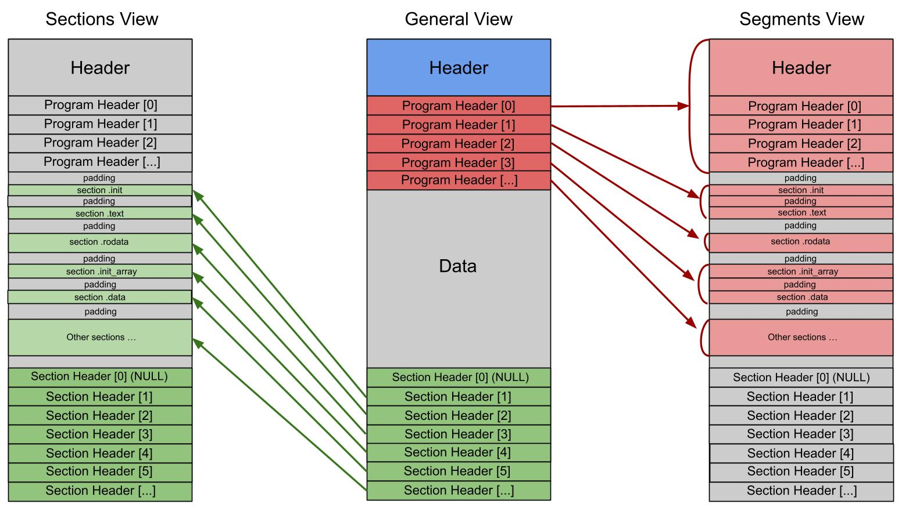
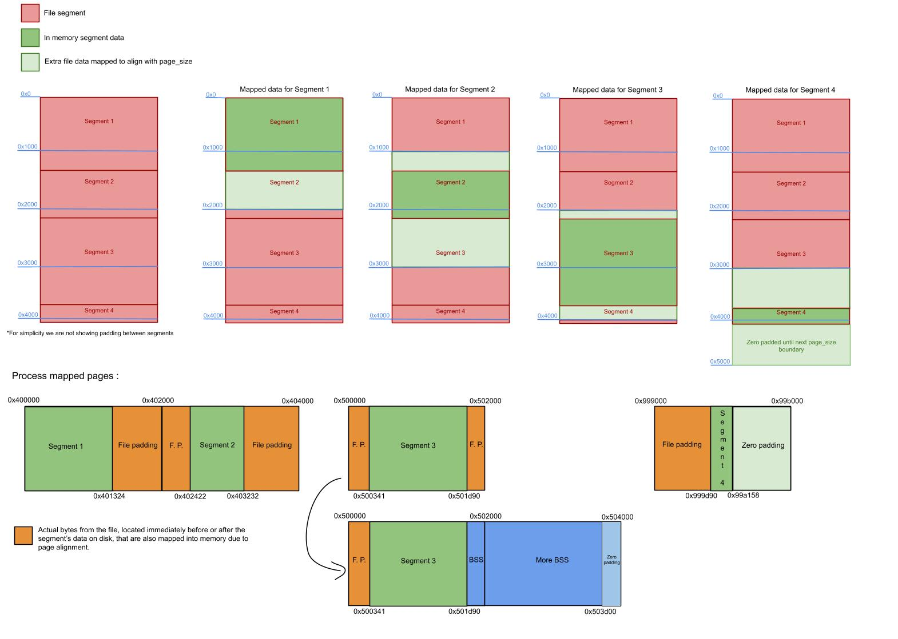
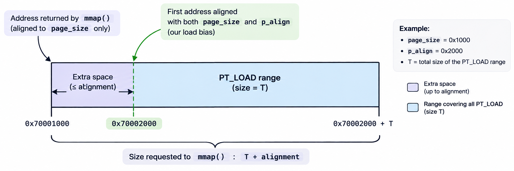
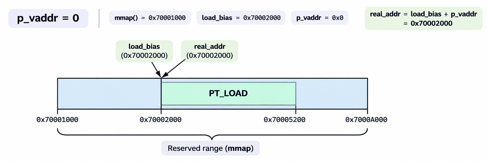
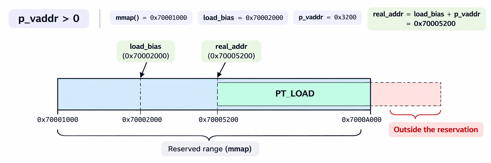
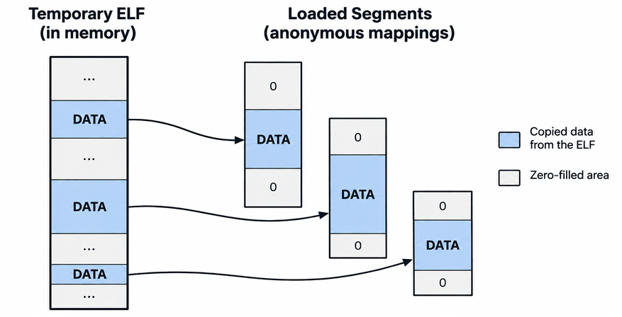

This is a study project aimed at exploring the structure of executables and how Linux executes them.

The idea is to create a simple packer for `x86_64` ELF files to put into practice the concepts I have learned by reading about the ELF format and how the Linux kernel loader works.

### What is a packer?

A packer is a tool that transforms an executable file by encrypting and/or compressing its contents, in order to reduce its size and/or make its analysis more difficult, while preserving its original behavior through an unpacking mechanism.

### Packing strategy

Many strategies exist, some very simple and others more complex. As part of this project, in order to really explore all the concepts involved in loading and executing a program, we will focus on the methodology used by the open-source packer [UPX](https://github.com/upx/upx).

This strategy can be roughly summarized in the following steps:

- The packer opens the executable file it needs to pack and compresses it.
- It creates a new file and inserts this compressed data into it.
- It also inserts executable code (which we will call a *stub*), responsible for finding the compressed data, decompressing it, and preparing the execution of the original program.

We therefore obtain a new executable in which the original program's code is no longer directly accessible in its initial form. The *stub* now constitutes the main code that can be immediately analyzed.

At execution time, the entry point will therefore point to the *stub*. It will restore the original program and prepare its execution environment before transferring control to it.

**All these operations are performed directly in memory**, without creating a temporary file or invoking a new `execve()`.

The goal is thus to recover the behavior of the original executable, while having profoundly changed the way it is represented on disk and loaded into memory.

In our implementation, we will use both compression and encryption of the payload data. However, we will not dwell on how these algorithms work, as they are not the main subject of this write-up.

Instead, we will focus on the mechanisms used to transform an executable, restore it in memory, and reproduce the operations required to load and execute it.

## Theoretical Background

### Virtual Memory

Before we begin, we need to briefly explain how virtual addressing works on Linux.

The physical RAM of our computer is mainly managed by the kernel. Among other things, it is responsible for allocating memory to the different processes and optimizing its use in the background (by grouping data together to defragment it, for example) without us noticing.

But this may seem worrying when we develop a program that uses this RAM. A developer certainly doesn't want their pointers to become invalid simply because the kernel needed to move their data elsewhere in physical memory, right?

To address this problem (among others), modern systems use a mechanism called virtual memory.

#### Virtual memory

To put it simply, we can say that a virtual address is just a "number/identifier" used to find the correct physical address. On `x86-64` architectures, they are represented on 64 bits and are generally within a range from `0x0` to `0x00007fffffffefff`. The first ranges are often forbidden, and these limits may vary depending on the system configuration).

When Linux executes a process, it provides it with a set of structures called *page tables* (we won't go into the technical details here). These structures are intended to link virtual addresses to physical addresses within a process. Inside these tables, each virtual address is generally assigned a physical address in RAM. If the kernel needs to reorganize RAM, it only has to update the physical address associated with the virtual address. Thus, when we "dereference" a virtual address, the processor fetches the data at the physical address associated with that virtual address (or triggers a `PAGE FAULT` if no physical address is specified).

When we talk about "addresses" in programming, we are almost always talking about virtual addresses.

Each process has its own independent *page tables*, which represent its "virtual address space". This means that two processes can perfectly well use the same virtual address, for example `0x400000`, without accessing the same data.

> **NOTE:** The *threads* of the same process all share the same virtual address space.

#### Memory pages

To fully understand this mechanism, we need to introduce the concept of a memory page. We said that `"one virtual address" -> "one physical address"`. In reality, it is more like `"one virtual page" -> "one physical page"`.

A page is simply a "fixed-size block of memory". On `x86-64`, this block is generally `0x1000` bytes (4096). The kernel works with pages of RAM (*page frames*) rather than isolated addresses. So when the kernel needs to allocate memory to a process, it assigns it a number of pages according to its needs, rather than exactly the number of bytes actually required.

**Example:** Need `0x2431` --> we round up to 3 pages of `0x1000`.

> **Warning:** Here, we are talking about allocating the memory needed to establish a process's execution context, not allocating working memory by the program during its execution (through `malloc()`, for example). In the second case, the requested memory may already be available in a previously reserved region (the kernel does not allocate new pages for every `malloc()`, the *heap* acts as a kind of memory reserve). If not, new virtual pages may be requested from the kernel.

So, to clarify what was said above: page tables link virtual pages to physical pages. To simplify, we can imagine these tables as a large dictionary containing "*key/value*" pairs:

- **Key:** the starting address of a virtual page.
- **Value:** the physical address of the corresponding *page frame*.

Let's take an example with two different processes:

**Process A:**

```text
0x400000 → 0x12A000
0x401000 → 0x31000
```

**Process B:**

```text
0x400000 → 0x58000
0x401000 → 0x92000
```

We can see that the two processes use exactly the same virtual addresses, but that these correspond to different physical locations. Now let's imagine that process A tries to read the data at virtual address `0x400123`. The processor identifies the virtual page containing this address (`0x400000`), finds its corresponding *page frame* (`0x12A000`), then adds the offset of `0x123` bytes to it. Our read will therefore take place at physical address `0x12A123`. This translation is performed automatically by a hardware component of the processor called the MMU (Memory Management Unit).

This implementation also provides other benefits. For example, two processes can each have a virtual page that corresponds to the same physical page. In particular, this allows the code of shared libraries to be shared between several processes, without having to duplicate it in RAM. It also allows two consecutive virtual pages to correspond to two physical *page frames* that are very far apart. A program can therefore manipulate a continuous range of virtual addresses, even if the corresponding data is scattered across physical RAM. Example:

**Process:**

```text
0x400000 → 0x12A000
0x401000 → 0x31000
```

If our program uses a ptr = `0x400900`, it can perfectly well increment it until it goes beyond `0x401000`, even if the physical *page frames* of these two pages are not contiguous. When the processor dereferences this pointer, it will automatically find the correct physical address.

> **NOTE:** *Page tables* are not simple "*key/value*" dictionaries. They are much more complex hierarchical structures, also containing information about page access permissions (more information here: [Linux kernel documentation](https://docs.kernel.org/mm/page_tables.html)). Moreover, a virtual page does not necessarily have an associated *page frame* at all times: for example, as an optimization, some pages may not yet have been loaded into RAM and will only be loaded when explicitly needed. Finally, the previous examples use pages of 0x1000, but x86-64 also supports larger pages. However, to understand the mapping operations performed as part of this project, the simplified model presented here is sufficient.

### ELF Format (Executable and Linking Format)

Here we will only deal with the `x86-64` ELF case.

An ELF file is not directly machine code intended for the processor. It is above all a file format that can store machine code, data, and information describing how these elements should be interpreted.

An ELF can represent several things. The most common are:

- **Executable:** A program intended to be executed by the system.
- **Shared object (.so):** A library whose code can be loaded and used by other programs. Often, .so files cannot be executed independently.
- **Relocatable object (.o):** A file containing compiled code, but which must be linked to be integrated into a program.

#### Sections and Segments

When compiling a program, the compiler and the *linker* organize its contents into different parts called sections. Each section contains specific data.

Some classic examples of sections automatically generated by almost all compilers/linkers:

- "`.text`" generally contains the program's machine instructions.
- "`.rodata`" generally contains read-only data.
- "`.data`" generally contains initialized data that can be modified during execution.

> **NOTE:** There is no official naming convention for sections.

This organization into sections is very useful when *linking* different object files into a final executable. For example, the *linker* can find all the machine code from all the objects and combine it into the final executable's `.text`, or even exclude entire sections from the final ELF that were only used for its construction. Likewise, this organization allows various Linux tools to quickly and easily parse the different contents of an ELF (readelf, objdump...).

However, sections are only used for building and analyzing an ELF. The kernel has no need to know about this subdivision into sections. All that matters to it is: which parts of the file need to be loaded into memory, and how to interpret these loaded parts of the file.

Another way of organizing the data is therefore necessary: segments.

A segment is essentially a contiguous area of data. This term is used to designate an area of the ELF file, most often encompassing one or more sections. During loading, some of these segments are processed by the system to load the data required for execution into memory. The term segment is used to designate both an area of data in an ELF on disk and the representation of that area in memory, when it is loaded.

#### Organization of the ELF Structure

We can distinguish 4 main elements:

- **HEADER**

  ```
  typedef struct
  {
    unsigned char	e_ident[EI_NIDENT];	/* Magic number and other info */
    Elf64_Half	e_type;			    /* Object file type */
    Elf64_Half	e_machine;		    /* Architecture */
    Elf64_Word	e_version;		    /* Object file version */
    Elf64_Addr	e_entry;		    /* Entry point virtual address */
    Elf64_Off	    e_phoff;		    /* Program header table file offset */
    Elf64_Off	    e_shoff;		    /* Section header table file offset */
    Elf64_Word	e_flags;		    /* Processor-specific flags */
    Elf64_Half	e_ehsize;		    /* ELF header size in bytes */
    Elf64_Half	e_phentsize;		/* Program header table entry size */
    Elf64_Half	e_phnum;		    /* Program header table entry count */
    Elf64_Half	e_shentsize;		/* Section header table entry size */
    Elf64_Half	e_shnum;		    /* Section header table entry count */
    Elf64_Half	e_shstrndx;		    /* Section header string table index */
  } Elf64_Ehdr;
  ```

  This is a fixed-size structure located at the very beginning of the file. It contains the general characteristics of the ELF, such as its architecture, its type, the address of the first instruction that will be executed, or the position of the Section Header Table and the Program Header Table. It is, in a way, the starting point for interpreting the rest of the file.

- **PROGRAM HEADER TABLE**

  ```
  typedef struct
  {
    Elf64_Word	p_type;			/* Segment type */
    Elf64_Word	p_flags;		/* Segment flags */
    Elf64_Off	    p_offset;		/* Segment file offset */
    Elf64_Addr	p_vaddr;		/* Segment virtual address */
    Elf64_Addr	p_paddr;		/* Segment physical address */
    Elf64_Xword	p_filesz;		/* Segment size in file */
    Elf64_Xword	p_memsz;		/* Segment size in memory */
    Elf64_Xword	p_align;		/* Segment alignment */
  } Elf64_Phdr;
  ```

  This is an array of structures called Program Headers. A Program Header contains information intended to be read by the system loader: the loading address of certain segments, their permissions, their loading area... Each Program Header can designate a segment (thus a contiguous area of the ELF), a loadable segment (thus a segment that must be loaded into memory), or loading metadata that does not represent any area of the ELF, merely information on how to manage loading and execution. Although this is not an official rule, the Program Header Table is often located before the Data, just after the Header. There are many types (`p_type`) of Program Headers, but in this write-up we will only focus on the following:

  - **`PT_LOAD`:** The most important. This *header* describes an ELF segment that will be loaded into memory. Note that it is very common for this type of segment to cover several other smaller segments. The first `PT_LOAD` segment of an ELF often includes at least the `PT_PHDR` and `PT_INTERP` segments.
  - **`PT_PHDR`:** Describes a segment containing all the entries of the Program Header Table.
  - **`PT_INTERP`:** Describes a segment containing the absolute path of an ELF executable that will act as an interpreter (this concept will be explained later).
  - **`PT_DYNAMIC`:** Describes a segment containing the `.dynamic` section. This section provides information necessary for dynamic linking. In particular, it indicates which shared libraries (.so) must be loaded and contains information for finding the memory addresses of the functions they export. We will look at this function in a little more detail later.
  - **`PT_GNU_STACK`:** This Program Header does not describe any segment; it only provides a *flag* indicating whether the *stack* that an ELF will have during execution should be executable or not (if that is not clear, it will be later).

- **DATA**

  This is the content of the file: machine instructions, constants, initialized variables, symbol information, etc. Most of it is organized into sections, which can in turn be grouped into segments.

- **SECTION HEADER TABLE**

  ```
  typedef struct
  {
    Elf64_Word	sh_name;		/* Section name (string tbl index) */
    Elf64_Word	sh_type;		/* Section type */
    Elf64_Xword	sh_flags;		/* Section flags */
    Elf64_Addr	sh_addr;		/* Section virtual addr at execution */
    Elf64_Off	    sh_offset;		/* Section file offset */
    Elf64_Xword	sh_size;		/* Section size in bytes */
    Elf64_Word	sh_link;		/* Link to another section */
    Elf64_Word	sh_info;		/* Additional section information */
    Elf64_Xword	sh_addralign;	/* Section alignment */
    Elf64_Xword	sh_entsize;		/* Entry size if section holds table */
  } Elf64_Shdr;
  ```

  This is an array of structures called Section Headers. A Section Header describes a section: its position, size, type, and various properties. This table is not used by the system loader and can therefore be absent without causing execution problems. The first entry in this table is always null. Most often, the Section Header Table is placed after the Data, at the end of the file, but this is not mandatory.



> **NOTE:** Notice that the Header and the Program Header Table are part of a segment without being part of a section.

The important thing to remember here is that Section Headers and Program Headers generally share the same data. They are simply structures that subdivide the ELF in different ways. This allows two different ways of reading it: one for executing the ELF and the other for building it.

We will now go into a little more detail about a Program Header.

#### Program Header

When we use `readelf -lW` to display the Program Header Table, we get something like this:

```
$ readelf -lW ./elf

Elf file type is EXEC (Executable file)
Entry point 0x401130
There are 13 program headers, starting at offset 64

Program Headers:
  Type           Offset   VirtAddr           PhysAddr           FileSiz  MemSiz   Flg Align
  PHDR           0x000040 0x0000000000400040 0x0000000000400040 0x0002d8 0x0002d8 R   0x8
  INTERP         0x000318 0x0000000000400318 0x0000000000400318 0x00001c 0x00001c R   0x1
      [Requesting program interpreter: /lib64/ld-linux-x86-64.so.2]
  LOAD           0x000000 0x0000000000400000 0x0000000000400000 0x000910 0x000910 R   0x1000
  LOAD           0x001000 0x0000000000401000 0x0000000000401000 0x0034f9 0x0034f9 R E 0x1000
  LOAD           0x005000 0x0000000000405000 0x0000000000405000 0x000e5c 0x000e5c R   0x1000
  LOAD           0x006df8 0x0000000000406df8 0x0000000000406df8 0x000298 0x0002b8 RW  0x1000
  DYNAMIC        0x006e08 0x0000000000406e08 0x0000000000406e08 0x0001d0 0x0001d0 RW  0x8
  NOTE           0x000338 0x0000000000400338 0x0000000000400338 0x000020 0x000020 R   0x8
  NOTE           0x000358 0x0000000000400358 0x0000000000400358 0x000044 0x000044 R   0x4
  GNU_PROPERTY   0x000338 0x0000000000400338 0x0000000000400338 0x000020 0x000020 R   0x8
  GNU_EH_FRAME   0x0056e8 0x00000000004056e8 0x00000000004056e8 0x000184 0x000184 R   0x4
  GNU_STACK      0x000000 0x0000000000000000 0x0000000000000000 0x000000 0x000000 RW  0x10
  GNU_RELRO      0x006df8 0x0000000000406df8 0x0000000000406df8 0x000208 0x000208 R   0x1

 Section to Segment mapping:
  Segment Sections...
   00     
   01     .interp 
   02     .interp .note.gnu.property .note.gnu.build-id .note.ABI-tag .gnu.hash .dynsym .dynstr .gnu.version .gnu.version_r .rela.dyn .rela.plt 
   03     .init .plt .text .fini 
   04     .rodata .eh_frame_hdr .eh_frame 
   05     .init_array .fini_array .dynamic .got .got.plt .data .bss 
   06     .dynamic 
   07     .note.gnu.property 
   08     .note.gnu.build-id .note.ABI-tag 
   09     .note.gnu.property 
   10     .eh_frame_hdr 
   11     
   12     .init_array .fini_array .dynamic .got 
```

Let's briefly explain each of the fields:

- **`p_type`:** Indicates the type of the Program Header, such as `PT_LOAD`, `PT_PHDR`, `PT_INTERP`... The different types can be found here: [linux/elf.h](https://github.com/torvalds/linux/blob/master/include/uapi/linux/elf.h). Other types exist for other architectures, but for this project we will use this *header* as a reference.

- **`p_offset`:** Indicates the *offset* within the file where the beginning of the data area covered by the segment is located.

- **`p_vaddr`:** Indicates the (virtual) memory address at which the data covered by this segment is located in memory. For PIE executables, this address is relative to a base address determined during loading (don't worry, we'll clarify this later).

- **`p_paddr`:** Indicates the physical address of the segment on systems that use this information. On Linux, for regular user-space executables, this field is ignored. It is often initialized to the same value as `p_vaddr`.

- **`p_filesz`:** Indicates the size of the data area covered by the segment inside the file.

- **`p_memsz`:** Indicates the size of the data area covered by the segment in memory. 

  > **NOTE:** When `p_memsz` is greater than `p_filesz` for a `PT_LOAD` segment, the additional space in memory is initialized to zero. This is particularly the case for uninitialized data (`.bss`). This technique avoids unnecessarily storing bytes in the file that we know will have to be initialized to zero. Memsz cannot be smaller than filesz.

- **`p_flags`:** For `PT_LOAD` segments, indicates the memory permissions requested during loading (read/write/execute). These permissions apply to the memory pages covering the segment and may subsequently be modified, particularly with mprotect(). At runtime, an operation at an address inside a page that does not have the corresponding permissions will be refused by the kernel (which will send a *segfault* to the process). For other types of Program Headers, these *flags* can have a different meaning (as with `PT_GNU_STACK`), or simply be ignored (as with `PT_PHDR`, `PT_INTERP`, `PT_DYNAMIC`...).

- **`p_align`:** Indicates the alignment constraint for the segment in the file and in memory. We will come back to how it works when discussing the details of the *stub* implementation.

A few examples to make sure everything is clear:

- `ProgramHeader[0]` is of type `PT_PHDR`. We therefore know that it describes a segment containing all the entries of the Program Header Table. The segment begins at the `0x40th` byte of the file, and occupies `0x2d8` bytes. In the final image loaded into memory, this segment will be at virtual address `0x400040`, and will have the same size as in the file (`0x2d8`). Here, although the `R` *flag* is set, it has no effect on memory permissions, because this Program Header does not itself cause any mapping. Its data is nevertheless present in memory because it is encompassed by a `PT_LOAD` segment.

- `ProgramHeader[2]` is of type `PT_LOAD`. We know that this segment will be loaded into memory. It covers the interval `[0x00-0x910)` of the ELF file. We can therefore see that it encompasses, in particular, the ELF Header and the `PT_PHDR` and `PT_INTERP` segments. In memory, it will be located at address `0x400000`, and will have the same size as in the file. Here, the `R` *flag* is applied during mapping as the segment's basic permission (these permissions can then be modified with `mprotect`).

- `ProgramHeader[5]` has the particularity of having a memsz greater than its filesz, so we know that this segment will be larger in memory than in the file, and that the additional space will be initialized to `0` (bss).

- `ProgramHeader[11]` is of type `PT_GNU_STACK`. This type of Program Header does not describe a segment, but is used to tell the kernel whether the memory representing the process's Stack (which is also an area of memory assigned by the kernel when a process starts, as we will see later) should be executable or not. So nothing is loaded here, the `p_flags` field is used to provide this information through the `p_flags` field, and the other fields are ignored.

We now have all the building blocks we need to understand how the system loads and executes an ELF.

### Loading an ELF

When a process calls `execve()` to execute an ELF file, the kernel must perform several initialization operations. We will detail the main steps in this section, but the order in which the kernel performs them is not necessarily the same as the order in which we will discuss them. 

#### Mapping Segments

To load the `PT_LOAD` segments, the kernel must create memory mappings at the appropriate virtual addresses, while respecting the constraints imposed by page size.

To perform these operations, Linux uses memory mapping mechanisms, which are also accessible to user programs through the `mmap()` system call.

In particular, `mmap()` can create two types of mappings: anonymous mappings and file mappings.

- **Anonymous mapping:** Allows a region of virtual memory that is not associated with any file to be reserved. Its initial contents consist of zeros. The size of the region actually mapped is rounded up to a multiple of the page size.

- **File mapping:** Allows a region of virtual memory to be associated with a portion of a file, defined by a starting *offset* and a length.

  However, `mmap()` can only map a whole number of memory pages. To maintain a correct correspondence between `[memory page] <--> [file portion]`, it also requires the file *offset* to be aligned to a page boundary.

  To load a `PT_LOAD` segment, the kernel must therefore align the starting *offset* of its file portion down to the previous page boundary, then extend the mapping to the page boundary following its end.

  > **NOTE:** `mmap()` accepts a mapping length that is not a multiple of `page_size`, but the kernel will implicitly round this length up to the next multiple.

Now let's take a concrete example to understand how the kernel loads these segments into memory. We will consider a page size of `0x1000` bytes.

```text
Type           Offset   VirtAddr           PhysAddr           FileSiz  MemSiz   Flg Align
LOAD           0x000000 0x0000000000400000 0x0000000000400000 0x001324 0x001324 R E 0x1000
LOAD           0x001422 0x0000000000402422 0x0000000000402422 0x000e10 0x000e10 R   0x1000
LOAD           0x002341 0x0000000000500341 0x0000000000500341 0x001a4f 0x0039bf RW  0x1000
LOAD           0x003d90 0x0000000000999d90 0x0000000000999d90 0x0003c8 0x0003c8 RW  0x1000
```

Let's look at the second `PT_LOAD`. Its contents begin at *offset* `0x1422` in the file and must be loaded at virtual address `0x402422`. However, since mappings are performed in whole pages, the kernel must align the start of the mapping to `0x1000` in the file and `0x402000` in memory.

With a `p_filesz` of `0xe10`, the data in this segment ends at address `0x403232`. The mapping must therefore cover two entire pages, namely the interval `[0x402000, 0x404000)`.

**This means that bytes from the file located before and after the segment will also be present in memory**, simply because they belong to the pages required for the mapping.

There are also two special cases:

- **When** `p_memsz > p_filesz` **:** the kernel initializes the additional space belonging to the segment to zero. It starts by replacing with zeros any additional bytes from the file present after the segment, in the last mapped page. If necessary, it then completes this region with zero-initialized anonymous pages (segment 3).

- **When the mapping reaches EOF:** the bytes located after the end of the file, in the last page of the mapping, are automatically filled with zeros (segment 4).

Finally, the permissions defined by `p_flags` apply to the mapped pages, including the extra bytes loaded from the file.

The following diagram illustrates these different cases, distinguishing the data belonging to the segments, the extra bytes of the file loaded because of page alignment, and the memory regions initialized to zero (bss).



In this example, the mapping requires a total of 10 memory pages of `0x1000` bytes.

Before continuing with the next steps of execution, we need to introduce the two types of ELF that we will deal with in this write-up.

#### PIE and PDE

**Position Dependent Executable (PDE or Non-PIE):** From the beginning, our examples have referred to this type of executable. A PDE is designed to be loaded at precise virtual addresses. Each `PT_LOAD` specifies the address at which it must be loaded, and if the address of the first `PT_LOAD` is not available (already occupied), execution fails. PDE ELF files are of type `ET_EXEC`, indicated in the `e_type` field of the ELF Header.

**Position Independent Executable (PIE):** This type of executable has no dependency on specific addresses. This means that it can be loaded and executed at any valid virtual addresses.

Unlike a classic PDE, the virtual addresses specified in a PIE, notably the `e_entry` and the `p_vaddr` of the segments, do not directly correspond to their actual addresses in memory, but to addresses relative to a loading base.

When loading an `ET_DYN` executable, the kernel must determine a *load bias*. This is simply an offset that will implicitly be added to each relative address specified in the ELF structure when it is used, to obtain the actual address.

If *ASLR* is enabled, this *load bias* is obtained randomly (within ranges considered valid), which makes the actual loading addresses different between two executions.

PIE ELF files are of type `ET_DYN`, just like shared libraries. Many modern compilers choose this type of ELF by default when compiling.

**Example:**

```
PDE: p_vaddr = 0x400000
PIE: p_vaddr = 0x1120  --> when loading: actual address = 0x1120 + 0x760000 = 0x761120
     p_vaddr = 0x1120  --> when loading: actual address = 0x1120 + 0x230000 = 0x231120
```

#### Execution Environment

##### Stack

In addition to the `PT_LOAD` segments, the kernel must prepare a memory region for the program's *stack*.

To do this, it chooses an address range in the process's virtual space, generally located toward the high addresses.

Although the *stack* shares the same virtual address space as regular `mmap()` mappings, the kernel uses a different strategy to determine its location.

Regular `mmap()` mappings are generally placed in a region lower in the virtual space, in order to leave enough room for the *stack* to grow.

> **NOTE:** On Linux `x86-64`, when we let the kernel choose the address with `mmap(NULL, ...)`, it searches by default for a free range starting at the top of the mapping area, below the *stack*, then moving downward toward lower addresses. This strategy is called *top-down*. If this search fails, the kernel can resume searching in the other direction.

If *ASLR* is enabled, the location of the *stack* is randomized.

Unlike the `PT_LOAD` segments, this region does not correspond to any portion of the ELF file. It is an anonymous memory region, whose physical pages are allocated as needed.

The kernel thus allocates the first pages needed to place the program's startup information there. The *stack* can then grow toward lower addresses, within the permitted limits, as the program uses more memory.

Here is a typical example of the kernel initializing the *stack* data:

```
------------------------------------------------------------- 0x7fff6c845000
     0x7fff6c844ff8: 0x0000000000000000
            _  4fec: './stackdump\0'                      <------+
      env  /   4fe2: 'ENVVAR2=2\0'                               |    <----+
           \_  4fd8: 'ENVVAR1=1\0'                               |   <---+ |
           /   4fd4: 'two\0'                                     |       | |     <----+
     args |    4fd0: 'one\0'                                     |       | |    <---+ |
           \_  4fcb: 'zero\0'                                    |       | |   <--+ | |
               3020: random gap padded to 16B boundary           |       | |      | | |
    - - - - - - - - - - - - - - - - - - - - - - - - - - - - - - -|       | |      | | |
               3019: 'x86_64\0'                        <-+       |       | |      | | |
     auxv      3009: random data: ed99b6...2adcc7        | <-+   |       | |      | | |
     data      3000: zero padding to align stack         |   |   |       | |      | | |
    . . . . . . . . . . . . . . . . . . . . . . . . . . .|. .|. .|       | |      | | |
               2ff0: AT_NULL(0)=0                        |   |   |       | |      | | |
               2fe0: AT_PLATFORM(15)=0x7fff6c843019    --+   |   |       | |      | | |
               2fd0: AT_EXECFN(31)=0x7fff6c844fec      ------|---+       | |      | | |
               2fc0: AT_RANDOM(25)=0x7fff6c843009      ------+           | |      | | |
      ELF      2fb0: AT_SECURE(23)=0                                     | |      | | |
    auxiliary  2fa0: AT_EGID(14)=1000                                    | |      | | |
     vector:   2f90: AT_GID(13)=1000                                     | |      | | |
    (id,val)   2f80: AT_EUID(12)=1000                                    | |      | | |
      pairs    2f70: AT_UID(11)=1000                                     | |      | | |
               2f60: AT_ENTRY(9)=0x4010c0                                | |      | | |
               2f50: AT_FLAGS(8)=0                                       | |      | | |
               2f40: AT_BASE(7)=0x7ff6c1122000                           | |      | | |
               2f30: AT_PHNUM(5)=9                                       | |      | | |
               2f20: AT_PHENT(4)=56                                      | |      | | |
               2f10: AT_PHDR(3)=0x400040                                 | |      | | |
               2f00: AT_CLKTCK(17)=100                                   | |      | | |
               2ef0: AT_PAGESZ(6)=4096                                   | |      | | |
               2ee0: AT_HWCAP(16)=0xbfebfbff                             | |      | | |
               2ed0: AT_SYSINFO_EHDR(33)=0x7fff6c86b000                  | |      | | |
    . . . . . . . . . . . . . . . . . . . . . . . . . . . . . . .        | |      | | |
               2ec8: environ[2]=(nil)                                    | |      | | |
               2ec0: environ[1]=0x7fff6c844fe2         ------------------|-+      | | |
               2eb8: environ[0]=0x7fff6c844fd8         ------------------+        | | |
               2eb0: argv[3]=(nil)                                                | | |
               2ea8: argv[2]=0x7fff6c844fd4            ---------------------------|-|-+
               2ea0: argv[1]=0x7fff6c844fd0            ---------------------------|-+
               2e98: argv[0]=0x7fff6c844fcb            ---------------------------+
     0x7fff6c842e90: argc=3
```

Illustrative example; the contents may change over time.

**Source:** [How programs get run: ELF binaries](https://lwn.net/Articles/631631)

##### Auxiliary Vector

As we are used to seeing, at the top of the *stack* (lowest address) we have `argc`, followed by the array of `argvs`, and the array of `envps`. 

However, we can see that after `envp` there is a list of structures of type `Elf64_auxv_t`, defined as follows in the [elf/elf.h](https://github.com/bminor/glibc/blob/master/elf/elf.h) header:

```c
typedef struct
{
  uint64_t a_type;		/* Entry type */
  union
    {
      uint64_t a_val;	/* Integer value */
    } a_un;
} Elf64_auxv_t;
```

All these structures make up what is called the *Auxiliary Vector* (`auxv`).

Each entry contains two fields:

- `a_type`: an identifier indicating the nature of the information.

- `a_un.a_val`: the value associated with this identifier.

When preparing the execution environment, the kernel builds this set of information, keeps a copy in its own memory, and also places a copy on the program's *stack*.

The purpose of the *Auxiliary Vector* is to allow the kernel to transmit certain information about its execution environment to the program, without the latter needing to make system calls to obtain it.

This information concerns both the system's characteristics and the details of loading the executable itself. For example, `AT_PAGESZ` indicates the system's memory page size, while `AT_PHDR` contains the memory address of the executable's Program Header Table.

We will come back to some of the fields of the *Auxiliary Vector* when we go into the details of the packer's implementation, but we won't explore the topic any further (for more information: [getauxval() and the auxiliary vector](https://lwn.net/Articles/519085/)).

##### Heap

The kernel also determines the starting address of the *heap*, a memory region intended for dynamic allocations.

To do this, it generally uses the end of the `PT_LOAD` segment located at the highest memory address (including BSS).

> **NOTE:** For `ET_DYN` ELF files without an *interpreter*, the kernel considers that it may be a program responsible for performing memory mappings itself. It can therefore place the beginning of the *heap* at an address lower than those of the `PT_LOAD` segments, to leave more room for it to grow without risking a collision with these future mappings.

This address can then be randomly shifted if *ASLR* is enabled.

Unlike the *stack*, the *heap* grows toward higher addresses, particularly when the program requests more memory with the `brk()` system call.

However, it should be noted that not all dynamic allocations necessarily use this region. For example, `malloc()` can also use anonymous `mmap()` mappings.

##### Registers

Finally, the kernel prepares the initial state of the processor registers to allow the program to start.

On an x86-64 architecture, it initializes, among others:

- `RIP` (*Instruction Pointer*): with the address of the first instruction to execute.

- `RSP` (*Stack Pointer*): with the address of the initial top of the *stack*.

It is important to understand that each thread has its own register state. During a context switch, the kernel can save this state so it can restore it when the thread resumes execution.

Thus, several programs can use the same physical CPU registers without losing their respective values.

### The ELF Interpreter

Now, our program is loaded and its environment is ready. We could simply put the address of the `entry_point` in `RIP` and start execution.

However, **loading a program into memory does not necessarily mean that it is ready to be executed.**

Let's take a simple example: a C program using the `printf()` function.

This function is generally provided by an external library, `libc`, whose code is not directly integrated into our executable.

For our program to use this function, this library must also be loaded into memory, and the program must be able to find the address of the `printf()` function.

More generally, some references to symbols in an executable can only be resolved definitively when it is loaded. This is particularly the case when libraries are loaded at variable addresses.

It then becomes necessary to perform certain address adjustments, called *relocations*, so that the program can work correctly.

> **NOTE:** Concretely (greatly simplifying things), an ELF contains *relocation* tables, made up of lists of structures each describing a modification to be made in memory.
>
> These tables are present in the data loaded by the `PT_LOAD` segments. The `PT_DYNAMIC` segment notably contains the information that allows the *interpreter* to locate them.
>
> Each *relocation* entry mainly contains:
>
> - `r_offset`: the virtual address of the location to modify.
>
> - `r_info`: the type of modification and, potentially, the symbol concerned (such as `printf`).
>
> These entries must be traversed, the necessary calculations performed, and the resulting values written to the indicated locations.

Rather than entrusting all these operations to the kernel, Linux uses a specialized program: *the ELF interpreter*, which performs a whole bunch of "preparation" operations so that the ELF can execute under the expected conditions.

> **NOTE:** The *Interpreter* is also often called the *Dynamic Linker*, because the operation it performs most often is resolving dynamic links at runtime.

#### The PT_INTERP Segment

When an executable requires an interpreter, it is indicated in a segment of type `PT_INTERP`.

This segment describes an area of the executable that contains the absolute path to another program.

On a Linux `x86-64` system using glibc, this path is generally:

`/lib64/ld-linux-x86-64.so.2`

> **NOTE:** The format therefore assumes that the *interpreter* is present on the system at the expected path.

After loading the segments of the main ELF and preparing its environment, the kernel also loads the segments of the *interpreter* in the same way we saw above, then initializes `RIP` to the address of the latter's `entry_point` instead of the main program's.

The interpreter then takes over.

In particular, it is responsible for loading the necessary libraries, resolving references to symbols, and performing the required *relocations*.

> **NOTE:** The interpreter notably uses `auxv` on the *stack* to find information about the main ELF.

Once the necessary preparations are complete, it finally transfers control to our program's entry point.

Thus, in the case of an executable using an interpreter, **the first code executed in user space is not that of our program, but that of its interpreter.**

Conversely, when no interpreter is specified, the kernel transfers control directly to the executable's entry point.

We will not go into the details of *relocation* mechanisms, *dynamic linking*, or the other operations performed by the *interpreter*. It is nevertheless important to understand that they exist, because they will directly influence our packer's implementation choices.

One last interesting point to note is that the *interpreter* does not itself have an *interpreter* (no `PT_INTERP` segment).

It is therefore designed to be able to start autonomously, without depending on another *dynamic linker*. Once loaded into memory by the kernel, it performs the operations needed for its own initialization, including its *relocations*.

## Implementation

### Strategy

A common approach to packing an ELF consists of encrypting only its executable segments, then injecting a *stub* into one of these regions with enough unused space (in place of the padding). It is then enough to modify its entry point (`e_entry`) so that this *stub* is executed before the original program. The *stub* would then find the beginning of the encrypted segments in memory, decrypt them, and jump to the original `e_entry` address.

> **NOTE:** The technique of injecting code into the padding area of an executable segment is called *code caving*.

This approach has the "advantage" of preserving a large part of the executable's original structure, which considerably simplifies implementation.

However, this technique comes with its share of disadvantages:

- **The ELF structure remains largely unchanged.** For obfuscation purposes, many clues therefore remain visible. Indeed, certain regions required for loading the executable by the kernel and the *interpreter* must remain usable. It is therefore possible to analyze the structure of the *Program Headers*, the contents of certain *sections*, as well as information about dynamic dependencies and imported symbols.

- **The space available in an executable segment is not always sufficient to inject our stub.** This therefore generally means that the *stub* must be short. This can make it difficult to integrate large decryption, decompression, or execution algorithms into it.

- **Some regions of the ELF may need to be used <u>even before</u> its `e_entry` is reached.** In my opinion, this is one of the most important disadvantages of this approach.

  As explained previously, the *interpreter* must perform various preparation operations before transferring control to the main executable. However, some of these operations require accessing data, or even executing code belonging directly to that executable.

  > **NOTE:** We won't go into the technical details, but to give a general idea, we can mention the case of certain *relocations* (such as`IRELATIVE`), which may require executing a *resolver* to find the correct address of a function (when several versions of a function are implemented). There are also preinitialization functions referenced by `DT_PREINIT_ARRAY`, in the `PT_DYNAMIC` segment (these are functions present in the main ELF and executed by the *interpreter*).

  If these regions have been encrypted, the *interpreter* may therefore try to read, modify, or execute them before our *stub* has had the chance to decrypt them. This forces us to keep certain regions unencrypted or implement additional mechanisms to guarantee that loading proceeds correctly.

As explained in the introduction, our strategy is inspired by modern packers such as [UPX](https://github.com/upx/upx), which address these problems.

Rather than simply injecting a *stub* into the original executable, we build a new ELF containing our *stub* as well as the original executable in the form of encrypted and compressed data.

The packed ELF will therefore be a very simple executable whose executable machine code is the *stub*'s code.

The *stub* will be responsible for finding and decompressing/decrypting the ELF and performing all the loading steps explained in the previous part (almost) in the same way as the Linux kernel would have done.

Since the packed ELF will be written "by hand" by our packer, generating the entire structure of *relocations* and dynamic links without the help of a *linker* would be too complex. This is because our *stub* will not have an *interpreter*, and the `entry_point` of the packed ELF will be the first instruction of the *stub*. This therefore means that the *stub*'s code must be independent of any additional "help" provided by an *interpreter*.

This approach is considerably more complex to implement, since it requires an in-depth understanding of certain kernel mechanisms and choices. However, it is precisely this aspect that led me to favor it, in order to deepen my understanding of how Linux works.

### Packing Format

Before looking at the *stub* (which does most of the work), we need to take a look at the format of the packed ELF produced by the packer.

Here is what we get when inspecting the contents of an ELF packed by our packer:

```
$ readelf -aW ./packed

ELF Header:
  Magic:   7f 45 4c 46 02 01 01 00 00 00 00 00 00 00 00 00 
  Class:                             ELF64
  Data:                              2's complement, little endian
  Version:                           1 (current)
  OS/ABI:                            UNIX - System V
  ABI Version:                       0
  Type:                              DYN (Shared object file)
  Machine:                           Advanced Micro Devices X86-64
  Version:                           0x1
  Entry point address:               0x1120
  Start of program headers:          64 (bytes into file)
  Start of section headers:          0 (bytes into file)
  Flags:                             0x0
  Size of this header:               64 (bytes)
  Size of program headers:           56 (bytes)
  Number of program headers:         4
  Size of section headers:           0 (bytes)
  Number of section headers:         0
  Section header string table index: 0

There are no sections in this file.

There are no section groups in this file.

Program Headers:
  Type           Offset   VirtAddr           PhysAddr           FileSiz  MemSiz   Flg Align
  LOAD           0x000000 0x0000000000000000 0x0000000000000000 0x000120 0x000120 R   0x1000
  LOAD           0x000120 0x0000000000001120 0x0000000000001120 0x004faa 0x004faa R E 0x1000
  LOAD           0x0050ca 0x00000000000070ca 0x00000000000070ca 0x00a470 0x00a470 RW  0x1000
  GNU_STACK      0x000000 0x0000000000000000 0x0000000000000000 0x000000 0x000000 RW  0

There is no dynamic section in this file.

There are no relocations in this file.
No processor specific unwind information to decode

Dynamic symbol information is not available for displaying symbols.

No version information found in this file.
```

We can see that the only information present is the *ELF Header*, 4 *Program Headers*, and the contents of the segments they describe.

The format our packer guarantees is as follows:

- **The packed ELF keeps the type of the original executable: `ET_EXEC` or `ET_DYN`**.

- **The three loadable segments have a memory size equal to their size in the file.** Their contents follow one another without padding in the file. Their virtual addresses are calculated so that each segment has its own distinct memory pages with their specific permissions (no overlapping segments).

- **The first `PT_LOAD` contains the ELF Header and the entire Program Header Table.** It starts at offset `0`, and the two elements follow one another without padding. The stub can thus find its *ELF Header* by subtracting `sizeof(Elf64_Ehdr)` from the address contained in `AT_PHDR` of `auxv`.

- **The second `PT_LOAD` contains the instructions and constants of the stub.** The entry point of the packed ELF corresponds to the beginning of this segment, where the stub's entry code is located.

- **The third and last `PT_LOAD` contains the payload.** This segment contains the entire compressed and encrypted original ELF. The stub searches for the last `PT_LOAD` in the table to locate it.

- **The payload segment starts with an unencrypted header of type `payload_header_t`.** This begins with a `WOODY` magic and contains a *flag* indicating whether the payload is compressed, the size of the packed data, the size of the original file, and the offset of the data from the beginning of the segment (so the stub can find the beginning of the original ELF after the `payload_header_t`).

  ```c
  typedef struct payload_header_s
  {
      unsigned char	magic[8];           /* "WOODY\0\0\0" */
      int				data_compressed;    /* 1 if payload is compressed, 0 if not */
      Elf64_Xword		packed_size;        
      Elf64_Xword		original_size;
      Elf64_Off		offset;			    /* From the beginning of this segment */
  } payload_header_t;
  ```

- **The last entry is a `PT_GNU_STACK`.** The packer copies the information from the original ELF's entry when it exists. Otherwise, it uses a stack declared as readable and writable, without execution permission.

- **For a packed `ET_DYN` ELF, the first `PT_LOAD` starts at virtual address `0`.** The memory address of its ELF Header therefore corresponds to the *load bias*. 

- **For an `ET_EXEC`, the packer chooses fixed addresses located after the range occupied by the original ELF's segments**. Thus, when loading the latter, we have a guarantee that none of the mappings will overwrite a segment of the *stub* (the *heap* will therefore be placed by the kernel after the *stub*'s segments).

- **The packed ELF has no `PT_INTERP`.** The stub starts autonomously, without any *libc* or *interpreter* loaded for it by the kernel. It then takes care of finding and loading the original ELF's possible *interpreter*.

- **The first argument expected by the packed ELF is the encryption key.** It takes the form of 64 hexadecimal digits preceded by `0x` or `0X`. The stub will shift the stack down by one address toward lower addresses to remove this argument before executing the original ELF.

### Stub

#### Constraints

The *stub* is the piece of code we will copy into the packed ELF and which will constitute the code executed at startup.

As introduced earlier, the packed ELF will have no structure usable by an *interpreter*, which means that our *stub* must be completely independent:

- **No dependencies.** No one is going to load shared libraries for it, so all the symbols it uses must be defined and findable within it. We also exclude static dependencies, as they would require us to integrate into our final ELF all the code and data on which they depend, which would considerably complicate our implementation.

  > **NOTE:** For example, `glibc` linked as *static PIE* has its own initialization and self-relocation mechanisms, which compensate for the absence of the *interpreter*, and rely on structures and metadata that our final ELF will not contain.

- **No relocations.** No one is going to perform *relocations* when the *stub* starts, so every address present must be correct from the very beginning.

- **The code must be independent of its loading address.** The packed ELF will have very different loading addresses depending on the original ELF it contains. The *stub*'s code must therefore work regardless of its loading address. This means that the machine code must use *RIP-relative addressing* to refer to <u>all</u> its addresses.

  This is a feature of the `x86-64` architecture that allows data to be referenced based on its distance from the current instruction, rather than from an absolute address.

  > **Example:** Let's imagine an ELF of type `ET_DYN`, in which an instruction at virtual address `0x1100` wants to retrieve the address of a character string located in `.rodata`, at virtual address `0x2500`.
  >
  > During loading, the kernel will add a *load bias* to these two addresses. Our code must therefore remain functional regardless of its value.
  >
  > - **Absolute addressing:** The instruction directly contains the virtual address of the string.
  >
  >   ```
  >   movabs rax, 0x2500
  >   ```
  >
  >   If the kernel loads the ELF with a *load bias* of `0x70000000`, the string will actually be located at address `0x70002500`. The instruction will nevertheless continue to use `0x2500`, since no relocation will correct this address.
  >
  > - **RIP-relative addressing:** The instruction contains a displacement relative to the address of the following instruction.
  >
  >   ```
  >   lea rax, [rip + 0x13F9]
  >   ```
  >
  >   Since the instruction occupies 7 bytes, the processor calculates `0x1107 + 0x13F9 = 0x2500`, to which the *load bias* is implicitly added because `RIP` already contains the <u>actual</u> address of the instruction.
  >
  >   The distance between the instruction and the string therefore remains constant, regardless of their location in memory.
  >
  > **Note:** The instruction used and its encoding determine whether a value is interpreted as an absolute address or as a displacement relative to `RIP`. Disassemblers can "hide" this distinction in their display. For example, a function call may be displayed as `call 0x2500 <function>`, yet in `x86-64`, the `CALL` instruction with a raw value (*immediate*) as its argument always refers to a displacement relative to `RIP`, not the address `0x2500`. The behavior of each instruction depending on its arguments is specified in the [manual](https://www.felixcloutier.com/x86/call).

- **The different sections containing the stub's code and data must preserve their relative positions.** For *RIP-relative* addressing to work correctly, the distances between the instructions and their targets must remain identical after the *stub* is injected into the new ELF, as well as when it is loaded into memory.

- **A single section.** To make the previous point easier, as well as copying the *stub* into another executable, we will link the final executable so that it has only one section (called `.stub`) containing all the resources (code and data) required for execution. Thus, by moving the `.stub` section as a block, all the distances between the elements that make it up will be preserved. This means that all the elements in this section must share the same memory permissions. For security reasons, we will restrict these permissions to read (`PF_R`) and execute (`PF_X`) only.

  This decision imposes an additional constraint on us: **we will not be able to use modifiable global variables**. Indeed, these would require write permission (`PF_W`) which, since our section also contains executable code, would make this memory region both writable and executable. Preinitialized constant (read-only) globals can still be used.

  > **NOTE:** Non-static local variables (within the scope of a function) are generally placed on the *stack* at runtime (or directly in registers). They are therefore not "stored" in the ELF file or in one of its segments in memory.
  >
  > Global and static variables initialized to a value other than 0 (`int glob_var = 100`) are stored directly in the ELF (generally in the `.data` or `.rodata` section if they are constants). When the ELF is loaded, the contents of these sections will be present in memory in `PT_LOAD` segments with the corresponding permissions. Accessing such a variable therefore amounts to accessing data located in one of these segments.
  >
  > Uninitialized global and static variables (or those initialized to 0) are generally placed in the *bss*. Unlike variables in `.data`, these are not present in the file. They will only be present in memory in the segment's bss space with the appropriate permissions (generally read and write).

- **No C execution environment.** When we compile a standard C program, the *compiler* and *linker* implicitly assume certain conventions. For example, we write a `main()` function without worrying about how it will be called. In reality, the *linker* integrates startup code (*C runtime*), whose entry point is generally designated by the `_start` symbol. This code notably prepares the operation of `libc`, initializes certain internal structures, then calls our `main()` function.

  Since we want to be completely independent and control our `entry_point`, we need to ask the *compiler* and *linker* not to apply these implicit conventions or add the usual startup code. Our *stub* will therefore have its own entry point, without going through `main()`, and will have to perform the initializations it depends on itself.

  > **NOTE:** We also want to retrieve the exact address of the top of the stack at the moment the kernel executes our packed ELF. Going through `main()` would not allow us to retrieve this address directly, since the C startup code would already have modified the stack. We will explain why this is necessary later in this chapter.

To obtain machine code that respects all these points, we mainly have two solutions:

- Write the *stub* entirely in assembly. This way, we would control every detail and make sure that everything is compatible with our implementation. 

  Obviously, this approach is not realistic given the amount of work it would represent.

- Write the *stub* in C (with small pieces of asm when necessary) and make sure that the machine code generated during compilation is compatible with these prerequisites. Unsurprisingly, this is the path we will take.

#### From Source Code to the .stub Section

##### What to Avoid

So we will simply write our stub in C.

However, we need to pay attention to how we write this code, to avoid generating certain incompatibilities. Fortunately, this is not a very big constraint. In our case, there are mainly two things to avoid:

- **Using the bss.** Since our method consists of manually generating the packed ELF that will execute the *stub*, using variables present in the *bss* would require additional management. Indeed, our packer would have to generate `PT_LOAD` segments that take into account the space required by the *stub*'s *bss*. We must therefore avoid variables likely to be placed in the *bss*: **no uninitialized globals or statics, or ones initialized to zero**.

- **Initialized global pointers and arrays of pointers.** Let's take the case of a global pointer `char *global_err = "Error\n"`. The string literal `"Error\n"` will be stored in the ELF (generally in `.rodata`), and our pointer will have to contain its address in memory.

  The problem is that this address is stored as a value in the program's data, rather than calculated relative to `RIP`, which prevents us from moving our *stub* without risking making this address invalid.

  It is nevertheless possible to use local pointers initialized in this way. In that case, the compiler can generate an instruction that calculates the address of the string literal directly at runtime, using *RIP-relative* addressing. No absolute address therefore needs to be stored in our *stub*.

  We can also use constant global character arrays, such as `static const char error[] = "Error\n";`, because in this case, unlike a pointer, the characters are stored directly in the array, which is itself constant and whose address (in `.rodata`) can be calculated with *RIP-relative* addressing, without requiring a relocation at runtime.

There may be other forms of code generating *relocations* that I have not encountered. A good indication of compatibility is that the command `readelf -rW stub` does not display any relocations (note that it is normal to find some in `.o` files). However, this command does not guarantee that our code does not depend on an absolute address encoded somewhere.

##### Compilation and Linking

Once our C/asm code is ready, we need to turn it into an independent section that can be copied into another ELF and that will contain everything needed to run autonomously.

To do this, we compile the C files and assemble the *stub*'s assembly files, then combine the resulting `.o` files into a single `.stub` section.

To compile the C code, we use the following *flags*, among others (with *Clang*):

- `-ffreestanding`: Tells Clang that our *stub* follows its own startup conventions. In particular, that our *stub* does not have a "special" `main` function. It also tells the compiler not to rely on `libc` being available. Without this, it might try to optimize our code by implicitly replacing certain parts with calls to `libc` functions. 

  > **NOTE:** Even in `freestanding` mode, *Clang* will use calls to `memcpy`, `memmove`, and `memset`, so we will have to make sure to provide our own implementation of these functions. More details [here](https://clang.llvm.org/docs/UsersManual.html#freestanding-builds).

- `-fPIE`: Asks *Clang* to generate code that is independent of its loading address. This is notably what favors *RIP-relative* addressing. The *stub* will therefore be able to find its instructions and constants even if we place it at another address.

- `-fno-stack-protector`: Without going into too much detail, *Clang* can add protection code against *stack overflows*, which consists of loading a value onto the stack at the entry of functions considered vulnerable by the compiler. This value is checked when the function returns, and if it has been corrupted, the code calls a function provided by libc (`__stack_chk_fail`). In our implementation, we do not have access to this function, and we would have to initialize this value manually. We therefore prevent the compiler from adding this protection code to our *stub*.

After compilation/assembly, we will use `ld` directly to link our object files without going through *Clang*. Indeed, when *Clang* invokes the *linker* for us, it implicitly asks it to link default object files, which notably contain the *C runtime* mentioned above.

To create our `.stub` section, we will use the `-T` *flag* to specify a *linker script*, which is a file that tells the *linker* how to organize the output file. In particular, it can set the location of sections, define symbols, and choose the entry point. More information here: [Using LD, the GNU linker - Linker Scripts](https://home.cs.colorado.edu/~main/cs1300/doc/gnu/ld_3.html).

###### Organization of Sections

Before looking at our *linker script*, we need to understand that **each** `.o` **file can contain several sections**, and that several `.o` files can contain sections with the same name.

For example, if we compile two C files separately, `loader.c` and `utils.c`, we will obtain two object files, `loader.o` and `utils.o`. Each may contain its own `.text` section (for code) and its own `.rodata` section (for constants).

The compiler can also create sections with more specific names such as `.text.execute_packed_elf` or `.text.decrypt_blob`. Likewise, certain constants or character strings may be placed in sections such as `.rodata.str1.1`.

This is why our *linker script* must take into account both the classic sections (`.text`, `.rodata`) and their different variants (`.text.*`, `.rodata.*`).

###### The Stub's Entry Point

There is one important particularity left: **we want the first instructions of our** `.stub` **section to correspond to the entry point of our code.**

Indeed, when the packer copies this section into the new ELF, we will know its loading address. By placing our entry point at the very beginning, this address will also be that of the first instruction to execute, and we won't have to look for it inside the entire section.

To do this, in our assembly code, we place the startup instructions in a section that we will explicitly call `.text.stub_entry`:

```asm
.section .text.stub_entry, "ax", @progbits
.global stub_entry

stub_entry:
    ; Stub startup instructions
```

The `.section` directive tells the assembler that the following instructions must be placed in this section. The name `.text.stub_entry` is therefore **a name we chose ourselves**, not a special section automatically created by the assembler.

We can then ask the *linker* to place this section before all the others.

###### Our Linker Script

```text
SECTIONS
{
    .stub :
    {
        *(.text.stub_entry)
        *(.text .text.*)
        *(.rodata .rodata.*)
    }
}
```

The `SECTIONS` command allows us to define how the sections of the object files will be organized in the final ELF.

Here, we ask the *linker* to create an output section called `.stub`. Everything between its braces will be combined into this section, in the order specified.

Expressions such as `*(.text .text.*)` are used to select sections from object files. The first `*` means "all object files provided to the linker". The names in parentheses indicate which sections of these files we want to retrieve.

The second `*`, in `.text.*`, is a wildcard: it allows all sections whose names begin with `.text.` to be selected, such as `.text.execute_packed_elf` or `.text.decrypt_blob`.

**The order of these three lines is intentional:**

We start with `*(.text.stub_entry)`, so that the startup instructions are placed at the beginning of our `.stub` section.

Next, `*(.text .text.*)` retrieves the rest of the code from our various object files, whether it is placed in classic `.text` sections or in more specific sections. The `.text.stub_entry` section will not be added a second time, since it has already been retrieved by the first line.

Finally, `*(.rodata .rodata.*)` retrieves the constant data needed by our code, such as the character strings used for error handling.

**We therefore obtain a** `.stub` **section organized as follows:**

```text
.stub
│
├── .text.stub_entry       ← Startup instructions
│
├── .text                  ← Function code
├── .text.*                ← Other code sections
│
├── .rodata                ← Constant data
└── .rodata.*              ← Other constant data sections
```

Of course, we choose to include only sections with executable content or constant data, but the resulting ELF will also contain other sections. Our constraints on global variables mentioned above notably mean that we do not need to include `.data` sections in `.stub` (because `.stub` would then have to be loaded into a segment with all permissions).

> **NOTE:** The *linker* can also insert a few bytes of padding inside `.stub` to respect their alignment constraints.

We have thus combined the necessary instructions and constants into a single section, while preserving their relative positions.

###### Extracting the Section

The ELF obtained after this compilation (`stub.elf`) simply serves as a container for us. Indeed, we have not specified an `entry_point`, and we have not designed this executable to run independently at all (executing it would cause a *segfault*). We simply want to extract the `.stub` *section* (visible with `readelf -SW stub.elf`), to integrate it directly into the packer's binary (we will return to this in the "Packer" section).

#### How the Stub Works

We now have an autonomous *stub*, capable of executing independently of its loading address.

Its objective is to find the original executable, restore it in memory, and prepare its execution environment, in order to transfer control to it as the kernel would have done.

To do this, our *stub* will have to reproduce most of the operations we explained in the "Theoretical Background" section. However, there is an important difference compared with the normal loading of an executable: **our stub runs inside a process that has already been initialized by Linux.**

Indeed, when we launch the packed ELF, the kernel prepares its execution environment: it loads the *stub*'s segments, initializes the *stack*, prepares the *Auxiliary Vector*, configures certain registers, etc.

We will therefore try to reuse as much of this environment as possible, rather than rebuilding everything ourselves.

The *stub*'s operation can be summarized as follows:

1. Retrieve the initial state of the *stack* and find the information concerning our packed ELF.

2. Locate the *payload*, then decrypt and decompress the original executable.

3. Load its `PT_LOAD` segments at the appropriate addresses.

4. Find and load its possible *interpreter*.

5. Adapt the *stack* and the *Auxiliary Vector* so that they correspond to the original executable.

6. Transfer execution to the appropriate entry point (*interpreter* or `e_entry` of the original ELF).

##### Entry Point

As explained earlier, our *stub* was compiled without the usual startup code provided by the *C runtime*.

We therefore need to create our own entry point.

We could perfectly well define our C function `execute_packed_elf()` directly as the executable's entry point, and the kernel would begin executing the machine instructions generated by the compiler for this function.

However, we need to retrieve the exact value of `RSP` at the moment the kernel transfers control to us, because it points to the beginning of the initial *stack*, containing `argc`, `argv`, `envp`, and `auxv`.

But the instructions at the beginning of a function generated during compilation often modify `RSP` to align it according to the *calling conventions*. `RSP` would therefore be modified before we could even retrieve its value.

We therefore use a small assembly entry point to retrieve `RSP` immediately, then call our C function, passing this address to it as an argument while respecting its calling convention:

```
.section .text.stub_entry, "ax", @progbits

.global stub_entry
.type stub_entry, @function
stub_entry:
    mov rdi, rsp
    call execute_packed_elf
    ud2
```

The first instruction copies `RSP` into `RDI`.

Why `RDI`? Because, according to the calling convention used on Linux `x86-64`, the first argument of a C function is passed in this register.

Thus, when we call our function:

```c
_Noreturn void execute_packed_elf(uintptr_t *stack)
```

The `stack` parameter directly contains the address of the initial top of the stack.

We can then write the rest of our logic in C, without worrying about the modifications the compiler might make to `RSP`.

The `ud2` instruction serves as a safety measure: it causes an exception if our function were to return even though this behavior is not expected.

> **NOTE:** The `call` instruction itself modifies `RSP`, since it places a return address on the stack. This is not a problem: we have already saved its initial value in `RDI`, before this call.

##### Making System Calls Without libc

Since we have no libraries available, the only way to make *syscalls* such as `mmap()` or`open()` is to use the assembly `syscall` instruction. 

To keep this write-up from getting too long, we will not explain this implementation in detail. The important thing to remember is simply that an assembly function has been created for each *syscall*, and will be called with the same arguments as the original `libc` function would have required.

> **NOTE:** Unlike `libc` functions, our wrappers do not set `errno`. On this architecture, a failed system call directly returns a negative value corresponding to `-errno` in `RAX`. These return values must therefore be checked correctly.

List of custom *syscalls*:

```c
ssize_t			sys_write(int fd, const void *buf, size_t count);
_Noreturn void	sys_exit(int status);
void			*sys_mmap(void *addr, size_t length, int prot, int flags, int fd, off_t offset);
int				sys_munmap(void *addr, size_t length);
int				sys_mprotect(void *addr, size_t size, int prot);
int				sys_open(const char *path, int flags, ...);
int				sys_close(int fd);
int				sys_fstat(int fd, struct stat *buf);
```

Example implementation of the `write` *syscall*:

```
.text

.global sys_write
.type sys_write, @function
sys_write:
	mov eax, 0x1
	syscall
	ret

.size sys_write, .-sys_write
```

This technique allows us to keep our C code relatively readable.

More information about the `syscall` instruction: [syscall and the Linux x86-64 ABI - x86-64 assembly](https://asm-editor.specy.app/learn/courses/x86/talking-to-the-outside-world/syscall-and-the-linux-abi).

##### Finding Our Own ELF in Memory

After retrieving `RSP`, our *stub* must find the data it will use to begin its work.

We know that the packed ELF contains three `PT_LOAD` segments:

- A segment containing the ELF Header and the Program Header Table.

- A segment containing the executable code and constants of the *stub*.

- A segment containing the *payload* (the original ELF).

Since execution has already begun, these segments have been loaded into memory by the kernel. We simply need to find their memory addresses.

To do this, we can make use of information present in the *Auxiliary Vector* by accessing it from the address of the *stack*.

###### Finding the Auxiliary Vector

As we saw earlier, the initial *stack* successively contains:

```c
---- High addresses ----
          AT_NULL
          ...
          auxv[1]
          auxv[0]
          NULL
          ...
          envp[1]
          envp[0]
          NULL
          ...
          argv[1]
          argv[0]
          argc
---- Low addresses ----
```

Since we know the address of `argc`, we can traverse this structure to find the beginning of `auxv`.

Our `find_auxv_start()` function simply moves through the stack until it passes the `NULL` of `envp`.

We can then traverse the entries of the *Auxiliary Vector* until we find the one we are interested in.

The first piece of information we are looking for is `AT_PHDR`.

This entry contains the memory address of the *Program Header Table* of the executable loaded by the kernel.

**We can therefore find our *Program Header Table* without needing to know the address at which the packed ELF was loaded.**

This property is particularly interesting for `ET_DYN` executables, whose loading address may vary with each execution.

###### Finding the ELF Header and the Load Bias

Once we have found our *Program Header Table*, we want to obtain the address of the *ELF Header*, which contains the information needed to navigate the contents of our loaded ELF.

This is where our choice of packing format comes in handy.

We deliberately built our packed ELF so that:

- The *ELF Header* is at the beginning of the first `PT_LOAD`.

- The *Program Header Table* is placed <u>immediately</u> after it.

- Both elements are loaded into the same segment.

We therefore know that:

```c
stub_header = stub_phdr - sizeof(Elf64_Ehdr)
```

This operation relies on a property of **our own format**, and would not necessarily be valid for just any ELF.

We now need to determine the *load bias*, which will allow us to find the actual addresses of the information, because, as a reminder, in the case of an `ET_DYN`, the virtual addresses specified in the *headers* are addresses relative to a common loading address.

For our packed ELF, two cases are therefore possible:

- If it is of type `ET_EXEC`: 

  The addresses specified in the Program Headers are already the actual loading addresses.

  We therefore use: 

  ```c
  stub_load_bias = 0;
  ```

- If it is of type `ET_DYN`:

  We have required its first `PT_LOAD` to have a `p_vaddr` of `0`.

  Since the ELF Header is located at the beginning of this segment, its memory address corresponds directly to the *load bias*:

  ```c
  stub_load_bias = stub_header;
  ```

We now have all the information needed to find any segment of our packed ELF.

Their memory address will simply be:

```c
segment_addr = stub_load_bias + segment->p_vaddr;
```

###### Locating the Payload

Next, we need to find the segment containing the original executable.

Our packer guarantees that the *payload* is in the last `PT_LOAD` of the *Program Header Table*.

We therefore traverse it from its last entry until we encounter a `PT_LOAD` segment.

Its address is obtained using the previous calculation.

At this location is our `payload_header_t` structure, containing notably the data sizes, their position, and the *flag* indicating whether the *payload* is compressed or not.

We can thus find the beginning of the encrypted *payload*, without having to search for a signature throughout memory.

##### Restoring the Original ELF File

Once the *payload* is located, we can start restoring it.

The decryption key is passed to our packed ELF as the first argument after the program name, that is, `argv[1]`.

Since our `stack` pointer directly references `argc`, this argument is located at:

```c
stack[2]
```

We convert this hexadecimal string into a 32-byte key, then use it to decrypt the *payload* with ChaCha20.

Decryption is performed directly in the segment containing the *payload*. This is why we gave write permission to this segment.

We then need to reconstruct the original ELF file.

To do this, we create a read/write anonymous mapping, large enough to hold the decompressed file.

If the *payload* was compressed, we use LZSS to write the decompressed data into this region. Otherwise, we simply copy the decrypted data into it.

We thus obtain **a complete copy of the original ELF file in memory**.

Two things must be clearly distinguished:

- **The file representation:** our temporary region contains the bytes of the ELF as they were on disk, with its ELF Header, Program Headers, and data.

- **The loaded program representation:** this is the set of `PT_LOAD` segments placed at their execution addresses, with their permissions and any BSS space.

For now, we only have the first representation.

The role of the following steps will be to build the second from the first.

> **NOTE:** This distinction appears in our `elf_info_t` structure, which notably contains `file_header` and `file_phdr` to access the file representation, as well as `mem_phdr` and `load_bias` to find the information about the loaded image.

##### Choosing the Loading Addresses

We are now reaching one of the most important parts of our implementation.

We need to reproduce the mappings of the original ELF's `PT_LOAD` segments.

However, unlike the kernel during an `execve()`, **we are working in an address space that already contains several mappings**.

In particular, we need to take into account:

- The segments of our packed ELF, containing the *stub* and its *payload*.

- The initial *stack*, which we want to preserve.

- Any other regions already created by the kernel.

- Our temporary mappings used during unpacking.

We must therefore choose the loading addresses while avoiding overwriting these regions.

The procedure depends on the type of the original executable.

###### Loading an ET_EXEC

For an `ET_EXEC`, we have no choice of addresses.

Its segments must be loaded at the absolute addresses specified in their Program Headers.

Our *load bias* will therefore be equal to `0`.

This explains why, when building our packed ELF, we took care to place its segments outside the memory range required by the original executable.

Without this precaution, loading an original segment could directly overwrite our *stub*'s code during its execution.

However, one problem remains: even if the segments of our packed ELF are not within this range, other mappings could occupy it.

We must therefore check that the necessary space is available.

To do this, our `map_ET_EXEC()` function first determines the memory interval covering all the `PT_LOAD` segments of the original executable.

It then attempts to reserve this interval with an anonymous mapping, using the `MAP_FIXED_NOREPLACE` flag.

This flag asks the kernel to create a mapping at the exact address we specify (always rounded to the page boundary), **but to refuse the operation if a region is already occupied**.

If the reservation fails, this means that between the page of the specified address and the last page of the interval, there would be a mapping that would be overwritten. We therefore cannot continue without risking corrupting an existing region.

If it succeeds, we know that the interval was available at the <u>time of the check</u>.

In our current implementation, we then release this reservation before creating the individual mappings of the segments. This means that we must be extremely careful not to perform any actions that could cause a potential mapping between the space-checking step and the actual mapping step.

###### Loading an ET_DYN

For an `ET_DYN`, we only have addresses relative to a *load bias* that we need to determine.

To do this, we must respect certain constraints.

The first difficulty is finding a sufficiently large memory range.

As a reminder, the *load bias* must be the same for all `PT_LOAD` segments to preserve the relative distances between them.

To do this, we start by determining the size of the total loading interval of all the `PT_LOAD` segments (also including any potential empty spaces). We are therefore looking for:

- The address of the beginning of the first segment, rounded down to the previous page boundary.

- The largest ending address among all the segments, rounded up to the next page boundary.

We could then simply use `mmap(NULL, size, ...)` to let Linux choose an available address (as for `ET_EXEC`) and use the address obtained as the *load bias*.

However, an additional problem arises: **the `p_align` constraints.**

###### Respecting Alignment Constraints

We have seen that memory mappings are performed in whole pages. However, some segments may impose additional alignment constraints, indicated by the `p_align` field of their *Program Header*.

This field has the following properties:

- If `p_align` is `0` or `1`, it imposes no additional constraint.

- If `p_align > 1`, its value must be a power of two.

- In the latter case, the segment's offset relative to a multiple of `p_align` must be identical in the file and in memory:

  ```
  p_offset % p_align == p_vaddr % p_align
  ```

  In the case of an `ET_DYN`, since the addresses actually used are not directly the `p_vaddr` values, we must add our *load bias* to them.

  The constraint therefore becomes:

  ```c
  (load_bias + p_vaddr) % p_align == p_offset % p_align
  ```

> **NOTE:** These alignment constraints mainly come from the *linker*, which organizes the contents of the segments while respecting the alignment needs of the elements they contain. However, some *linkers* use a `p_align` value corresponding to <u>at least</u> the memory page size by default, since alignment to a power of two automatically guarantees compliance with all alignments to smaller powers of two.
>
> **Example:** A `p_align` of `0x1000` guarantees that alignments to `0x800`, `0x400`, `0x100`, `0x10`, etc., will also be respected, since all these values are powers of two smaller than `0x1000`.

Since the original ELF is assumed to satisfy the first equality, we can preserve this property by choosing a *load bias* that is itself a multiple of `p_align`.

```c
Original ELF segment:
p_offset = 0x1200
p_vaddr  = 0x3200
p_align  = 0x2000

0x1200 % 0x2000 = 0x1200
0x3200 % 0x2000 = 0x1200  --> Constraint satisfied

load_bias = 0x70002000 (multiple of 0x2000)
Actual address = 0x70002000 + 0x3200 = 0x70005200

0x70005200 % 0x2000 = 0x1200 --> Constraint satisfied
```

In addition to `p_align`, the usual alignment constraint on `page_size` that we saw earlier must still be applied.

Since `page_size` is a power of 2, the solution is therefore to choose the greater alignment of the two:

```c
alignment = max(page_size, "The largest p_align among all PT_LOADs");
```

Then choose a *load bias* that is a multiple of this value.

But one difficulty remains.

**The address returned by `mmap()` only guarantees alignment to `page_size`.**

We therefore cannot directly use just any address returned by `mmap()`.

To solve this problem, we reserve an interval slightly larger than necessary.

The requested size is:

```
Size of the PT_LOAD range + alignment
```

This additional space allows us to shift the beginning of our future image to the next address compatible with the desired alignment, while keeping enough room for all the segments.



However, we need to pay attention to one detail: **this only works if the `p_vaddr` of the first `PT_LOAD` is equal to `0` .**

Indeed, the *load bias* will be added to the different `p_vaddr` values of the `PT_LOAD` segments, and if the first is greater than 0, our logic may cause us to go beyond the reserved area.

> **NOTE:** As a reminder, `PT_LOADS` are arranged in ascending order of `p_vaddr`.





We can therefore simply "shift" our *load bias* "to the left" while respecting the alignments. To do this, we subtract the first `p_vaddr` **<u>rounded down to the previous page boundary</u>** from the address returned by `mmap()` <u>**before**</u> rounding the result up to the next multiple of `alignment`.

This gives us the following final calculation:

```c
load_bias = round_up("Return value of mmap()" - round_down("First p_vaddr", page_size), alignment);
```

Finally, as with `ET_EXEC`, we release this reservation before performing the actual mappings of the segments.

##### Reproducing Segment Mappings

We now know the addresses at which the segments must be loaded.

We still need to create the mappings and place the data in them.

An obvious solution would be to use `mmap()` directly on the original file, as the kernel generally does.

However, **our original file no longer exists in the form of an open file on disk**: we have reconstructed it in an anonymous memory region.

But a file mapping requires a *file descriptor* associated with an object that the kernel can map.

We could consider creating a temporary file or a memory object of type `memfd`, but this would introduce additional operations that we don't really need.

We already have all the bytes of the file accessible in memory.

We will therefore adopt another strategy:

1. Create anonymous mappings at the loading addresses of the segments.

2. Copy the necessary data into them from our temporary ELF representation.

3. Initialize any BSS regions.

4. Apply the final permissions.

###### Copying by Pages

From there, we could simply make calls to our `mmap()` to map each `PT_LOAD` segment *anonymously* (therefore initialized to 0) and copy `p_filesz` bytes from our temporary file representation to the *load bias* + `p_vaddr` address of the loaded program.

This method is relatively simple, but it would produce a slightly different result from Linux's segment mapping.

Indeed, our loaded segments would contain <u>only</u> the file contents they are supposed to have, and the page padding surrounding the segment would remain initialized to `0`.



As we explained earlier, Linux maps segments by whole pages of the file.

The areas of our anonymous mappings outside the exact boundaries of the segments should therefore contain the data actually present at the corresponding locations in the original file, rather than zeros.

To preserve this particularity, we simply need to extend the copy to the nearest page boundaries.

> **NOTE:** The ELF format does not require reproducing the contents of bytes located outside the segment boundaries. We nevertheless choose to imitate Linux's behavior to limit possible incompatibilities.

###### Initializing the BSS

We now need to handle the case where `p_memsz` is greater than `p_filesz`.

In this case, we know that the segment must contain a region initialized to zero.

We then simply need to zero the bytes between the end of the part of the segment defined by `p_filesz` and the next page boundary.

If the *bss* extends beyond this page, the following pages are already initialized to zero, since they were included in our initial anonymous mapping, sized to cover `p_memsz`.

This is precisely what allows us to reproduce the behavior explained in the segment-loading diagram presented earlier.

###### Overlapping Segments

In some cases, several `PT_LOAD` segments may overlap or share the same memory page.

Our strategy is to let subsequent mappings replace pages of previous mappings when they overlap.

To do this, we use `MAP_FIXED_NOREPLACE` for the first segment, to avoid overwriting an already occupied memory region, then `MAP_FIXED` for the following ones, to allow these overlaps.

> **NOTE:** The `MAP_FIXED_NOREPLACE` *flag* requests a mapping at a specific address and fails if the requested region is already occupied. `MAP_FIXED` also imposes a specific address, but replaces existing mappings on the pages concerned.

Our strategy of also copying the file data surrounding the segments allows us to preserve their contents when a page is replaced by a subsequent mapping.

###### Applying the Final Permissions

During loading, we create our mappings with `PROT_READ | PROT_WRITE` permissions.

This allows us to copy the data, even when the final segment is supposed to be read-only or executable only.

But of course, we don't want to keep these permissions.

Once all the segments are loaded, we traverse the *Program Header Table* again to apply the permissions defined by their `p_flags` using `mprotect()`.

Since permissions are applied by whole pages, several segments sharing a single page cannot have independent permissions for the bytes located within that page.

As with mapping, when a page is shared, the permissions of the following segment replace those of the previous segment.

##### Loading the Interpreter if Present

Our original executable is now present in memory at its loading addresses.

However, as we explained earlier, this does not necessarily mean that it is ready to be executed.

It may still require the intervention of an *interpreter*.

We therefore traverse the original *Program Header Table* to look for a segment of type `PT_INTERP`.

If it does not exist, we go directly to the step of transferring control to the executable's entry point.

Otherwise, we must load the interpreter before continuing.

###### Finding and Loading the Interpreter's File

The `PT_INTERP` segment contains the *path* to the *interpreter* file.

> **NOTE:** For execution to be possible, this file must be accessible on the system where the program is launched.

We retrieve this *path* from our temporary representation of the original ELF, then use our system calls to open the file and access its contents in memory with `mmap()`.

Since the *interpreter* is itself an ELF executable, we can reuse our `PT_LOAD` segment-loading strategy.

Once the operation is complete, we can close the *file descriptor* and release the temporary mapping used to read the file of the`*interpreter*.

The segments we loaded remain present in memory.

###### A Word of Caution About ET_EXEC Interpreters

We have explained that *interpreters* are generally designed to be able to start autonomously.

However, this does not necessarily mean that they are all of type `ET_DYN`.

Linux can also support `ET_EXEC` interpreters.

In this case, loading them poses an additional problem: as with any `ET_EXEC`, their segments must be placed at fixed addresses.

At packing time, our packer does not know the type of *interpreter* required by the ELF it is packing, let alone the `p_vaddr` of its segments.

When our packed ELF is loading an *interpreter* of type `ET_EXEC`, its mapping could therefore collide with a region containing the *stub*.

Since we are already executing this code, replacing its pages could immediately corrupt our process.

In our current implementation, I have chosen to reject `ET_EXEC` interpreters rather than introduce additional handling for these collisions.

`ET_DYN` interpreters, such as glibc's usual *dynamic linker*, are supported.

##### Reusing the Initial Stack

We are almost there.

We have loaded the original executable's segments and its possible interpreter.

However, **the stack and *Auxiliary Vector* were prepared by the kernel for our packed ELF, not for the original executable.**

We therefore need to adapt this environment.

A first solution would have been to build an entirely new *stack* containing the arguments, environment variables, *Auxiliary Vector* entries, and all the data they reference.

But this approach would be particularly complex.

Indeed, we would notably need to reproduce the stack's organization, respect alignment constraints, and make sure that all the pointers contained in this structure designate the correct addresses.

However, the kernel has already done a large part of this work for us.

Our solution is therefore to **keep the original stack built by Linux, then modify only the necessary information.**

This is precisely why we needed to retrieve the initial value of `RSP` from the very first instruction of our *stub*.

###### Correcting the Auxiliary Vector

We start by modifying the entries in `auxv` that represent the executable currently being executed, to make them correspond to the original ELF.

In our implementation, we modify the following 4 fields:

- `AT_PHDR` **:** must contain the memory address of the original executable's *Program Header Table*.

  This address must not be confused with that of our temporary file representation. We must find the location of the table in the <u>actually loaded segments</u>.

> **NOTE:** The presence of a `PT_PHDR` segment is not mandatory, in which case we can find the memory address of the *Program Header Table* by searching for the `PT_LOAD` segment containing this table, whose offset in the file is indicated by the `e_phoff` field of the *ELF Header*.

- `AT_PHNUM`: must contain the number of entries in the original *Program Header Table*.

- `AT_ENTRY`: must contain the actual address of the original executable's entry point, that is, `e_entry + load_bias`.

- `AT_BASE`: must contain the *load bias* of the <u>*interpreter*</u> we loaded, or `0` if there is none.

This information will notably allow the *interpreter* to correctly find the structures of the main executable.

> **NOTE:** An original `exeve()` sets the `AT_EXECFN` field with a pointer to the path used to launch the executable. In our case, we leave the path pointing to the packed ELF, which can lead to behavioral differences in certain particular programs.

###### Removing the Key From the Arguments

We have one last modification left.

Our packed ELF expects the decryption key as the first argument after the program name.

For example:

```
./woody "0x1234...ABCD" "hello world"
```

However, the original executable must not receive this key as an argument.

We want it to see only:

```c
argv[1] = ".hello world"
argv[0] = "./woody"
```

We must therefore remove the entry corresponding to the key.

To do this, we shift **all the data located after the pointer to the key** one 8-byte slot toward lower addresses using our implementation of `memmove()`.

> **NOTE:** We shift starting from the end of `auxv`, inclusive, up to `argv[1]`.

```
BEFORE                                              AFTER

------ END OF AUXV ------
2ff0: AT_NULL(0)=0                                  ------ END OF AUXV ------
      ...                                           2fe8: AT_NULL(0)=0
2ee0: AT_HWCAP(16)=0xbfebfbff                             ...
2ed0: AT_SYSINFO_EHDR(33)=0x7fff6c86b000            2ed8: AT_HWCAP(16)=0xbfebfbff
------ START OF AUXV ------                         2ec8: AT_SYSINFO_EHDR(33)=0x7fff6c86b000
2ec8: environ[2]=(nil)                              ------ START OF AUXV ------
2ec0: environ[1]=0x7fff6c844fe2                     2ec0: environ[2]=(nil)
2eb8: environ[0]=0x7fff6c844fd8                     2eb8: environ[1]=0x7fff6c844fe2
2eb0: argv[3]=(nil)                                 2eb0: environ[0]=0x7fff6c844fd8
2ea8: argv[2]=0xptr_to_arg_1                        2ea8: argv[2]=(nil)
2ea0: argv[1]=0xptr_to_key    <--- overwritten      2ea0: argv[1]=0xptr_to_arg_1
2e98: argv[0]=0xptr_to_path                         2e98: argv[0]=0xptr_to_path
2e90: argc=3                        updated --->    2e90: argc=2
```

The *stack* now has a coherent organization, without the argument containing the key appearing in `argv`.

However, it should be noted that here we remove **the pointer to the key in the argument list**, not the bytes of the string containing this key, which may still be present elsewhere on the *stack*.

Furthermore, since we have never modified the address of the initial *stack* pointer, we preserve its original alignment.

> **NOTE:** We chose to keep `argv[0]` as it was provided when launching the packed file. This value therefore does not correspond to the name of the original executable.

##### Freeing Temporary Resources

We have now completed all the operations necessary for our loading process.

Before transferring control, we can remove several regions that we no longer need:

- The temporary mapping containing the complete representation of the original ELF file.

- The temporary mapping used to read the possible *interpreter*'s file.

- The segment containing the encrypted, then decrypted, *payload* of our packed ELF.

We obviously keep the segments we have just loaded, as well as the initial *stack*.

This step is not essential for the program to function immediately, but it avoids unnecessarily keeping copies of large amounts of data in memory.

We use `munmap()` on the corresponding ranges, taking care to round their boundaries to page boundaries.

##### Transferring Control to the Executable

We are finally ready to launch the original executable.

At this stage, we have:

- Its `PT_LOAD` segments, placed at their loading addresses.

- Its possible interpreter, also loaded into memory.

- An initial *stack* whose arguments have been corrected.

- An *Auxiliary Vector* containing the main information required to start the original executable.

- The exact address of the first instruction to execute.

All that remains is to transfer control.

However, a simple C function call would not be suitable.

Indeed, we do not want to **call a function** and then return to our *stub*.

We want to reproduce the situation in which the kernel finishes its preparations and starts executing the program.

This also means restoring `RSP` to its initial value.

We therefore use one last small assembly function:

```
.global jump_to_with_stack
.type jump_to_with_stack, @function

jump_to_with_stack:
    mov rsp, rsi
    xor rdx, rdx
    jmp rdi
```

This function receives two arguments:

```c
jump_to_with_stack(entry, stack);
```

According to the C *calling convention*, `entry` will be placed in `RDI` and `stack` in `RSI`.

The first instruction:

```
mov rsp, rsi
```

Restores the initial stack pointer.

The function calls and local variables used while executing the *stub* therefore no longer matter.

Next:

```
xor rdx, rdx
```

Sets `RDX` to zero.

On the `x86-64` ABI, this register has a particular meaning when user code starts: it can be used to pass a finalization function provided by the *interpreter*.

When we transfer control directly to a program without an *interpreter*, this function does not exist. We therefore initialize this register to zero.

Finally:

```
jmp rdi
```

Transfers control directly to the address of our entry point.

We use `jmp` rather than `call`, because we do not want to *push* a new return address onto the *stack*.

The program therefore starts with `RSP` pointing to `argc`, exactly as expected during a classic ELF startup.

If an *interpreter* is present, it is the one that starts executing. It then performs its own preparation operations before transferring control to the original executable.

Otherwise, we start execution directly at the original `e_entry`.

### Packer

Since the packer's implementation is relatively simple, we will go into less technical detail than we did for the *stub*. 

Its role is to prepare the payload, retrieve the *stub* code, then assemble these elements into a new ELF. 

Its operation can be broken down into 5 steps:

- Opening and validating the ELF file to be packed

- Compressing and encrypting the ELF data and creating the `payload_header_t` that represents the payload's metadata.

- Searching for the `.stub` section within the packer's own binary, and extracting its contents.

- Creating the *ELF Header* and *Program Headers* structures.

- Creating an output file and copying these structures to its beginning, followed by the contents of the `.stub` section, then the packed payload.

#### Reading and Validating the Original File

After opening and mapping the entire file to be packed into memory with `open()` and `mmap()`, we perform a few checks to determine whether the executable type is supported: `x86-64` ELF, little-endian, of type `ET_EXEC` or `ET_DYN`. 

Although the integrity of the ELF provided as an argument is not our responsibility, we nevertheless perform some simple checks on the consistency of certain elements, such as the headers, the boundaries of the data they designate, segment alignment constraints, the presence of an `e_entry` pointing to an executable segment...

#### Preparing the Payload

The first step of the packing operation is compressing the ELF with the *LZSS* algorithm. If the algorithm detects that compression does not actually reduce the ELF's size, this step is skipped.

The data (compressed or not) is then encrypted with the *ChaCha20* algorithm, using a 32-byte key generated from the stream obtained from `/dev/urandom`.

> **NOTE:** We try to compress the data before encrypting it, because compression relies on exploiting recurring patterns. However, encrypted or already compressed data has little redundancy, which limits the effectiveness of compression.

Finally, we fill in the `payload_header_t` with the compression *flag* set to 1 or 0, and the sizes and offset needed by the *stub* to find and restore the original file.

The encryption key will be written to `STDOUT` if all operations are successful. It will not appear in the packed ELF.

#### Retrieving the Stub

As we saw earlier, compiling the *stub* generated a `stub.elf` file. This contains a `.stub` section holding the machine code and associated data of the *stub*, and can be moved into another ELF without breaking its execution.

After compiling the *packer*, the Makefile completes the build with a call to the `objcopy` utility:

```makefile
$(PACKER): $(PACKER_OBJ) $(STUB)
	$(CC) $(PACKER_OBJ) -o $@
	objcopy --dump-section .stub=stub.bin $(STUB)
	objcopy --add-section .stub=stub.bin $@
	@rm stub.bin
```

The first `objcopy` extracts the `.stub` section from the ELF `stub.bin`, and the second adds this section to the packer's executable (`woody-woodpacker`).

> **NOTE:** This section will only be present in the ELF with a valid entry in the *Section Header Table*, but will not belong to any segment.

```
$ readelf -SW ./woody-woodpacker
Section Headers:
[Nr] Name              Type            Address          Off    Size   ES Flg Lk Inf Al
[ 0]                   NULL            0000000000000000 000000 000000 00      0   0  0
[ 1] .interp           PROGBITS        0000000000000318 000318 00001c 00   A  0   0  1
...
[35] .stub             PROGBITS        0000000000000000 0110a6 004faa 00      0   0  1
...
```

During execution, the *packer* opens `/proc/self/exe` to access its own file, then looks for `.stub` in its *Section Header Table*. Thanks to the section's *offset* and size, it can extract the exact contents of the *stub* to copy them into the packed ELF being built.

> **NOTE:** Only the <u>contents</u> will be copied into the executable segment of the packed ELF, which will not have a *Section Header Table*.

#### Building the Headers and Placing the Segments

Once the sizes of the *stub* and the payload are known, we can build the *ELF Header* and the four *Program Headers*.

This construction simply consists of filling in an `Elf64_Ehdr` structure and 4 `Elf64_Phdr` structures (described earlier).

In the packed ELF file, the different contents follow one another without padding. In memory, however, we must avoid having two segments share the same page, so that we can assign them distinct permissions.

To position each segment, we therefore round the end of the previous one up to the beginning of the next available page, then add the offset needed to preserve the same offset within a page in memory and in the file.

Let's return to the packed ELF example from earlier:

```
Program Headers:
  Type           Offset   VirtAddr           PhysAddr           FileSiz  MemSiz   Flg Align
  LOAD           0x000000 0x0000000000000000 0x0000000000000000 0x000120 0x000120 R   0x1000  <-- Header + Program Headers
  LOAD           0x000120 0x0000000000001120 0x0000000000001120 0x004faa 0x004faa R E 0x1000  <-- Executable stub
  LOAD           0x0050ca 0x00000000000070ca 0x00000000000070ca 0x00a470 0x00a470 RW  0x1000  <-- Packed payload
  GNU_STACK      0x000000 0x0000000000000000 0x0000000000000000 0x000000 0x000000 RW  0       <-- Metadata to set permission on stack segment
```

The headers occupy `0x120` bytes. The *stub* therefore starts at *offset* `0x120` in the file, but we round up to the beginning of the next page (so `0x1000`) then add its file *offset*: `0x1120`. It therefore keeps its offset of `0x120` while starting on a separate page.

Next, we must take into account the type of the original ELF.

For an `ET_DYN`, the addresses are built starting from zero. The kernel will determine the *load bias* of the packed ELF when it is launched.

For an `ET_EXEC`, the original program's segments must be restored to their fixed addresses. We must therefore place the packed ELF's segments elsewhere, so that loading them does not overwrite the *stub*. 

The packer calculates the memory range covering the original segments, then places the packed ELF's segments immediately after it. If these new addresses exceed the limits chosen by our implementation, packing is refused.

Thus, the final mapping will generally look like this:

```
ET_EXEC: | Low addresses -> Original ELF -> Packed ELF -> Heap -> Interpreter -> Stack -> High addresses |
ET_DYN:  | Low addresses -> Heap -> Interpreter -> Original ELF -> Packed ELF -> Stack -> High addresses |
```

> **NOTE:** As a reminder, the kernel chooses the addresses for `mmap(NULL,...)` using a *top-down* search.

The last *Program Header* is initialized to zero, then its type is set to `PT_GNU_STACK`. The `PF_X` bit, which indicates whether the stack should be executable, is set in the same way as that of the original ELF's `PT_GNU_STACK` *Program Header*, if present. Otherwise, the bit remains zero and the new ELF's *stack* will not be executable.

Finally, the `e_entry` field of the *ELF Header* is set to the address of the beginning of the segment containing the *stub*.

#### Writing the Packed ELF

We create a new file called `woody`, and write all the data we have prepared in the intended order: the `Elf64_Ehdr` structure, the 4 `Elf64_Phdr` structures, the *stub* data, and finally the `payload_header_t` structure followed by the packed payload data.

The `woody` file is then ready and the packer displays the key required to launch it.

### Limitations

Our goal was to reproduce the main operations required to allow the original executable to run from its encrypted and compressed representation.

As explained in the introduction, this project is above all a personal exercise allowing me to apply the concepts of loading and execution in the Linux kernel. 

Although particular attention was paid to fidelity in the steps presented in this write-up, executing an ELF packed by our implementation does not reproduce <u>exactly</u> all the operations performed by Linux during a real `execve()`.

Several differences are worth mentioning.

- **The information retained by the kernel.** Even though we have adapted the structures visible on the *stack* and mapped the original executable's segments, the kernel also retains its own information about the process.

  For example, the initial location of the *heap* and the information used for certain operations such as `brk()` were determined when our packed ELF was loaded.

  Likewise, some information exposed through `/proc` continues to correspond to the packed ELF. This is notably the case for `/proc/<pid>/exe`, as well as the *Auxiliary Vector* accessible through `/proc/<pid>/auxv`, which is not updated when we modify the one present on the *stack*.

  Simply mapping the original segments and adapting their execution environment is therefore not enough to fully reproduce the state that the kernel would have established by loading the original executable directly.

- **The types of interpreters supported.** We currently reject `ET_EXEC` interpreters, even though Linux supports them.

- **Rejection of ELF files with the Set-UID (SUID) or Set-GID (SGID) bits enabled.** Indeed, the ELF file generated by our packer will belong to the user and group that ran the packer. Keeping these permissions could therefore change the privileges under which the program runs.

- **Relative trust in the original ELF.** Although our *packer* performs basic validation, our loader does not claim to reproduce all the kernel's checks. In particular, the *stub* assumes that any *interpreter* is in a correct and functional ELF format.

Finally, although I have tried to describe the mechanisms covered in this write-up as faithfully as possible, the explanations presented do not constitute an exhaustive description of how the Linux kernel works.

Some behaviors have deliberately been simplified or omitted to keep the explanations accessible. It is also possible that I have missed certain subtleties or that some of my interpretations are imperfect.

This document should therefore be considered an introduction to the main mechanisms studied, and not a complete reference on loading executables under Linux.
