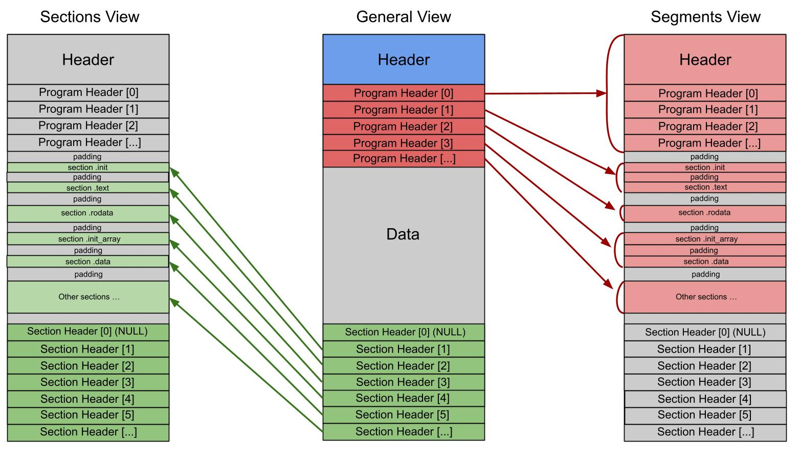
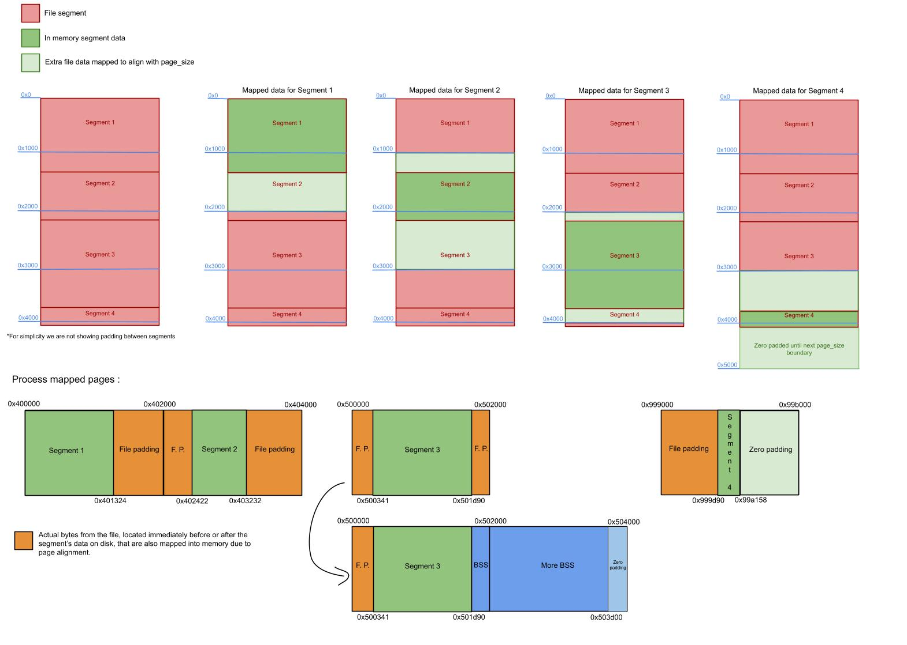
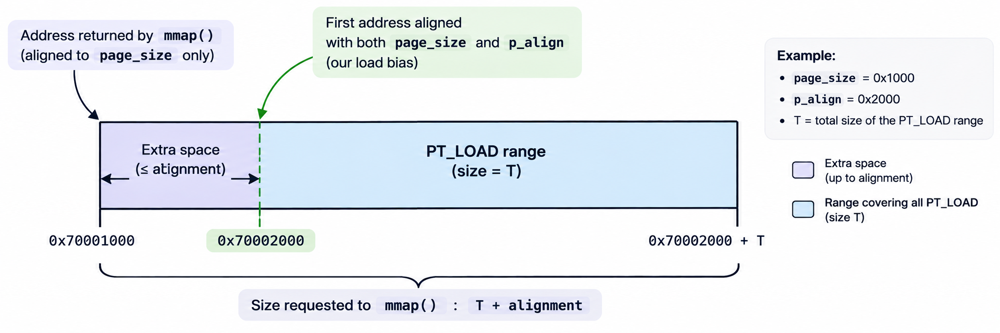
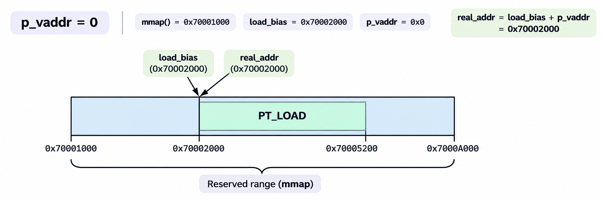
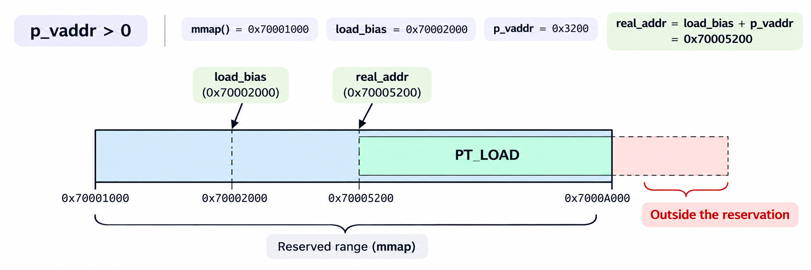
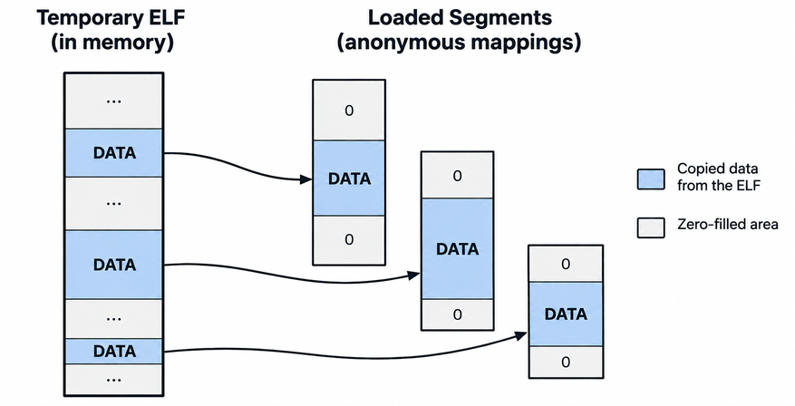

Ceci est un projet d'étude visant a explorer la structure des executables et la manière dont Linux les execute.

L'idée est de créer un simple packer pour ELF `x86_64` pour mettre en pratique les notions que j'ai pu apprendre en me documentant sur le format ELF et sur le fonctionnement du chargeur du kernel Linux.

### Qu'est ce qu'un packer ?

Un packer est un outil qui transforme un fichier exécutable en chiffrant et/ou compressant son contenu, afin de réduire sa taille et/ou de compliquer son analyse, tout en préservant son comportement originel grâce à un mécanisme de dépaquetage.

### Strategie de packing

Beaucoup de stratégies existent, certaines très simples et d'autres plus complexes. Dans le cadre de ce projet, afin de réellement explorer toutes les notions impliqués dans le chargement et l'exécution d'un programme, nous nous intereserons a la methodologie employee par le packer open source [UPX](https://github.com/upx/upx).

Cette strategie consiste sommairement en les etapes suivantes :

- Le packer ouvre le fichier executable qu'il doit packer et le compresse.
- Il cree un nouveau fichier et insère cette data compressée à l'intérieur.
- Il insère également du code exécutable (que nous appellerons *stub*), chargé de retrouver les données compressées, de les décompresser et de préparer l'exécution du programme original.

Nous obtenons donc un nouvel exécutable dans lequel le code du programme original n'est plus directement accessible sous sa forme initiale. Le *stub* constitue désormais le principal code immédiatement analysable.

Lors de l'exécution, le point d'entrée pointera donc vers le *stub*. Celui-ci va restaurer le programme original et préparer son environnement d'exécution avant de lui transférer le contrôle.

**Toutes ces opérations sont réalisées directement en mémoire**, sans créer de fichier temporaire ni faire appel à un nouvel `execve()`.

L'objectif est ainsi de retrouver le comportement de l'exécutable original, tout en ayant profondément modifié la manière dont celui-ci est représenté sur le disque et chargé en mémoire.

Dans notre implémentation, nous utiliserons à la fois la compression et le chiffrement des données du payload. Cependant, nous ne nous attarderons pas sur le fonctionnement de ces algorithmes, qui ne constituent pas le sujet principal de ce write-up.

Nous nous concentrerons plutôt sur les mécanismes permettant de transformer un exécutable, de le restaurer en mémoire et de reproduire les opérations nécessaires à son chargement et à son exécution.

## Rappels Théoriques

### Mémoire virtuelle

Avant de commencer, il nous faut expliquer rapidement comment fonctionne l'adressage virtuel sous Linux.

La RAM physique de notre ordinateur est principalement gérée par le kernel. Celui-ci s'occupe notamment d'attribuer de la mémoire aux différents processus et d'optimiser son utilisation en arrière-plan (en regroupant les données pour défragmenter par exemple) sans que nous nous en rendions compte.

Mais cela peut paraître inquiétant lorsque nous développons un programme qui utilise cette RAM. Un développeur ne veut surtout pas que ses pointeurs se retrouvent invalidés simplement parce que le kernel a eu besoin de déplacer ses données ailleurs en mémoire physique, n'est-ce pas ?

Pour pallier ce problème (entre autres), les systèmes modernes utilisent un mécanisme appelé mémoire virtuelle.

#### La mémoire virtuelle

En vulgarisant on peut dire qu'une adresses virtuelle est simplement un "nombre/identifiant" servant a retrouver la bonne adresse physique. Sur les architectures `x86-64`, elles sont représentées sur 64 bits et sont comprises généralement dans une plage allant de `0x0` à `0x00007fffffffefff`. Les premières plages sont souvent interdites, et ces limites peuvent varier en fonction de la configuration du système).

Lorsque Linux exécute un processus, il lui fournit un ensemble de structures appelées *page tables* (nous ne rentrerons pas dans les détails techniques ici). Ces structures ont pour but de faire le lien entre les adresses virtuelles et les adresses physiques au sein d'un processus. A l'intérieur de ces tables, chaque adresse virtuelle se voit en général attribuée un adresse physique dans la RAM. Si le kernel a besoin de réorganiser la RAM, il n'aura qu'a mettre a jour l'adresse physique associée à l'adresse virtuelle. Ainsi, lorsqu'on "déréférence" une adresse virtuelle, le processeur va chercher les données présentes à l'adresse physique associée à cette adresse virtuelle (ou déclancher un `PAGE FAULT` dans le cas ou aucne adresse physique n'est spécifiée).

Lorsqu'on parle "d'adresses" en programmation, on parle pratiquement toujours d'adresses virtuelles.

Chaque processus possède ses propres *page tables* indépendantes, qui représentent son "espace d'adressage virtuel". Cela signifie que deux processus peuvent parfaitement utiliser la même adresse virtuelle, par exemple `0x400000`, sans pour autant accéder aux mêmes données.

> **NOTE :** Les *threads* d'un même processus partagent tous le même espace d'adressage virtuel.

#### Les pages mémoire

Pour comprendre totalement ce mécanisme, il faut introduire le concept de page mémoire. Nous avons dit que `"une adresse virtuelle" -> "une adresse physique"`. En réalité, il s'agit plutôt de `"une page virtuelle" -> "une page physique"`.

Une page est simplemnt un "bloc de mémoire de taille fixe". Sur `x86-64`, ce bloc est en général de `0x1000` bytes (4096). Le kernel travaille avec des pages de RAM (*page frames*) plutot qu'avec des adresses isolées. Donc lorsque le kernel doit allouer de la mémoire pour un processus, il lui attribue un nombre depages en fonction du besoin, et non pas exactement le nombre de bytes réellement nécessaires.

**Exemple :** Besoin de `0x2431` --> on arrondit à 3 pages de `0x1000`.

> **Attention :** Ici, nous parlons de l'allocation de mémoire nécessaire à l'établissement du contexte d'exécution d'un processus, et non de l'allocation de mémoire de travail par le programme pendant son exécution (via `malloc()`, par exemple). Dans ce second cas, la mémoire demandée peut déjà être disponible dans une région précédemment réservée (le kernel n'alloue pas de nouvelles pages a chaque `malloc()`, la *heap* agit comme une sorte réserve de mémoire). Si ce n'est pas le cas, de nouvelles pages virtuelles peuvent être demandées au kernel.

Donc pour préciser ce qui à été dit plus haut : les pages tables permettent de relier les pages virtuelles aux pages physiques. Pour simplifier, nous pouvons imaginer ces tables représentent un grand dictionnaire contenant des paires « *key/value* » :

- **Key :** l'adresse de début d'une page virtuelle.
- **Value :** l'adresse physique du *page frame* correspondant.

Prenons un exemple avec deux processus différents :

**Processus A :**

```text
0x400000 → 0x12A000
0x401000 → 0x31000
```

**Processus B :**

```text
0x400000 → 0x58000
0x401000 → 0x92000
```

Nous remarquons que les deux processus utilisent exactement les mêmes adresses virtuelles, mais que celles-ci correspondent à des emplacements physiques différents. Imaginons maintenant que le processus A tente de lire les données situées à l'adresse virtuelle `0x400123`. Le processeur identifie la page virtuelle contenant cette adresse (`0x400000`), retrouve son *page frame* correspondant (`0x12A000`), puis y ajoute le décalage de `0x123` octets. Notre lecture s'effectuera donc à l'adresse physique `0x12A123`. Cette traduction est effectuée automatiquement par un composant matériel du processeur appelé MMU (Memory Management Unit).

Cette implémentation permet également d'autres avantages. Par exemple, deux processus peuvent posséder chaqu'un une page virtuelle qui correspond a la meme page physique. Cela permet notamment de partager le code des bibliothèques partagées entre plusieurs processus, sans avoir besoin de le dupliquer en RAM. Ceci autorise également deux pages virtuelles consécutives à correspondre à deux *page frames* physiques très éloignés. Un programme peut donc manipuler une plage d'adresses virtuelles continue, même si les données correspondantes sont dispersées dans la RAM physique. Exemple :

**Processus :**

```text
0x400000 → 0x12A000
0x401000 → 0x31000
```

Si notre programme utilise un ptr = `0x400900`, il peu très bien l'incrémenter jusqu'à dépasser `0x401000`, même si le *page frame* physique de ces deux pages n'est pas contigu. Lorsque le processeur déréférencera ce pointeur, il trouvera automatiquement la bonne adresse physique.

> **NOTE :** Les *page tables* ne sont pas de simples dictionnaires « *key/value* ». Ce sont des structures hiérarchiques beaucoup plus complexes, contenant également des informations sur les permissions d'accès aux pages (plus d'info ici [documentation du noyau Linux](https://docs.kernel.org/mm/page_tables.html)). De plus, une page virtuelle ne possède pas nécessairement un *page frame* associé à tout instant : par exemple, pour optimiser, certaines pages peuvent ne pas encore avoir été chargées en RAM et ne le seront que lorsqu'on en a explicitement besoin. Enfin, les exemples précédents utilisent des pages de 0x1000, mais x86-64 prend également en charge des pages plus grandes. Cependant, pour comprendre les opérations de mapping effectuées dans le cadre de ce projet, le modèle simplifié présenté ici est suffisant.

### Format ELF (Executable and Linking Format)

Ici nous traiterons uniquement le cas ELF `x86-64`.

Un fichier ELF n'est pas directement du code machine destiné au processur. C'est avant tout un format de fichier qui permet de stocker du code machine, des données, ainsi que des informations décrivant comment ces éléments doivent être interprétés.

Un ELF peut représenter plusieurs choses. Les plus communes sont :

- **Executable :** Un programme destiné à être exécuté par le système.
- **Shared object (.so) :** Une bibliothèque dont le code peut être chargé et utilisé par d'autres programmes. Souvent les .so ne sont pas executables independamment.
- **Relocatable object (.o) :** Un fichier contenant du code compilé, mais qui doit être linké pour être intégré à un programme.

#### Sections et Segments

Lors de la compilation d'un programme, le compilateur et le *linker* organisent son contenu en différentes parties appelées sections. Chaque section contient de la data spécifique.

Quelques exemples classiques de sections générées automatiquement par presque tous les compilateurs/linkers :

- "`.text`" contient généralement les instructions machine du programme.
- "`.rodata`" contient généralement des données en lecture seule.
- "`.data`" contient généralement des données initialisées qui peuvent être modifiées pendant l'exécution.

> **NOTE :** Il n'y a aucune règle de nommage officielle pour les sections.

Cette organisation par sections est très utile lors du *linking* de différents fichiers objets en un executable final. Le *linker* peut par exmple retrouver l'ensemble du code machine des tous les objets et l'unir ensemble dans le `.text` final de l'executable, ou encore exclure de l'ELF final des sections entieres qui ne servaient que pour la construction. De la même maniere, cette organisation peremet a différents outils Linux de parser rapidement et simplement les differents contenus d'un ELF (readelf, objdump...).

Cependant, les sections ne servent que pour la construction et l'analyse d'un ELF. Le kernel n'a aucunement besoin de connaitre cette subdivision en sections. Tout ce qui lui importe c'est : quelles parties du fichier faut il charger en mémoire, et comment interpreter ces bouts de fichier chargés.

Une autre manière d'organiser la data est donc nécessaire : les segments.

Un segment est essentiellement une zone contigue de données. Ce terme est utilisé pour designer une zone du fichier ELF, le plus souvent en englobant une ou plusieurs sections. Lors du chargement, certains de ces segments sont traités par le système pour charger en mémoire les données nécessaires à l'execution. On utilise le terme segment pour designer aussi bien une zone de données d'un ELF sur disque, que la representation de cette zone en mémoire, lorsqu'elle est chargée.

#### Organisation de la structure ELF

Nous pouvons distinguer 4 éléments principaux :

- **HEADER**

  ```
  typedef struct
  {
    unsigned char	e_ident[EI_NIDENT];	/* Magic number and other info */
    Elf64_Half	e_type;			    /* Object file type */
    Elf64_Half	e_machine;		    /* Architecture */
    Elf64_Word	e_version;		    /* Object file version */
    Elf64_Addr	e_entry;		    /* Entry point virtual address */
    Elf64_Off	    e_phoff;		    /* Program header table file offset */
    Elf64_Off	    e_shoff;		    /* Section header table file offset */
    Elf64_Word	e_flags;		    /* Processor-specific flags */
    Elf64_Half	e_ehsize;		    /* ELF header size in bytes */
    Elf64_Half	e_phentsize;		/* Program header table entry size */
    Elf64_Half	e_phnum;		    /* Program header table entry count */
    Elf64_Half	e_shentsize;		/* Section header table entry size */
    Elf64_Half	e_shnum;		    /* Section header table entry count */
    Elf64_Half	e_shstrndx;		    /* Section header string table index */
  } Elf64_Ehdr;
  ```

  Il s'agit d'une structure de taille fixe située au tout début du fichier. Il contient les caractéristiques générales de l'ELF, comme son architecture, son type, l'adresse de la première instruction qui sera exécutée ou encore la position de la Section Header Table et de la Program Header Table. C'est en quelque sorte le point de départ permettant d'interpréter le reste du fichier.

- **PROGRAM HEADER TABLE**

  ```
  typedef struct
  {
    Elf64_Word	p_type;			/* Segment type */
    Elf64_Word	p_flags;		/* Segment flags */
    Elf64_Off	    p_offset;		/* Segment file offset */
    Elf64_Addr	p_vaddr;		/* Segment virtual address */
    Elf64_Addr	p_paddr;		/* Segment physical address */
    Elf64_Xword	p_filesz;		/* Segment size in file */
    Elf64_Xword	p_memsz;		/* Segment size in memory */
    Elf64_Xword	p_align;		/* Segment alignment */
  } Elf64_Phdr;
  ```

  Il s'agit d'un tableau de structures appellées Program Header. Un Program Header contient des informations destinées a être lues par le chargeur du système : l'adresse de chargement de certains segments, leurs permissions, leur zone de chargement... Chaque Program Header peut désigner un segment (donc une zone contigue de l'ELF), un segment chargeable (donc un segment qui doit être chargé en mémoire), ou de la métadonée de chargement qui ne représente aucune zone de l'ELF, simplement des informations sur comment gérer le chargement et l'execution. Bien que ce ne soit pas une règle officielle, la Program Header Table se situe souvent avant la Data, juste après le Header. Il existe de nombreux types (`p_type`) de Program Headers, mais dans le cadre de ce write-up nous nous interesserons seulement aux suivants :

  - **`PT_LOAD` :** Le plus important. Cet *header* decrit un segment de l'ELF qui sera chargé en mémoire. A noter qu'il est très fréquent que ce type de segment couvre plusieurs autres segments plus petis. Le premier segment `PT_LOAD` d'un ELF comprend souvent au moins le segment `PT_PHDR` et `PT_INTERP`.
  - **`PT_PHDR` :** Decrit un segment qui contient l'entièreté des entrées de la Program Header Table.
  - **`PT_INTERP` :** Decrit un segment qui contient le nom absolu d'un exectuable ELF qui jouera le role d'interpreteur (cette notion sera expliquée plus tard).
  - **`PT_DYNAMIC` :** Decrit un segment qui contient la section `.dynamic`. Cette section fournit des informations nécessaires à la liaison dynamique. Elle permet notamment de savoir quelles bibliothèques partagées (.so) doivent être chargées et contient les informations pour retrouver les adresse mémoire des fonctions qu'elles exportent. Nous nous interesserons un peu plus en détails a cette fonction plus tard.
  - **`PT_GNU_STACK` :** Ce Program Header ne decrit aucun segment, il renseigne seulement un *flag* qui indique si la *stack* qu'un ELF va avoir lors de son execution doit être executable ou non (si ce n'est pas clair, ça le sera plus tard).

- **DATA**

  C'est le contenu du fichier : instructions machine, constantes, variables initialisées, informations de symboles, etc. La majorité est rangée par sections, qui peuvent a leur tour être regroupées par segments.

- **SECTION HEADER TABLE**

  ```
  typedef struct
  {
    Elf64_Word	sh_name;		/* Section name (string tbl index) */
    Elf64_Word	sh_type;		/* Section type */
    Elf64_Xword	sh_flags;		/* Section flags */
    Elf64_Addr	sh_addr;		/* Section virtual addr at execution */
    Elf64_Off	    sh_offset;		/* Section file offset */
    Elf64_Xword	sh_size;		/* Section size in bytes */
    Elf64_Word	sh_link;		/* Link to another section */
    Elf64_Word	sh_info;		/* Additional section information */
    Elf64_Xword	sh_addralign;	/* Section alignment */
    Elf64_Xword	sh_entsize;		/* Entry size if section holds table */
  } Elf64_Shdr;
  ```

  Il s'agit d'un tableau de structures appellées Section Header. Un Section Header décrit une section: sa position, sa taille, son type et différentes propriétés. Cette table n'est pas utilisée par le chargeur du système, et peut donc être absente sans poser de problèmes d'execution. La premiere entrée de cette table est toujours nulle. Le plus souvent, la Section Header Table est placée après la Data, à la fin du fichier, mais ce n'est pas une obligation.



> **NOTE :** On remarque que le Header et la Program Header Table font partie d'un segment sans pour autant faire partie d'une section.

Ce qu'il faut retenir ici est que les Sections Headers et Program Headers se partagent globalement la meme donnée. Ce sont simplement des structures qui subdivisent l'ELF de maniere differente. Cela permet deux lectures differentes, une qui sert a executer l'ELF et l'autre qui sert a le construire.

Nous allons maintenant entrer un peu plus dans les details d'un Prgoram Header.

#### Program Header

Lorsqu'on utilise `readelf -lW` pour afficher la Program Header Table, on obtient quelque chose comme ça :

```
$ readelf -lW ./elf

Elf file type is EXEC (Executable file)
Entry point 0x401130
There are 13 program headers, starting at offset 64

Program Headers:
  Type           Offset   VirtAddr           PhysAddr           FileSiz  MemSiz   Flg Align
  PHDR           0x000040 0x0000000000400040 0x0000000000400040 0x0002d8 0x0002d8 R   0x8
  INTERP         0x000318 0x0000000000400318 0x0000000000400318 0x00001c 0x00001c R   0x1
      [Requesting program interpreter: /lib64/ld-linux-x86-64.so.2]
  LOAD           0x000000 0x0000000000400000 0x0000000000400000 0x000910 0x000910 R   0x1000
  LOAD           0x001000 0x0000000000401000 0x0000000000401000 0x0034f9 0x0034f9 R E 0x1000
  LOAD           0x005000 0x0000000000405000 0x0000000000405000 0x000e5c 0x000e5c R   0x1000
  LOAD           0x006df8 0x0000000000406df8 0x0000000000406df8 0x000298 0x0002b8 RW  0x1000
  DYNAMIC        0x006e08 0x0000000000406e08 0x0000000000406e08 0x0001d0 0x0001d0 RW  0x8
  NOTE           0x000338 0x0000000000400338 0x0000000000400338 0x000020 0x000020 R   0x8
  NOTE           0x000358 0x0000000000400358 0x0000000000400358 0x000044 0x000044 R   0x4
  GNU_PROPERTY   0x000338 0x0000000000400338 0x0000000000400338 0x000020 0x000020 R   0x8
  GNU_EH_FRAME   0x0056e8 0x00000000004056e8 0x00000000004056e8 0x000184 0x000184 R   0x4
  GNU_STACK      0x000000 0x0000000000000000 0x0000000000000000 0x000000 0x000000 RW  0x10
  GNU_RELRO      0x006df8 0x0000000000406df8 0x0000000000406df8 0x000208 0x000208 R   0x1

 Section to Segment mapping:
  Segment Sections...
   00     
   01     .interp 
   02     .interp .note.gnu.property .note.gnu.build-id .note.ABI-tag .gnu.hash .dynsym .dynstr .gnu.version .gnu.version_r .rela.dyn .rela.plt 
   03     .init .plt .text .fini 
   04     .rodata .eh_frame_hdr .eh_frame 
   05     .init_array .fini_array .dynamic .got .got.plt .data .bss 
   06     .dynamic 
   07     .note.gnu.property 
   08     .note.gnu.build-id .note.ABI-tag 
   09     .note.gnu.property 
   10     .eh_frame_hdr 
   11     
   12     .init_array .fini_array .dynamic .got 
```

Exliquons brièvement chaqu'un des champs:

- **`p_type` :** Indique le type de du Program Header, comme `PT_LOAD`, `PT_PHDR`, `PT_INTERP`... Les differents types sont consultables ici [linux/elf.h](https://github.com/torvalds/linux/blob/master/include/uapi/linux/elf.h). D'autres types existent pour d'autres architecture, mais dans le cadre de ce projet nous utilierons ce *header* comme référence.

- **`p_offset` :** Indique à quel *offset* du fichier se trouve le debut de la zone de données couverte par le segment.

- **`p_vaddr` :** Indique l'adresse mémoire (virtuelle) à laquelle la data couverte par ce segment se trouve en mémoire. Pour les exécutables de type PIE, cette adresse est relative à une adresse de base déterminée lors du chargement (pas d'inquiétudes, on va clarifier après).

- **`p_paddr` :** Indique l'adresse physique du segment sur les systèmes qui utilisent cette information. Sous Linux, pour les exécutables classiques en espace utilisateur, ce champ est ignoré. Il est souvent initialisé à la même valeur que `p_vaddr`.

- **`p_filesz` :** Indique la taille de la zone de données couverte par le segment à l'intérieur du fichier.

- **`p_memsz` :** Indique la taille de la zone de données couverte par le segment dans la mémoire. 

  > **NOTE :** Lorsque `p_memsz` est supérieur à `p_filesz` pour un segment `PT_LOAD`, l'espace supplémentaire en mémoire est initialisé à zéro. C'est notamment le cas des données non initialisées (`.bss`). Cette technique évite de stocker inutilement dans le fichier des octets dont on sait qu'ils devront être initialisés à zéro. Memsz ne peut pas être inférieur a filesz.

- **`p_flags` :** Pour les segments `PT_LOAD`, indique les permissions mémoire demandées lors du chargement (read/write/execute). Ces permissions s'appliquent aux pages mémoire couvrant le segment et peuvent ensuite être modifiées, notamment avec mprotect(). Durant le runtime, une operation a une adresse a l'intérieur d'une page qui ne possède pas les permissions correspondantes se verra refusée par le kernel (qui enverra un *segfault* au processus). Pour d'autres types de Program Headers, ces *flags* peuvent avoir une signification différente (comme `PT_GNU_STACK`), ou être simplmement ignorés (comme `PT_PHDR`, `PT_INTERP`, `PT_DYNAMIC`...).

- **`p_align` :** Indique la contrainte d'alignement du segment dans le fichier et en mémoire. Nous reviendrons sur son fonctionnement lors des détails sur l'implémentation du *stub*.

Quelques exemples pour s'assurer que tout soit clair :

- `ProgramHeader[0]` est de type `PT_PHDR`. On sait donc qu'il decrit un segment qui va contenir toutes les entrées de la Program Header Table. Le segment commence au `0x40ème` bytes du fichier, et occupe `0x2d8` bytes. Dans l'image finale chargée en mémoire, ce segment sera à l'adresse virtuelle `0x400040`, et aura la même taille que dans le fichier (`0x2d8`). Ici, bien que le *flag* `R` soit set, celui-ci n'a aucun impact sur les permissions mémoire, car ce Program Header ne provoque pas lui-même de mapping. Ses données sont néanmoins présentes en mémoire puisqu'elles sont englobées dans un segment `PT_LOAD`.

- `ProgramHeader[2]` est de type `PT_LOAD`. On sait que ce segment va être chargé en mémoire. Il comprend l'intervalle `[0x00-0x910)` du fichier ELF. On voit donc qu'il englobe notamment le Header de l'ELF et les segments `PT_PHDR` et `PT_INTERP`. En mémoire il se trouvera à l'addrese `0x400000`, et aura la même taille que dans le fichier. Ici le *flag* `R` est appliqué lors du mapping comme permission de base du segment (ces permissions peuvent ensuite être modifiées avec `mprotect`).

- `ProgramHeader[5]` a la particularité d'avoir un memsz supérieur a son filesz, on sait donc que ce segment en mémoire sera plus grand que le segment dans le fichier, et que l'espace supplémentaire sera initialisé a `0` (bss).

- `ProgramHeader[11]` est de type `PT_GNU_STACK`. Ce type de Program Header ne decrit pas un segment, mais sert a indiquer au kernel quelles la mémoire représentant la Stack du processus (qui est egalement un espace memoire attribué par le kernel au demarrage d'un processus, nous y reviendrons) doit être executable ou non. Ici rien n'est donc chargé, le champ `p_flags` est utilisé pour renseigner cette information via le champ `p_flags` les autres champs sont ignorés.

Nous avons desormais toutes les briques necessaires pour comprendre comment le système charge et execute un ELF.

### Chargement d'un ELF

Lorsqu'un processus appelle `execve()` pour exécuter un fichier ELF, le kernel doit effectuer plusieurs opérations d'initialisation. Nous détaillerons les principales étapes dans cette section, mais l'ordre dans lequel le kernel les effectue n'est pas forcément identique à l'ordre dans lequel nous les aborderons. 

#### Mapping des Segments

Pour charger les segments `PT_LOAD`, le kernel doit créer des mappings mémoire aux adresses virtuelles appropriées, en respectant les contraintes imposées par la taille des pages.

Pour réaliser ces opérations, Linux utilise les mécanismes de mapping mémoire, également accessibles aux programmes utilisateurs grâce à l'appel système `mmap()`.

`mmap()` permet notamment de créer deux types de mappings : les mappings anonymes et les mappings de fichier.

- **Mapping anonyme :**  Permet de réserver une région de mémoire virtuelle qui n'est associée à aucun fichier. Son contenu initial est constitué de zéros. La taille de la région effectivement mappée est arrondie à un multiple de la taille des pages.

- **Mapping par fichier :** Permet d'associer une région de mémoire virtuelle à une portion de fichier, définie par un *offset* de départ et une longueur.

  Cependant, `mmap()` peut mapper uniquement un nombre entier de pages mémoire. Pour garder une  correspondance correcte entre `[page mémoire] <--> [portion de fichier]`, il impose également que l'*offset* du fichier soit aligné sur une frontière de page.

  Pour charger un segment `PT_LOAD`, le kernel doit donc aligner l'*offset* de début de sa portion de fichier sur la frontière de page précédente, puis étendre le mapping jusqu'à la frontière de page suivant sa fin.

  > **NOTE :** `mmap()` accepte une longueur de mapping qui n'est pas un multiple de `page_size`, mais le kernel arrondira implicitement cette longueur au prochain multiple.

Prenons maintenant un exemple concret pour comprendre comment le kernel charge ces segments en mémoire. Nous considérerons une taille de page de `0x1000` bytes.

```text
Type           Offset   VirtAddr           PhysAddr           FileSiz  MemSiz   Flg Align
LOAD           0x000000 0x0000000000400000 0x0000000000400000 0x001324 0x001324 R E 0x1000
LOAD           0x001422 0x0000000000402422 0x0000000000402422 0x000e10 0x000e10 R   0x1000
LOAD           0x002341 0x0000000000500341 0x0000000000500341 0x001a4f 0x0039bf RW  0x1000
LOAD           0x003d90 0x0000000000999d90 0x0000000000999d90 0x0003c8 0x0003c8 RW  0x1000
```

Observons le deuxième `PT_LOAD`. Son contenu commence à l'*offset* `0x1422` du fichier et doit être chargé à l'adresse virtuelle `0x402422`. Cependant, comme les mappings s'effectuent par pages entières, le kernel doit aligner le début du mapping sur `0x1000` dans le fichier et `0x402000` en mémoire.

Avec un `p_filesz` de `0xe10`, les données de ce segment se terminent à l'adresse `0x403232`. Le mapping doit donc couvrir deux pages entières, soit l'intervalle `[0x402000, 0x404000)`.

**Cela signifie que des octets du fichier situés avant et après le segment seront également présents en mémoire**, simplement parce qu'ils appartiennent aux pages nécessaires au mapping.

Il existe également deux cas particuliers :

- **Lorsque** `p_memsz > p_filesz` **:** le kernel initialise à zéro l'espace supplémentaire appartenant au segment. Il commence par remplacer par des zéros les éventuels octets supplémentaires du fichier présents après le segment, dans la dernière page mappée. Si nécessaire, il complète ensuite cette région avec des pages anonymes initialisées à zéro (segment 3).

- **Lorsque le mapping atteint EOF :** les octets situés après la fin du fichier, dans la dernière page du mapping, sont automatiquement remplis de zéros (segment 4).

Enfin, les permissions définies par `p_flags` s'appliquent aux pages mappées, y compris aux octets du fichier chargés en supplément.

Le schéma suivant illustre ces différents cas, en distinguant les données appartenant aux segments, les octets supplémentaires du fichier chargés à cause de l'alignement des pages et les régions de mémoire initialisées à zéro (bss).



Dans cet exemple, le mapping requière au total 10 pages mémoire de `0x1000` bytes.

Avant de de continuer avec les étapes suivantes de l'execution, il convient d'introduire les deux types d'ELF que nous traiterons dans ce write-up.

#### PIE et PDE

**Position Dependent Executable (PDE ou Non-PIE) :** Depuis le debut, nos exemples se réfèrent à ce type d'executable. Un PDE est conçu pour être chargé à des adresses virtuelles précises. Chaque `PT_LOAD` spécifie l'adresse à laquelle il doit être chargé, et si l'adresse du premier `PT_LOAD` n'est pas disponible (déja occupée) l'execution échoue. Les ELF PDE sont de type `ET_EXEC`,  indiqué dans le champ `e_type` de l'ELF Header.

**Position Independent Executable (PIE) :** Ce type d'executable n'a aucune dépendance d'adresses spécifiques. Ce qui signifie qu'il peut être chargé et executé à n'importe quelles adresses virtuelles valides.

Contrairement à un PDE classique, les adresses virtuelles renseignées dans un PIE, notamment les `e_entry` et les `p_vaddr` des segments, ne correspondent pas directement à leurs adresses réelles en mémoire, mais a une adresses relatives à une base de chargement.

Lors du chargement d'un exécutable `ET_DYN`, le kernel doit déterminer un *load bias*. Ce dernier est simplement un décalage qui sera implicitement ajouté à chaque adresse relative rensignée dans la structure de l'ELF lorsqu'elle sera utilisée, pour obtenir l'adresse réelle.

Si l'*ASLR* est activé, ce *load bias* est obtenu aléatoirement (dans une limite de plages considérées comme valides), ce qui rend les adresses réelles de chargement différentes entre deux executions.

Les ELF PIE sont de type `ET_DYN` au même titre que les bibliothèques partagées. Beaucoup de compilateurs modernes choisissent ce type d'ELF par défault lors des compilations.

**Exemple :**

```
PDE: p_vaddr = 0x400000
PIE: p_vaddr = 0x1120  --> au chargement : adresse réelle = 0x1120 + 0x760000 = 0x761120
     p_vaddr = 0x1120  --> au chargement : adresse réelle = 0x1120 + 0x230000 = 0x231120
```

#### Environnement d'execution

##### Stack

En plus des segments `PT_LOAD`, le kernel doit préparer une région mémoire destinée à la *stack* du programme.

Pour cela, il choisit une plage d'adresses dans l'espace virtuel du processus, généralement située vers les adresses hautes.

Bien que la *stack* partage le même espace d'adressage virtuel que les mappings `mmap()` classiques, le kernel utilise une stratégie différente pour déterminer son emplacement.

Les mappings `mmap()` classiques sont généralement placés dans une région située plus bas dans l'espace virtuel, afin de conserver suffisamment de place pour permettre à la *stack* de s'étendre.

> **NOTE :** Sur Linux `x86-64`, lorsqu’on laisse le kernel choisir l’adresse avec `mmap(NULL, ...)`, il cherche par défaut une plage libre en partant du haut de la zone de mapping, sous la *stack*, puis en descendant vers les adresses plus basses. Cette stratégie est dite *top-down*. Si cette recherche échoue, le kernel peut reprendre la recherche dans l’autre sens.

Si l'*ASLR* est activé, l'emplacement de la *stack* est randomisé.

Contrairement aux segments `PT_LOAD`, cette région ne correspond à aucune portion du fichier ELF. Il s'agit d'une région de mémoire anonyme, dont les pages physiques sont allouées selon les besoins.

Le kernel alloue ainsi les premières pages nécessaires pour y placer les informations de démarrage du programme. La *stack* pourra ensuite s'étendre vers les adresses inférieures, dans les limites autorisées, à mesure que le programme utilisera davantage de mémoire.

Voici un exemple typique de l'initialisation des données de la *stack* par le kernel :

```
------------------------------------------------------------- 0x7fff6c845000
     0x7fff6c844ff8: 0x0000000000000000
            _  4fec: './stackdump\0'                      <------+
      env  /   4fe2: 'ENVVAR2=2\0'                               |    <----+
           \_  4fd8: 'ENVVAR1=1\0'                               |   <---+ |
           /   4fd4: 'two\0'                                     |       | |     <----+
     args |    4fd0: 'one\0'                                     |       | |    <---+ |
           \_  4fcb: 'zero\0'                                    |       | |   <--+ | |
               3020: random gap padded to 16B boundary           |       | |      | | |
    - - - - - - - - - - - - - - - - - - - - - - - - - - - - - - -|       | |      | | |
               3019: 'x86_64\0'                        <-+       |       | |      | | |
     auxv      3009: random data: ed99b6...2adcc7        | <-+   |       | |      | | |
     data      3000: zero padding to align stack         |   |   |       | |      | | |
    . . . . . . . . . . . . . . . . . . . . . . . . . . .|. .|. .|       | |      | | |
               2ff0: AT_NULL(0)=0                        |   |   |       | |      | | |
               2fe0: AT_PLATFORM(15)=0x7fff6c843019    --+   |   |       | |      | | |
               2fd0: AT_EXECFN(31)=0x7fff6c844fec      ------|---+       | |      | | |
               2fc0: AT_RANDOM(25)=0x7fff6c843009      ------+           | |      | | |
      ELF      2fb0: AT_SECURE(23)=0                                     | |      | | |
    auxiliary  2fa0: AT_EGID(14)=1000                                    | |      | | |
     vector:   2f90: AT_GID(13)=1000                                     | |      | | |
    (id,val)   2f80: AT_EUID(12)=1000                                    | |      | | |
      pairs    2f70: AT_UID(11)=1000                                     | |      | | |
               2f60: AT_ENTRY(9)=0x4010c0                                | |      | | |
               2f50: AT_FLAGS(8)=0                                       | |      | | |
               2f40: AT_BASE(7)=0x7ff6c1122000                           | |      | | |
               2f30: AT_PHNUM(5)=9                                       | |      | | |
               2f20: AT_PHENT(4)=56                                      | |      | | |
               2f10: AT_PHDR(3)=0x400040                                 | |      | | |
               2f00: AT_CLKTCK(17)=100                                   | |      | | |
               2ef0: AT_PAGESZ(6)=4096                                   | |      | | |
               2ee0: AT_HWCAP(16)=0xbfebfbff                             | |      | | |
               2ed0: AT_SYSINFO_EHDR(33)=0x7fff6c86b000                  | |      | | |
    . . . . . . . . . . . . . . . . . . . . . . . . . . . . . . .        | |      | | |
               2ec8: environ[2]=(nil)                                    | |      | | |
               2ec0: environ[1]=0x7fff6c844fe2         ------------------|-+      | | |
               2eb8: environ[0]=0x7fff6c844fd8         ------------------+        | | |
               2eb0: argv[3]=(nil)                                                | | |
               2ea8: argv[2]=0x7fff6c844fd4            ---------------------------|-|-+
               2ea0: argv[1]=0x7fff6c844fd0            ---------------------------|-+
               2e98: argv[0]=0x7fff6c844fcb            ---------------------------+
     0x7fff6c842e90: argc=3
```

Exemple illustratif, le contenu est susceptible d'évoluer avec le temps.

**Source :** [How programs get run: ELF binaries](https://lwn.net/Articles/631631)

##### Auxiliary Vector

Comme nous avons l'habitude de le voir, en haut de la *stack* (adresse la plus basse) nous avons `argc`, suivi du tableau des `argvs`, et du tableau des `envps`. 

Nous voyons cependant qu'après`envp` il y a une liste de structures de type `Elf64_auxv_t`, défini ainsi dans l'header [elf/elf.h](https://github.com/bminor/glibc/blob/master/elf/elf.h)  :

```c
typedef struct
{
  uint64_t a_type;		/* Entry type */
  union
    {
      uint64_t a_val;	/* Integer value */
    } a_un;
} Elf64_auxv_t;
```

L'ensemble de ces structures constitue ce qu'on appelle l'*Auxiliary Vector* (`auxv`).

Chaque entrée contient deux champs :

- `a_type` : un identifiant qui indique la nature de l'information.

- `a_un.a_val` : la valeur associée à cet identifiant.

Lors de la préparation de l'environnement d'exécution, le kernel construit cet ensemble d'informations, en conserve une copie dans sa propre mémoire et en place également une copie dans la *stack* du programme.

L'objectif de l'*Auxiliary Vector* est de permettre au kernel de transmettre au programme certaines informations sur son environnement d'exécution, sans que celui-ci ait besoin d'effectuer des appels système pour les obtenir.

Ces informations concernent aussi bien les caractéristiques du système que les détails du chargement de l'exécutable lui-même. Par exemple, `AT_PAGESZ` indique la taille des pages mémoire du système, tandis que `AT_PHDR` contient l'adresse mémoire de la Program Header Table de l'exécutable.

Nous reviendrons sur certains des champs de l'*Auxiliary Vector* lorsque nous entrerons dans les détails de l'implémentation du packer, mais nous n'approfondirons pas d'avantage le sujet (pour plus d'infos : [getauxval() and the auxiliary vector](https://lwn.net/Articles/519085/)).

##### Heap

Le kernel détermine également l'adresse de départ de la *heap*, une région mémoire destinée aux allocations dynamiques.

Pour cela, il se base généralement sur la fin du segment `PT_LOAD` situé à l'adresse mémoire la plus haute (BSS inclu).

> **NOTE :** Pour les ELF de type `ET_DYN` sans *interpreter*, le kernel considère qu'il peut s'agir d'un programme chargé d'effectuer lui-même des mappings mémoire. Il peut donc placer le début de la *heap* à une adresse inférieure à celles des segments `PT_LOAD`, afin de laisser davantage de place à sa croissance sans risquer de collision avec ces futurs mappings.

Cette adresse peut ensuite être décalée aléatoirement si l'*ASLR* est activé.

Contrairement à la *stack*, la *heap* s'étend vers les adresses supérieures, notamment lorsque le programme demande davantage de mémoire avec l'appel système `brk()`.

Il faut cependant noter que toutes les allocations dynamiques n'utilisent pas nécessairement cette région. Par exemple, `malloc()` peut également utiliser des mappings anonymes `mmap()`.

##### Registres

Pour finir, le kernel prépare l'état initial des registres du processeur pour permettre le démarrage du programme.

Sur une architecture x86-64, il initialise notamment :

- `RIP` (*Instruction Pointer*) : avec l'adresse de la première instruction à exécuter.

- `RSP` (*Stack Pointer*) : avec l'adresse du sommet initial de la *stack*.

Il est important de comprendre que chaque thread possède son propre état de registres. Lors d'un changement de contexte, le kernel peut sauvegarder cet état afin de le restaurer lorsque le thread reprend son exécution.

Ainsi, plusieurs programmes peuvent utiliser les mêmes registres physiques du CPU sans perdre leurs valeurs respectives.

### L'interpréteur ELF

À présent, notre programme est chargé et son environnement est pret. Nous pourrions simplement renseigner l'addresse de l'`entry_point` dans `RIP` et commencer l'execution.

Cependant, **charger un programme en mémoire ne signifie pas nécessairement qu'il est prêt à être exécuté.**

Prenons un exemple simple : un programme C utilisant la fonction `printf()`.

Cette fonction est généralement fournie par une bibliothèque externe, la `libc`, dont le code n'est pas directement intégré à notre exécutable.

Pour que notre programme puisse utiliser cette fonction, il faut donc que cette bibliothèque soit également chargée en mémoire, et que le programme puisse retrouver l'adresse de la fonction `printf()`.

De manière plus générale, certaines références à des symboles présentes dans un exécutable ne peuvent être résolues définitivement qu'au moment de son chargement. C'est notamment le cas lorsque des bibliothèques sont chargées à des adresses variables.

Il devient alors nécessaire d'effectuer certains ajustements d'adresses, appelés *relocations*, afin que le programme puisse fonctionner correctement.

> **NOTE :** Concrètement (en simplifiant grandement), un ELF contient des tables de *relocations*, constituées de listes de structures décrivant chacune une modification à effectuer en mémoire.
>
> Ces tables sont présentes dans les données chargées par les segments `PT_LOAD`. Le segment `PT_DYNAMIC` contient notamment les informations permettant à l'*interpreter* de les localiser.
>
> Chaque entrée de *relocation* contient principalement :
>
> - `r_offset` : l'adresse virtuelle de l'emplacement à modifier.
>
> - `r_info` : le type de modification et, éventuellement, le symbole concerné (comme `printf`).
>
> Il faut parcourrir ces entrées, effectuer les calculs nécessaires et écrire les valeurs obtenues aux emplacements indiqués.

Plutôt que de confier l'ensemble de ces opérations au kernel, Linux utilise un programme spécialisé : *l'interpréteur ELF*, qui vient effectuer tout un tas d'operations de "préparation" pour que l'ELF puisse s'executer dans les conditions prévues.

> **NOTE :** L'*Interpreter* est aussi souvent appelé *Dynamic Linker*, dû au fait que l'opération qu'il effectue le plus souvent est la résolution des liens dynamiques au runtime.

#### Le segment PT_INTERP

Lorsqu'un exécutable nécessite un interpréteur, celui-ci est indiqué dans un segment de type `PT_INTERP`.

Ce segment décrit une zone de l'executable qui contient le chemin absolu vers un autre programme.

Sur un système Linux `x86-64` utilisant la glibc, ce chemin est généralement :

`/lib64/ld-linux-x86-64.so.2`

> **NOTE :** Le format part donc du principe que l'*interpreter* soit présent dans le système au chemin attendu.

Après avoir chargé les segments de l'ELF principal et préparé son environnement, le kernel charge également les segments l'*interpreter* de la même maniere que nous l'avons vu plus haut, puis initialise `RIP` à l'adresse de l'`entry_point` de ce dernier au lieu de celui du programme principal.

L'interpréteur prend alors le relais.

Il se charge notamment de charger les bibliothèques nécessaires, de résoudre les références aux symboles et d'effectuer les *relocations* requises.

> **NOTE  :** L'interpreteur utilise notamment `auxv` dans la *stack* pour retrouver les informations concernant l'ELF principal.

Une fois les préparations nécessaires terminées, il transfère finalement le contrôle au point d'entrée de notre programme.

Ainsi, dans le cas d'un exécutable utilisant un interpréteur, **le premier code exécuté en espace utilisateur n'est pas celui de notre programme, mais celui de son interpréteur.**

À l'inverse, lorsqu'aucun interpréteur n'est spécifié, le kernel transfère directement le contrôle au point d'entrée de l'exécutable.

Nous n'entrerons pas dans les détails des mechanismes de *relocation*, *dynamic linking* ainsi que les autres opérations effectuées par l'*interpreter*. Il est cependant important de comprendre leur existence, car ils vont influencer directement les choix d'implémentation de notre packer.

Un dernier point intéressant à noter est que l'*interpreter* ne possède pas lui-même d'*interpreter* (pas de segment `PT_INTERP`).

Il est donc conçu pour pouvoir démarrer de manière autonome, sans dépendre d'un autre *dynamic linker*. Une fois chargé en mémoire par le kernel, il effectue lui-même les opérations nécessaires à sa propre initialisation, notamment ses *relocations*.

## Implémentation

### Stratégie

Une approche courante pour packer un ELF consiste à chiffrer uniquement ses segments executables, puis d'injecter un *stub* dans l'une de ces régions disposant d'assez de place inutilisée (à la place du padding). Il suffit alots de modifier son point d'entrée (`e_entry`) pour que ce *stub* soit exécuté avant le programme original. Le *stub* viendrait alors trouver le début des segment chiffrés en mémoire, les dechifrer et jump à l'adresse du `e_entry` original.

> **NOTE :** La technique consitant a injecter du code dans la zone de padding d'un segment executable est appelée *code caving*.

Cette manière de faire présente "l'avantage" de conserver une grande partie de la structure originale de l'exécutable, ce qui simplifie de manière considérable l'implémentation.

Cependant, cette technique comporte son lot d'inconvénients :

- **La structure de l'ELF reste globalement inchangée.** Dans un objectif d'obfuscation, de nombreux indices restent donc visibles. En effet, certaines régions nécessaires au chargement de l'exécutable par le kernel et l'*interpreter* doivent rester exploitables. Il est ainsi possible d'analyser la structure des *Program Headers*, le contenu de certaines *sections*, ainsi que les informations relatives aux dépendances dynamiques et aux symboles importés.

- **L'espace disponible dans un segment executable n'est pas toujours suffisant pour y injecter notre stub.** Ceci implique donc généralement que le *stub* doit être court. Ce qui peut compliquer l'integration d'algorithmes de déchiffrement, de décompression ou d'execution volumineux à l'interieur de celui-ci.

- **Certaines régions de l'ELF peuvent devoir être utilisées <u>avant même</u> que son `e_entry` ne soit atteint.** C'est, à mon sens, l'un des inconvénients les plus importants de cette approche.

  Comme expliqué précédemment, l'*interpreter* doit effectuer différentes opérations de préparation avant de transférer le contrôle à l'exécutable principal. Or, certaines de ces opérations nécessitent d'accéder à des données, voir d'exécuter du code appartenant directement à cet exécutable.

  > **NOTE :** Nous ne rentrerons pas dans les détails techniques, mais pour donner une idée générale on peut citer le cas de certaines *relocations* (comme`IRELATIVE`), qui peuvent nécessiter l'exécution d'un *resolver* pour trouver la bonne adresse d'une fonction (lorsque plusieurs versions d'une fonction sont implémentées). Il existe aussi les fonctions de préinitialisation référencées par `DT_PREINIT_ARRAY`, dans le segment `PT_DYNAMIC` (qui sont des fonctions présentes dans l'ELF principal et executées par l'*interpreter*).

  Si ces régions ont été chiffrées, l'*interpreter* risque donc de tenter de les lire, de les modifier ou de les exécuter avant que notre *stub* ait eu l'occasion de les déchiffrer. Cela nous oblige à conserver certaines régions en clair ou à mettre en place des mécanismes supplémentaires pour garantir le bon déroulement du chargement.

Comme expliqué dans l'introduction, notre stratégie s'inspire des packer modernes comme [UPX](https://github.com/upx/upx), qui viennent pallier a ces problèmes.

Plutôt que d'injecter simplement un *stub* dans l'exécutable original, nous construisons un nouvel ELF contenant notre *stub* ainsi que l'exécutable original sous forme de données chiffrées et compressées.

L'ELF packé sera donc un executable très simple qui aura comme code machine executable le code du *stub*.

Le *stub* se chargera de trouver et de décompresser/déchifrer l'ELF et d'effectuter toutes les étapes de chargement expliquées dans la partie précédente (presque) de la même manière que l'aurait fait le kernel Linux.

Puisque l'ELF packé sera écrit "à la main" par notre packer, générer toute la structure de *relocations* et de liens dynamiques sans l'aide d'un *linker* serait trop complexe. Pour cause, notre *stub* ne possèdera pas d'*interpreter* et l'`entry_point` de l'ELF packé sera la première instruction du *stub*. Ceci implique donc que le code du *stub* devra être indépendant de toute "aide" supplémentaire fournie par un *interpreter*.

Cette approche est considérablement plus complexe à implémenter, puisqu'elle nécessite de comprendre en profondeur certains mécanismes et choix du kernel. C'est cependant précisément cet aspect qui m'a poussé à la privilégier, afin d'approfondir ma compréhension du fonctionnement de Linux.

### Format de packing

Avant de nous interesser au *stub* (qui fait le gros du travail), il convient de nous attarder sur le format de l'ELF packé produit par le packer.

Voici ce que nous obtenons en inspectant le contenu d'un ELF packé par notre packer :

```
$ readelf -aW ./packed

ELF Header:
  Magic:   7f 45 4c 46 02 01 01 00 00 00 00 00 00 00 00 00 
  Class:                             ELF64
  Data:                              2's complement, little endian
  Version:                           1 (current)
  OS/ABI:                            UNIX - System V
  ABI Version:                       0
  Type:                              DYN (Shared object file)
  Machine:                           Advanced Micro Devices X86-64
  Version:                           0x1
  Entry point address:               0x1120
  Start of program headers:          64 (bytes into file)
  Start of section headers:          0 (bytes into file)
  Flags:                             0x0
  Size of this header:               64 (bytes)
  Size of program headers:           56 (bytes)
  Number of program headers:         4
  Size of section headers:           0 (bytes)
  Number of section headers:         0
  Section header string table index: 0

There are no sections in this file.

There are no section groups in this file.

Program Headers:
  Type           Offset   VirtAddr           PhysAddr           FileSiz  MemSiz   Flg Align
  LOAD           0x000000 0x0000000000000000 0x0000000000000000 0x000120 0x000120 R   0x1000
  LOAD           0x000120 0x0000000000001120 0x0000000000001120 0x004faa 0x004faa R E 0x1000
  LOAD           0x0050ca 0x00000000000070ca 0x00000000000070ca 0x00a470 0x00a470 RW  0x1000
  GNU_STACK      0x000000 0x0000000000000000 0x0000000000000000 0x000000 0x000000 RW  0

There is no dynamic section in this file.

There are no relocations in this file.
No processor specific unwind information to decode

Dynamic symbol information is not available for displaying symbols.

No version information found in this file.
```

Nous constatons que les seules informations présentes sont le *ELF Header*, 4 *Program Headers* et le contenu des segments qu'ils decrivent.

Le format que notre packer garanti est le suivant :

- **L'ELF packé conserve le type de l’exécutable original : `ET_EXEC` ou `ET_DYN`**.

- **Les trois segments chargeables ont une taille mémoire égale à leur taille dans le fichier.** Leurs contenus se suivent sans padding dans le fichier. Leurs adresses virtuelles sont calculées pour que chaque segment ait ses propres pages mémoire distinctes avec leurs permissions spécifiques (pas de chevauchement de segments).

- **Le premier `PT_LOAD` contient l’ELF Header et l’intégralité de la Program Header Table.** Il commence à l’offset `0` et les deux éléments se suivent sans padding. Le stub peut ainsi retrouver son *ELF Header* en soustrayant `sizeof(Elf64_Ehdr)` à l'adresse de contenue dans `AT_PHDR` de `auxv`.

- **Le deuxième `PT_LOAD` contient les instructions et les constantes du stub.** Le point d’entrée de l’ELF packé correspond au début de ce segment, où se trouve le code d’entrée du stub.

- **Le troisième et dernier `PT_LOAD` contient le payload.** Ce segment contient l'entièreté de l'ELF original compressé et chiffré. Le stub recherche le dernier `PT_LOAD` de la table pour le localiser.

- **Le segment du payload commence par un header non chiffré de type `payload_header_t`.** Celui-ci commence par un magic `WOODY`et contient un *flag* indiquant si le payload est compressé, la taille des données packées, la taille du fichier original et l’offset des données depuis le début du segment (pour que le stub trouve le debut de l'ELF original apres le `payload_header_t`).

  ```c
  typedef struct payload_header_s
  {
      unsigned char	magic[8];           /* "WOODY\0\0\0" */
      int				data_compressed;    /* 1 if payload is compressed, 0 if not */
      Elf64_Xword		packed_size;        
      Elf64_Xword		original_size;
      Elf64_Off		offset;			    /* From the beginning of this segment */
  } payload_header_t;
  ```

- **La dernière entrée est un `PT_GNU_STACK`.** Le packer copie les informations de celui de l’ELF original lorsqu’il existe. Sinon, il utilise une stack déclarée en lecture et écriture, sans permission d’exécution.

- **Pour un ELF packé `ET_DYN`, le premier `PT_LOAD` commence à l’adresse virtuelle `0`.** L’adresse mémoire de son ELF Header correspond donc au *load bias*. 

- **Pour un `ET_EXEC`, le packer choisit des adresses fixes situées après la plage occupée par les segments de l’ELF original**. Ainsi, lors du chargement de ce dernier, nous avons la garantie qu'aucun des mapping n'ira écraser un segment du *stub* (la *heap* sera donc placée par le kernel apres les segments du *stub*).

- **L’ELF packé ne possède aucun `PT_INTERP`.** Le stub démarre de manière autonome, sans *libc* ni *interpreter* chargé pour lui par le kernel. Il se charge ensuite de retrouver et de charger l’éventuel *interpreter* de l’ELF original.

- **Le premier argument attendu par l'ELF packé est la clé de chiffrement.** Celle-ci est sous la forme de 64 chiffres hexadécimaux précédés de `0x` ou `0X`. Le stub se chargera de décaler la stack d'un adresse vers les adresses basses pour supprimer cet argument avant l'execution de l'ELF original.

### Stub

#### Contraintes

Le *stub* est le morceau de code que nous allons copier dans l’ELF packé et qui constituera le code executé au démarrage.

Comme introduit précédemment, l'ELF packé ne disposera d'aucune structure utilisable par un *interpreter*,  ce qui impose que notre *stub* soit completement indépendant :

- **Aucune dépendance.** Personne ne va charger de librairies partagées pour lui, donc tous les symboles qu'il utilise devront être définis et trouvables en son sein. Nous excluons également les dépendances statiques, car elles nécessiteraient d'intégrer à notre ELF final tout le code et les données dont elles dépendent, ce qui complexifierait considérablement notre implémentation.

  > **NOTE :** Par exemple, la `glibc` liée en *static PIE* possède ses propres mécanismes d'initialisation et d'auto-relocation, qui viennent palier l'absence de l'*interpreter*, et reposent sur des structures et métadonnées que notre ELF final ne contiendra pas.

- **Aucune relocation.** Personne ne va effectuer les *relocations* au démarrage du *stub*, donc toute adresse présente devra être correcte dès le debut.

- **Le code devra être indépendant de son adresse de chargement.** L'ELF packé aura des adresses de chargement très différentes en fonction de l'ELF original qu'il contient. Il faut donc que le code du *stub* puisse fonctionner quelle que soit son adresse de chargement. Ceci signifie que le code machine devra utiliser le *RIP-relative addressing* pour se référer à <u>toutes</u> ses adresses.

  Il s'agit d'une fonctionnalité de l'architecture `x86-64` permettant de référencer des données à partir de leur distance avec l'instruction courante, plutôt qu'à partir d'une adresse absolue.

  > **Exemple :** Imaginons un ELF de type `ET_DYN`, dans lequel une instruction située à l'adresse virtuelle `0x1100` souhaite récupérer l'adresse d'une chaîne de caractères située dans `.rodata`, à l'adresse virtuelle `0x2500`.
  >
  > Lors du chargement, le kernel ajoutera un *load bias* à ces deux adresses. Notre code doit donc rester fonctionnel quelle que soit sa valeur.
  >
  > - **Adressage absolu :** L'instruction contient directement l'adresse virtuelle de la chaîne.
  >
  >   ```
  >   movabs rax, 0x2500
  >   ```
  >
  >   Si le kernel charge l'ELF avec un *load bias* de `0x70000000`, la chaîne se trouvera en réalité à l'adresse `0x70002500`. L'instruction continuera pourtant d'utiliser `0x2500`, puisqu'aucune relocation ne viendra corriger cette adresse.
  >
  > - **Adressage relatif à RIP :** L'instruction contient un déplacement par rapport à l'adresse de l'instruction suivante.
  >
  >   ```
  >   lea rax, [rip + 0x13F9]
  >   ```
  >
  >   L'instruction occupant 7 octets, le processeur calcule `0x1107 + 0x13F9 = 0x2500`, auxquels s'ajoute implicitement le *load bias* puisque `RIP` contient déjà l'adresse <u>réelle</u> de l'instruction.
  >
  >   La distance entre l'instruction et la chaîne reste donc constante, quel que soit leur emplacement en mémoire.
  >
  > **Note :** C'est l'instruction utilisée et son encodage qui déterminent si une valeur est interprétée comme une adresse absolue ou comme un déplacement relatif à `RIP`. Les désassembleurs peuvent "masquer" cette distinction dans leur affichage. Par exemple, un appel de fonction peut être affiché `call 0x2500 <function>`, pourtant en `x86-64` , l'instruction `CALL` avec comme argument une valeur brute (*immediate*), se réfère toujours a un déplacement relatif à `RIP`, et non l'adresse `0x2500`. Le comportement de chaque instruction en fonction de ses arguments est spécifié dans le [manuel](https://www.felixcloutier.com/x86/call).

- **Les différentes sections contenant le code et les données du stub devront conserver leurs positions relatives.** Pour que l'adressage *RIP-relative* fonctionne correctement, les distances entre les instructions et leurs cibles devrons rester identiques après l'injection du *stub* dans le nouvel ELF, ainsi que lors de son chargement en mémoire.

- **Une seule section.** Pour faciliter le point précédent, ainsi que la copie du *stub* vers un autre executable, nous linkerons l'executable final de manière à ce qu'il n'ait qu'une seule section (appelée `.stub`) contenant l'ensemble des ressources (code et data) nécessaires à l'éxecution. Ainsi, en déplaçant en bloc la section `.stub` toutes les distances entre les éléments qui la composent sera respectée. Ceci implique que tous les éléments de cette section devront partager les mêmes permissions mémoire. Par mesure de sécurité, nous limiterons ces permissions à la lecture (`PF_R`) et à l'exécution (`PF_X`) seules.

  Cette décision nous impose une contrainte supplémentaire : **nous ne pourrons pas utiliser de variables globales modifiables**. En effet, celles-ci nécessiteraient une permission d'écriture (`PF_W`) qui, puisque notre section contient également du code exécutable, rendrait cette région mémoire à la fois modifiable et exécutable. Les globales constantes préinitialisées (readonly) seront cependant utilisables.

  > **NOTE :** Les variables locales non-statiques (dans le scope d'une fonction) sont en général placées dans la *stack* au runtime (ou directement dans les registres). Elles ne sont donc pas "stockées" dans le fichier ELF ou dans un de ses segments en mémoire.
  >
  > Les variables globales et statiques initialisées a une valeur différente de 0 (`int glob_var = 100`), sont quant à elles stockées directement dans l'ELF (en général dans la section `.data` ou `.rodata` si elles sont constantes). Lorsque l'ELF est chargé, les contenus de ces sections seront présents en mémoire dans les segments `PT_LOAD` avec les permissions correspondantes. Accéder à une telle variable revient donc à accéder à une donnée située dans l'un de ces segments.
  >
  > Les variables globales et statiques non initialisées (ou initialisées a 0) sont en général placées dans le *bss*. Contrairement aux variables dans `.data`, celles-ci ne sont pas présentes dans le fichier. Elles seront présentes uniquement en mémoire dans l'espace bss du segment avec les permissions apporpriées (en général lecture et écriture).

- **Aucun environnement d'exécution C.** Lorsque nous compilons un programme C standard, le *compilateur* et le *linker* supposent implicitement certaines conventions. Par exemple, nous écrivons une fonction `main()` sans nous préoccuper de la manière dont elle sera appelée. En réalité, le *linker* intègre du code de démarrage (*C runtime*), dont le point d'entrée est généralement désigné par le symbole `_start`. Ce code prépare notamment le fonctionnement de la `libc`, initialise certaines structures internes, puis appelle notre fonction `main()`.

  Vu que nous voulons être totalement independants et maitriser notre `entry_point`, nous devons demander au *compilateur* et au *linker* de ne pas appliquer ces conventions implicites ni d'ajouter le code de démarrage habituel. Notre *stub* possédera donc son propre point d'entrée, sans passer par `main()`, et devra assurer lui-même les initialisations dont il dépend.

  > **NOTE :** Nous voulons également récupérer l'adresse exacte du haut de la stack au moment ou le kernel execute notre ELF packé. Passer par `main()` ne nous permettrait pas de récupérer directement cette adresse, puisque le code de démarrage C aurait déjà modifié la pile. Nous expliqueront cette nécessité plus tard dans ce chapitre.

Pour obtenir du code machine qui respecte tous ces points, nous avons principalement deux solutions :

- Coder le *stub* entièrement en assembler. Ainsi nous controllerions chaque détail et nous nous assurerions que tout soit compatbile avec notre implémentation. 

  Evidemment, cette aproche n'est pas vraisemblable vu la quantité de travail que ça représenterait.

- Coder le *stub* en C (avec des petits bouts en asm lorsque nécessaire) et faire en sorte que le code machine généré à la compilation soit compatible avec ces prérequis. Sans surprise c'est la voie que nous emprunterons.

#### Du code source à la section .stub

##### Quoi éviter

Nous allons donc simplement coder notre stub en C.

Il faut toutefois faire attention à la manière dont nous écrivons ce code, pour éviter la génération de certaines incompatibilités. Heureusement ce n'est pas une très grosse contrainte. Dans notre cas, il y a surtout deux choses à éviter :

- **Utiliser le bss.** Puisque notre méthode consiste a générer à la main l'ELF packé qui exécutera le *stub*, utiliser des variables présentes dans le *bss* impliquerait une gestion supplémentaire. En effet notre packer devrait générer des `PT_LOAD` qui prennent en compte l'espace nécessaire requis par le *bss* du *stub*. Nous devons donc éviter les variables susceptibles d'être placées dans le *bss* : **pas de globales ou statiques non initialisées ou initialisées à zéro**.

- **Les pointeurs et tableaux de pointeurs globaux initialisés.** Prenons le cas d'un pointeur global `char *global_err = "Error\n"`. La chaîne littérale `"Error\n"` sera stockée dans l'ELF (généralement dans `.rodata`), et notre pointeur devra contenir son adresse en mémoire.

  Le problème est que cette adresse est stockée comme une valeur dans les données du programme, et non calculée relativement à `RIP`, ce qui nous empêche de déplacer notre *stub* sans risquer de rendre cette adresse invalide.

  Il est toutefois possible d'utiliser des pointeurs locaux initialisés de cette manière. Dans ce cas, le compilateur peut générer une instruction qui calcule l'adresse de la chaîne littérale directement à l'exécution, grâce à l'adressage *RIP-relative*. Aucune adresse absolue n'a donc besoin d'être stockée dans notre *stub*.

  Nous pouvons également utiliser des tableaux de caractères globaux constants, comme `static const char error[] = "Error\n";`, puisque dans ce cas, contrairement à un pointeur, les caractères sont directement stockés dans le tableau, qui est lui-même constant et dont l'adresse (dans `.rodata`) peut être calculée en *RIP-relative*, sans nécessiter de relocation à l'exécution.

Il existe potentiellement d'autres formes de code générant des *relocations* que je n'ai pas eu l'occasion de rencontrer. Un bon indice de compatibilité est que la commande `readelf -rW stub` n'affiche pas de relocations (attention, dans les fichiers `.o` il est normal d'en trouver). Cette commande ne nous garantit cependant pas que notre code ne dépende pas d'une adresse absolue encodée quelque part.

##### Compilation et Linking

Une fois notre code en C/asm prèt, nous devons le transformer en une section indépendante qui pourra être copiée dans un autre ELF et qui contiendra tout le nécessaire pour être executée de manière autonome.

Pour cela, nous compilons les fichiers C et assemblons les fichiers assembleur du *stub*, puis nous réunissons les fichiers `.o` obtenus dans une seule section `.stub`.

Pour compiler le code C, nous utilisons notamment les *flags* suivants (avec *Clang*) :

- `-ffreestanding`: Indique à Clang que notre *stub* suit ses propres conventions de démarrage. En particulier, que notre *stub* n'a pas une fonction `main` "spéciale". Il informe aussi le compilateur de ne pas compter sur le fait que la `libc` soit disponible. Sans cela, il pourrait tenter d'optimiser notre code en remplaçant certaines parties par des appels a des fonctions de la `libc` de manière implicite. 

  > **NOTE :** Même en `freestanding`, *Clang* utilisera des appels a `memcpy`, `memmove` et `memset`, nous devrons donc nous assurer de fournir notre propre implementation de ces fonctions. Plus de détails [ici](https://clang.llvm.org/docs/UsersManual.html#freestanding-builds).

- `-fPIE`:  Demande à *Clang* de générer du code indépendant de son adresse de chargement. C'est notament ce qui favorise les *RIP-relative*. Le *stub* pourra ainsi retrouver ses instructions et ses constantes même si nous le plaçons à une autre adresse.

- `-fno-stack-protector`: Sans entrer trop dans les détails, *Clang* peut ajouter du code de protection contre les *stack overflows*, qui consiste a charger une valeur dans la stack a l'entrée des fonctions considérées vulnérables par le compilateur. Cette valeur est vérifiée au retour de la fonction et si elle a été corrompue, le code appelle une fonction fournie par la libc (`__stack_chk_fail`). Dans notre implémentation nous n'avons pas acces a cette fonction, et il faudrait initialiser manuellement cette valeur. Nous évitons donc que le compilateur n'ajoute ce code de protection a notre *stub*.

Après la compilation/assemblage nous utiliserons directement `ld` pour linker nos fichiers objet sans passer par *Clang*. En effet lorsque c'est *Clang* qui appelle le *linker* pour nous, il lui demande implicitment de lier des fichier objet par default, qui contiennent notament le *runtime C*, cité plus haut.

Pour créer notre section `.stub` nous utiliserons le *flag* `-T` pour spécifier un *linker script*, qui est un fichier qui indique au *linker* comment organiser le fichier de sortie. Il peut notamment fixer l’emplacement des sections, définir des symboles et choisir le point d’entrée. Plus d'infos ici [Using LD, the GNU linker - Linker Scripts](https://home.cs.colorado.edu/~main/cs1300/doc/gnu/ld_3.html).

###### Organisation des sections

Avant de regarder notre *linker script*, il faut comprendre que **chaque fichier** `.o` **peut contenir plusieurs sections**, et que plusieurs fichiers `.o` peuvent contenir des sections portant le même nom.

Par exemple, si nous compilons séparément deux fichiers C, `loader.c` et `utils.c`, nous obtiendrons deux fichiers objet, `loader.o` et `utils.o`. Chacun pourra contenir sa propre section `.text` (pour le code) et sa propre section `.rodata` (pour les constantes).

Le compilateur peut également créer des sections avec des noms plus spécifiques comme `.text.execute_packed_elf` ou `.text.decrypt_blob`. De même, certaines constantes ou chaînes de caractères peuvent être placées dans des sections comme `.rodata.str1.1`.

C'est pour cette raison que notre *linker script* devra prendre en compte à la fois les sections classiques (`.text`, `.rodata`) et leurs différentes variantes (`.text.*`, `.rodata.*`).

###### Le point d'entrée du stub

Il nous reste une particularité importante : **nous voulons que les premières instructions de notre section** `.stub` **correspondent au point d'entrée de notre code.**

En effet, lorsque le packer copiera cette section dans le nouvel ELF, nous connaîtrons son adresse de chargement. En plaçant notre point d'entrée au tout début, cette adresse sera également celle de la première instruction à exécuter, et on n'aura pas la chercher à l'intérieur de toute la section.

Pour cela, dans notre code assembleur, nous plaçons les instructions de démarrage dans une section que nous appellerons explicitement `.text.stub_entry` :

```asm
.section .text.stub_entry, "ax", @progbits
.global stub_entry

stub_entry:
    ; Instructions de démarrage du stub
```

La directive `.section` indique à l'assembleur que les instructions suivantes doivent être placées dans cette section. Le nom `.text.stub_entry` est donc **un nom que nous avons choisi nous-mêmes**, et non une section spéciale créée automatiquement par l'assembleur.

Nous pouvons ensuite demander au *linker* de placer cette section avant toutes les autres.

###### Notre linker script

```text
SECTIONS
{
    .stub :
    {
        *(.text.stub_entry)
        *(.text .text.*)
        *(.rodata .rodata.*)
    }
}
```

La commande `SECTIONS` permet de définir comment les sections des fichiers objet seront organisées dans l'ELF final.

Ici, nous demandons au *linker* de créer une section de sortie appelée `.stub`. Tout ce qui se trouve entre ses accolades sera réuni dans cette section, dans l'ordre indiqué.

Les expressions comme `*(.text .text.*)` servent à sélectionner les sections des fichiers objet. Le premier `*` signifie « tous les fichiers objet fournis au linker ». Les noms entre parenthèses indiquent quelles sections de ces fichiers nous voulons récupérer.

Le second `*`, dans `.text.*`, est un caractère générique : il permet de sélectionner toutes les sections dont le nom commence par `.text.`, comme `.text.execute_packed_elf` ou `.text.decrypt_blob`.

**L'ordre de ces trois lignes est volontaire :**

Nous commençons par `*(.text.stub_entry)`, afin que les instructions de démarrage soient placées au début de notre section `.stub`.

Ensuite, `*(.text .text.*)` récupère le reste du code de nos différents fichiers objet, qu'il soit placé dans des sections `.text` classiques ou dans des sections plus spécifiques. La section `.text.stub_entry` ne sera pas ajoutée une seconde fois, puisqu'elle a déjà été récupérée par la première ligne.

Enfin, `*(.rodata .rodata.*)` récupère les données constantes nécessaires à notre code, comme les chaînes de caractères utilisées pour la gestion des erreurs.

**Nous obtenons donc une section** `.stub` **organisée de la manière suivante :**

```text
.stub
│
├── .text.stub_entry       ← Instructions de démarrage
│
├── .text                  ← Code des fonctions
├── .text.*                ← Autres sections de code
│
├── .rodata                ← Données constantes
└── .rodata.*              ← Autres sections de données constantes
```

Bienentendu, nous faisons le choix de n'inclure que les sections avec du contenu executable ou des données constantes, mais l'ELF produit contiendra également d'autres sections. Nos contraintes sur les variables globales citées plus haut servent notamment à ne pas avoir besoin d'inclure les sections `.data` dans `.stub` (car il faudrait alors que `.stub` soit chargé dans un segment avec toutes les permissions).

> **NOTE :** Le *linker* peut également insérer quelques octets de padding a l'intérieur de `.stub` pour respecter leurs contraintes d'alignement.

Nous avons ainsi regroupé les instructions et les constantes nécessaires dans une même section, en conservant leurs positions relatives.

###### Extraction de la section

L'ELF obtenu après cette compilation (`stub.elf`), nous sert simplement de conteneur. En effet nous n'avons pas spécifé d'`entry_point`, et nous n'avons pas du tout pensé cet executable pour être executé indépendanment (l'executer causerait un *segfault*). Nous voulons simplement extraire la *section* `.stub` (visible avec `readelf -SW stub.elf`), pour l'intégrer directement au binaire du packer (nous y reviendrons dans la partie "Packer").

#### Fonctionnement du Stub

Nous disposons désormais d'un *stub* autonome, capable d'être exécuté indépendamment de son adresse de chargement.

Son objectif est de retrouver l'exécutable original, de le restaurer en mémoire et de préparer son environnement d'exécution, afin de pouvoir lui transférer le contrôle comme l'aurait fait le kernel.

Pour ce faire, notre *stub* va devoir reproduire la pluspart des opérations que nous avons expliquées dans la partie "Rappels Théoriques". Cependant, il existe une différence importante avec le chargement classique d'un exécutable : **notre stub s'exécute à l'intérieur d'un processus qui a déjà été initialisé par Linux.**

En effet, lorsque nous lançons l'ELF packé, le kernel prépare son environnement d'exécution : il charge les segments du *stub*, initialise la *stack*, prépare l'*Auxiliary Vector*, configure certains registres, etc.

Nous allons donc essayer de réutiliser au maximum cet environnement, plutôt que de tout reconstruire nous-mêmes.

Le fonctionnement du *stub* peut être résumé ainsi :

1. Récupérer l'état initial de la *stack* et retrouver les informations concernant notre ELF packé.

2. Localiser le *payload*, puis déchiffrer et décompresser l'exécutable original.

3. Charger ses segments `PT_LOAD` aux adresses appropriées.

4. Retrouver et charger son éventuel *interpreter*.

5. Adapter la *stack* et l'*Auxiliary Vector* pour qu'ils correspondent à l'exécutable original.

6. Transférer l'exécution au point d'entrée approprié (*interpreter* ou `e_entry` de l'ELF original).

##### Point d'entrée

Comme expliqué précedemment, notre *stub* a été compilé sans le code de démarage habituel fourni par le *runtime C*.

Il nous faut donc créer notre propre point d'entrée.

Nous pourrions parfaitement définir directement notre fonction C `execute_packed_elf()` comme point d'entrée de l'exécutable, et le kernel commencerait à exécuter les instructions machine générées par le compilateur pour cette fonction.

Cependant, nous avons besoin de récupérer la valeur exacte de `RSP` au moment où le kernel nous transfère le contrôle, car elle pointe vers le début de la *stack* initiale, contenant `argc`, `argv`, `envp` et `auxv`.

Or, les instructions au début d'une fonction générées à la compilation servent souvent a modifier `RSP` pour l'aligner conformément aux *calling conventions*. `RSP` serait donc modifié avant même que nous puissions en récupérer la valeur.

Nous utilisons donc un petit point d'entrée en assembleur afin de récupérer immédiatement `RSP`, puis d'appeler notre fonction C en lui transmettant cette adresse comme argument, tout en respectant sa convention d'appel :

```
.section .text.stub_entry, "ax", @progbits

.global stub_entry
.type stub_entry, @function
stub_entry:
    mov rdi, rsp
    call execute_packed_elf
    ud2
```

La première instruction copie `RSP` dans `RDI`.

Pourquoi `RDI` ? Parce que, selon la convention d'appel utilisée sur Linux `x86-64`, le premier argument d'une fonction C est transmis dans ce registre.

Ainsi, lorsque nous appelons notre fonction :

```c
_Noreturn void execute_packed_elf(uintptr_t *stack)
```

Le paramètre `stack` contient directement l'adresse du sommet initial de la pile.

Nous pouvons ensuite écrire le reste de notre logique en C, sans nous soucier des modifications que le compilateur pourrait apporter à `RSP`.

L'instruction `ud2` sert de sécurité : elle provoque une exception si notre fonction devait retourner alors que ce comportement n'est pas prévu.

> **NOTE :** L'instruction `call` modifie elle-même `RSP`, puisqu'elle place une adresse de retour sur la pile. Cela ne pose aucun problème : nous avons déjà sauvegardé sa valeur initiale dans `RDI`, avant cet appel.

##### Effectuer des appels système sans libc

N'ayant a disposition aucune librairie, la seule manière d'effectuer des *syscalls* comme `mmap()` ou`open()` est de passer par l'instruction assembler `syscall`. 

Par soucis de longueur de ce write-up, nous n'expliquerons pas cette implémentation dans les détails. Il faut simplement retenir qu'une fonction assembler par *syscall* a été crée, et sera appelée avec les mêmes arguments qu'aurait demandé la fonction de la `libc` originelle.

> **NOTE :** Contrairement aux fonctions de la `libc`, nos wrappers ne renseignent pas `errno`. Sur cette architecture, un appel système échoué renvoie directement une valeur négative correspondant à `-errno` dans `RAX`. Il faut donc vérifier correctement ces valeurs de retour.

Liste des *syscalls* custom :

```c
ssize_t			sys_write(int fd, const void *buf, size_t count);
_Noreturn void	sys_exit(int status);
void			*sys_mmap(void *addr, size_t length, int prot, int flags, int fd, off_t offset);
int				sys_munmap(void *addr, size_t length);
int				sys_mprotect(void *addr, size_t size, int prot);
int				sys_open(const char *path, int flags, ...);
int				sys_close(int fd);
int				sys_fstat(int fd, struct stat *buf);
```

Exemple d'implémentation du *syscall* `write` :

```
.text

.global sys_write
.type sys_write, @function
sys_write:
	mov eax, 0x1
	syscall
	ret

.size sys_write, .-sys_write
```

Cette technique nous permet de conserver un code C relativement lisible.

Plus d'info sur l'instruction `syscall` : [syscall and the Linux x86-64 ABI - x86-64 assembly](https://asm-editor.specy.app/learn/courses/x86/talking-to-the-outside-world/syscall-and-the-linux-abi).

##### Retrouver notre propre ELF en mémoire

Après avoir récupéré `RSP`,  notre *stub* doit retrouver les données qu'il va utiliser pour commencer son travail.

Nous savons que l'ELF packé contient trois segments `PT_LOAD` :

- Un segment contenant l'ELF Header et la Program Header Table.

- Un segment contenant le code executable et les constantes du *stub*.

- Un segment contenant le *payload* (l'ELF original).

L'execution ayant déja commencé, ces segments ont été chargés en mémoire par le kernel. Il nous suffit donc de retrouver leurs adresses mémoire.

Pour cela, nous pouvons exploiter une information présente dans l'*Auxiliary Vector* en y accedant depuis l'adresse de la *stack*.

###### Retrouver l'Auxiliary Vector

Comme nous l'avons vu précédemment, la *stack* initiale contient successivement :

```c
---- Adresses hautes ----
          AT_NULL
          ...
          auxv[1]
          auxv[0]
          NULL
          ...
          envp[1]
          envp[0]
          NULL
          ...
          argv[1]
          argv[0]
          argc
---- Adresses basses ----
```

Puisque nous connaissons l'adresse de `argc`, nous pouvons parcourir cette structure pour retrouver le début de `auxv`.

Notre fonction `find_auxv_start()` avance simplement a travers la stack jusqu'a passer le `NULL` de `envp`.

Nous pouvons ensuite parcourir les entrées de l'*Auxiliary Vector* jusqu'à trouver celle qui nous intéresse.

La première information recherchée est `AT_PHDR`.

Cette entrée contient l'adresse mémoire de la *Program Header Table* de l'exécutable chargé par le kernel.

**Nous pouvons donc retrouver notre *Program Header Table* sans avoir besoin de connaître l'adresse à laquelle l'ELF packé a été chargé.**

Cette propriété est particulièrement intéressante pour les exécutables `ET_DYN`, dont l'adresse de chargement peut varier à chaque exécution.

###### Retrouver l'ELF Header et le load bias

Une fois notre *Program Header Table* retrouvée, nous voulons obtenir l'adresse de l'*ELF Header* qui contient les informations nécessaires pour naviguer dans le contenu de notre ELF chargé.

C'est ici que notre choix de format de packing devient utile.

Nous avons volontairement construit notre ELF packé de manière à ce que :

- L'*ELF Header* soit au début du premier `PT_LOAD`.

- La *Program Header Table* soit placée <u>immédiatement</u> après lui.

- Ces deux éléments soient chargés dans le même segment.

Nous savons donc que :

```c
stub_header = stub_phdr - sizeof(Elf64_Ehdr)
```

Cette opération repose sur une propriété de **notre propre format**, et ne serait pas nécessairement valable pour un ELF quelconque.

Il nous reste maintenant à déterminer le *load bias*, qui nous permettera de trouver les adresses réelles des informations, car nous le rappelons, dans le cas d'un `ET_DYN`, les adresse virtuelles renseignées dans les *headers* sont des adresses relatives à une adresse comune de chargement.

Pour notre ELF packé, deux cas sont donc possibles :

- S'il est de type `ET_EXEC`: 

  Les adresses indiquées dans les Program Headers sont déjà les adresses réelles de chargement.

  Nous utilisons donc : 

  ```c
  stub_load_bias = 0;
  ```

- S'il est de type `ET_DYN`:

  Nous avons imposé que son premier `PT_LOAD` possède un `p_vaddr` de `0`.

  Puisque l'ELF Header se trouve au début de ce segment, son adresse mémoire correspond directement au *load bias* :

  ```c
  stub_load_bias = stub_header;
  ```

Nous possédons désormais toutes les informations nécessaires pour retrouver n'importe quel segment de notre ELF packé.

Leur adresse mémoire sera simplement :

```c
segment_addr = stub_load_bias + segment->p_vaddr;
```

###### Localiser le payload

Nous devons ensuite retrouver le segment contenant l'exécutable original.

Notre packer garantit que le *payload* se trouve dans le dernier `PT_LOAD` de la *Program Header Table*.

Nous parcourons donc celle-ci depuis sa dernière entrée jusqu'à rencontrer un segment `PT_LOAD`.

Son adresse est obtenue grâce au calcul précédent.

À cet emplacement se trouve notre structure `payload_header_t`, contenant notamment les tailles des données, leur position et le *flag* indiquant si le *payload* est compressé ou non.

Nous pouvons ainsi retrouver le début du *payload* chiffré, sans avoir à rechercher une signature à travers toute la mémoire.

##### Restaurer le fichier ELF original

Une fois le *payload* localisé, nous pouvons commencer sa restauration.

La clé de déchiffrement est transmise à notre ELF packé comme premier argument après le nom du programme, c'est-à-dire `argv[1]`.

Puisque notre pointeur `stack` référence directement `argc`, cet argument se trouve à :

```c
stack[2]
```

Nous convertissons cette chaîne hexadécimale en une clé de 32 octets, puis nous l'utilisons pour déchiffrer le *payload* avec ChaCha20.

Le déchiffrement est effectué directement dans le segment contenant le *payload*. C'est la raison pour laquelle nous avons donné la permission d'écriture à ce segment.

Nous devons ensuite reconstruire le fichier ELF original.

Pour cela, nous créons un mapping anonyme en lecture/écriture, suffisamment grand pour accueillir le fichier décompressé.

Si le *payload* avait été compressé, nous utilisons LZSS pour écrire les données décompressées dans cette région. Sinon, nous y copions simplement les données déchiffrées.

Nous obtenons ainsi **une copie complète du fichier ELF original en mémoire**.

Il faut bien distinguer deux choses :

- **La représentation du fichier :** notre région temporaire contient les octets de l'ELF tels qu'ils se trouvaient sur le disque, avec son ELF Header, ses Program Headers et ses données.

- **La représentation du programme chargé :** c'est l'ensemble des segments `PT_LOAD` placés à leurs adresses d'exécution, avec leurs permissions et leur éventuel espace BSS.

Pour le moment, nous possédons uniquement la première représentation.

Le rôle des étapes suivantes sera de construire la seconde à partir de la première.

> **NOTE :** Cette distinction apparaît dans notre structure `elf_info_t`, qui contient notamment `file_header` et `file_phdr` pour accéder à la représentation du fichier, ainsi que `mem_phdr` et `load_bias` pour retrouver les informations de l'image chargée.

##### Choisir les adresses de chargement

Nous arrivons maintenant à l'une des parties les plus importantes de notre implémentation.

Nous devons reproduire les mappings des segments `PT_LOAD` de l'ELF original.

Cependant, contrairement au kernel lors d'un `execve()`, **nous travaillons dans un espace d'adressage qui contient déjà plusieurs mappings**.

Il faut notamment prendre en compte :

- Les segments de notre ELF packé, contenant le *stub* et son *payload*.

- La *stack* initiale, que nous voulons conserver.

- Les éventuelles autres régions déjà créées par le kernel.

- Nos mappings temporaires utilisés pendant le dépaquetage.

Nous devons donc choisir les adresses de chargement en évitant d'écraser ces régions.

La manière de procéder dépend du type de l'exécutable original.

###### Chargement d'un ET_EXEC

Pour un `ET_EXEC`, nous n'avons pas le choix des adresses.

Ses segments doivent être chargés aux adresses absolues indiquées dans leurs Program Headers.

Notre *load bias* sera donc égal à `0`.

Cela explique pourquoi, lors de la construction de notre ELF packé, nous avons pris soin de placer ses segments en dehors de la plage mémoire requise par l'exécutable original.

Sans cette précaution, il serait possible que le chargement d'un segment original écrase directement le code de notre *stub* pendant son exécution.

Il reste cependant un problème : même si les segments de notre ELF packé ne se trouvent pas dans cette plage, d'autres mappings pourraient l'occuper.

Nous devons donc vérifier que l'espace nécessaire est disponible.

Pour cela, notre fonction `map_ET_EXEC()` commence par déterminer l'intervalle mémoire couvrant l'ensemble des segments `PT_LOAD` de l'exécutable original.

Elle tente ensuite de réserver cet intervalle avec un mapping anonyme, en utilisant le flag `MAP_FIXED_NOREPLACE`.

Ce flag demande au kernel de créer un mapping à l'adresse exacte que nous indiquons (toujours arrondie à la frontière de page), **mais de refuser l'opération si une région est déjà occupée**.

Si la réservation échoue, cela signifie qu'entre la page de l'adrese rensignée et la dernière page de l'intervalle, il y aurait un mapping qui serait écrasé. Nous ne pouvons donc pas poursuivre sans risquer de corrompre une région existante.

Si elle réussit, nous savons que l'intervalle était disponible au <u>moment de la vérification</u>.

Dans notre implémentation actuelle, nous libérons ensuite cette réservation avant de créer les mappings individuels des segments. Ce qui implique qu'il faut être extrèmement vigilant a ne pas effectuer d'actions qui causeraint un potentiel mapping entre l'étape de vérification de place et l'étape de mapping effective.

###### Chargement d'un ET_DYN

Pour un `ET_DYN`, nous n'avons que des adresses relatives a un *load bias* que nous devons déterminer.

Pour ce faire  nous devons respecter certaines contraintes.

La première difficulté est de trouver une plage mémoire suffisamment grande.

Nous rappelons que le *load bias* devra être le même pour tous les `PT_LOAD` pour conserver les distances relatives entre ces derniers.

Pour cela, nous commençons par déterminer quelle sera la taille de l'intervalle totale de chargement de l'ensemble des `PT_LOAD` (incluant également les espaces vides potentiels). On cherche donc :

- L'adresse du début du premier segment, arrondie à la frontière de page précédente.

- La plus grande adresse de fin parmi tous les segments, arrondie à la frontière de page suivante.

Nous pourrions alors simplement utiliser `mmap(NULL, taille, ...)` pour laisser Linux choisir une adresse disponible (comme pour `ET_EXEC`) et utiliser l'adresse obtenue comme *load bias*.

Cependant, un problème supplémentaire intervient : **les contraintes de `p_align`.**

###### Respecter les contraintes d'alignement

Nous avons vu que les mappings mémoire s'effectuent par pages entières. Cependant, certains segments peuvent imposer des contraintes d'alignement supplémentaires, indiquées par le champ `p_align` de leur *Program Header*.

Ce champ possède les propriétés suivantes :

- Si `p_align` vaut `0` ou `1`, il n'impose aucune contrainte supplémentaire.

- Si `p_align > 1`, sa valeur doit être une puissance de deux.

- Dans ce dernier cas, le décalage du segment par rapport à un multiple de `p_align` doit être identique dans le fichier et en mémoire :

  ```
  p_offset % p_align == p_vaddr % p_align
  ```

  Dans le cas d'un `ET_DYN`, les adresses réellement utilisées n'étant pas directement les `p_vaddr`, nous devons leur ajouter notre *load bias*.

  La contrainte devient donc :

  ```c
  (load_bias + p_vaddr) % p_align == p_offset % p_align
  ```

> **NOTE :** Ces contraintes d'alignement proviennent principalement du *linker*, qui organise le contenu des segments en respectant les besoins d'alignement des éléments qu'ils contiennent. Cependant, certains *linkers* utilisent par default une valeur de `p_align` correspondant à <u>au moins</u> la taille des pages mémoire, puisqu'un alignement sur une puissance de deux garantit automatiquement le respect de tous les alignements sur des puissances de deux inférieures.
>
> **Exemple :** Un `p_align` de `0x1000` garantit que les alignements sur `0x800`, `0x400`, `0x100`, `0x10`, etc., seront également respectés, puisque toutes ces valeurs sont des puissances de deux inférieures à `0x1000`.

Puisque l'ELF original est supposé respecter la première égalité, nous pouvons conserver cette propriété en choisissant un *load bias* qui est lui-même un multiple de `p_align`.

```c
Segment de l'ELF original :
p_offset = 0x1200
p_vaddr  = 0x3200
p_align  = 0x2000

0x1200 % 0x2000 = 0x1200
0x3200 % 0x2000 = 0x1200  --> Contrainte respectée

load_bias = 0x70002000 (multiple de 0x2000)
Adresse réelle = 0x70002000 + 0x3200 = 0x70005200

0x70005200 % 0x2000 = 0x1200 --> Contrainte respectée
```

En plus de `p_align` la contrainte d'alignement sur `page_size` classique que nous avons vu précedemment doit toujours être appliquée.

Comme `page_size` est une puissance de 2, la solution consiste donc à choisir le plus grand alignement parmis les deux :

```c
alignment = max(page_size, "Le plus grand p_align parmis tous les PT_LOADs");
```

Puis à choisir un *load bias* multiple de cette valeur.

Mais une difficulté subsiste.

**L'adresse retournée par `mmap()` garantit un alignement sur `page_size` uniquement.**

Nous ne pouvons donc pas utiliser directement n'importe quelle adresse retournée par `mmap()`.

Pour résoudre ce problème, nous réservons un intervalle légèrement plus grande que nécessaire.

La taille demandée est :

```
Taille de la plage PT_LOAD + alignment
```

Cet espace supplémentaire nous permet de décaler le début de notre future image vers la prochaine adresse compatible avec l'alignement recherché, tout en conservant suffisamment de place pour l'ensemble des segments.



Il faut cependant faire attention à un détail : **ceci ne fonctionne que si le `p_vaddr` du premier `PT_LOAD` est égal a `0` .**

En effet le *loaad bias* sera ajouté aux differents `p_vaddr` des `PT_LOAD`, et dans le cas ou le premier est supérieur a 0, notre logique peut nous faire dépasser de la zone reservée.

> **NOTE :** On rappelle que les `PT_LOADS` sont rangés par ordre de `p_vaddr` croissant.





Nous pouvons donc simplement "décaler" notre *load bias* "vers la gauche" tout en respectant les alignements. Pour ce faire, nous soustrayons le premier `p_vaddr` **<u>arrondi à la frontière de page précédente</u>**, à l'adresse retournée par `mmap()` <u>**avant**</u> d'arrondir le résultat au prochain multiple de `alignment`.

Ce qui nous donne le calcul final suivant :

```c
load_bias = round_up("Retour de mmap()" - round_down("Premier p_vaddr", page_size), alignment);
```

Enfin, comme pour `ET_EXEC`, on libère cette réservation avant de procéder aux mappings effectifs des segments.

##### Reproduire les mappings des segments

Nous connaissons désormais les adresses auxquelles les segments doivent être chargés.

Il reste à créer les mappings et à y placer les données.

Une solution évidente serait d'utiliser `mmap()` directement sur le fichier original, comme le fait généralement le kernel.

Cependant, **notre fichier original n'existe plus sous la forme d'un fichier ouvert sur le disque** : nous l'avons reconstruit dans une région mémoire anonyme.

Or, un mapping de fichier nécessite un *file descriptor* associé à un objet que le kernel peut mapper.

Nous pourrions envisager de créer un fichier temporaire ou un objet mémoire de type `memfd`, mais cela introduirait des opérations supplémentaires dont nous n'avons pas vraiment besoin.

Nous avons déjà tous les octets du fichier accessibles en mémoire.

Nous allons donc adopter une autre stratégie :

1. Créer des mappings anonymes aux adresses de chargement des segments.

2. Y copier les données nécessaires depuis notre représentation temporaire de l'ELF.

3. Initialiser les éventuels zones BSS.

4. Appliquer les permissions finales.

###### Copie par pages

À partir de là, nous pourrions simplement faire des appels à notre `mmap()` pour mapper de manière *anonyme* chaque segment `PT_LOAD` (donc initialisé a 0) et copier `p_filesz` bytes depuis notre representation temporaire du fichier, vers l'adresse  *load bias* + `p_vaddr` du programme chargé.

Cette méthode est relativement simple, mais elle aurait un résultat légèrement différent de celui produit par le mapping des segments de Linux.

En effet, nos segments chargés auraient <u>uniquement</u> le contenu du fichier qu'ils sont censés avoir, et le padding de la page qui entoure en dehors du segment resterait initialisé à `0`.



Comme nous l'avons expliqué précédemment, Linux mappe les segments par pages entières du fichier.

Les zones de nos mappings anonymes situées en dehors des limites exactes des segments devraient donc contenir les données réellement présentes aux emplacements correspondants dans le fichier original, plutôt que des zéros.

Pour préserver cette particularité, il nous suffit donc d'étendre la copie aux forntières de page les plus proches.

> **NOTE :** Le format ELF n'impose pas de reproduire le contenu des octets situés en dehors des limites des segments. Nous choisissons néanmoins d'imiter le comportement de Linux pour limiter les éventuelles incompatibilités.

###### Initialisation du BSS

Nous devons maintenant gérer le cas où `p_memsz` est supérieur à `p_filesz`.

Dans ce cas, nous savons que le segment doit contenir une région initialisée à zéro.

Il suffit alors de remettre à zéro les bytes situés entre la fin de la partie du segment définie par `p_filesz` et la frontière de page suivante.

Si le *bss* s'étend au-delà de cette page, les pages suivantes sont déjà initialisées à zéro, puisqu'elles ont été incluses dans notre mapping anonyme initial, dimensionné pour couvrir `p_memsz`.

C'est précisément ce qui nous permet de reproduire le comportement expliqué dans le schéma de chargement des segments présenté précédemment.

###### Les segments qui se chauvauchent

Dans certains cas, plusieurs `PT_LOAD` peuvent se chevaucher ou partager une même page mémoire.

Notre stratégie consiste à laisser les mappings suivants remplacer les pages des mappings précédents lorsqu'ils se chevauchent.

Pour cela, nous utilisons `MAP_FIXED_NOREPLACE` pour le premier segment, afin de ne pas écraser une région mémoire déjà occupée, puis `MAP_FIXED` pour les suivants, afin d'autoriser ces chevauchements.

> **NOTE :** Le *flag* `MAP_FIXED_NOREPLACE` demande un mapping a une adresse précise et échoue si la région demandée est déjà occupée. `MAP_FIXED` impose également une adresse précise, mais remplace les mappings existants sur les pages concernées.

Notre stratégie consistant à recopier également les données du fichier situées autour des segments permet de préserver leur contenu lorsqu'une page est remplacée par un mapping suivant.

###### Appliquer les permissions finales

Pendant le chargement, nous créons nos mappings avec les permissions `PROT_READ | PROT_WRITE`.

Cela nous permet de copier les données, même lorsque le segment final doit être uniquement lisible ou exécutable.

Mais nous ne voulons évidemment pas conserver ces permissions.

Une fois tous les segments chargés, nous parcourons à nouveau la *Program Header Table* pour appliquer les permissions définies par leurs `p_flags` avec `mprotect()`.

Puisque les permissions sont appliquées par pages entières, plusieurs segments qui partagent une seule page ne peuvent pas posséder des permissions indépendantes pour les octets situés dans cette page.

Comme pour le mapping, en cas de partage de page, les permissions du segment suivant remplacent celles du segment précédent.

##### Charger l'éventuel interpréteur

Notre exécutable original est désormais présent en mémoire à ses adresses de chargement.

Cependant, comme nous l'avons expliqué précédemment, cela ne signifie pas nécessairement qu'il est prêt à être exécuté.

Il peut encore nécessiter l'intervention d'un *interpreter*.

Nous parcourons donc la *Program Header Table* originale pour rechercher un segment de type `PT_INTERP`.

S'il n'existe pas, nous passons directement à l'étape transfère de contrôle au point d'entrée de l'exécutable.

Sinon, nous devons charger l'interpréteur avant de poursuivre.

###### Retrouver et charger le fichier de l'interpréteur

Le segment `PT_INTERP` contient le *path* vers le fichier de l'*interpreter*.

> **NOTE :** Pour que l'exécution soit possible, ce fichier doit être accessible sur le système où le programme est lancé.

Nous récupérons ce *path* depuis notre représentation temporaire de l'ELF original, puis nous utilisons nos appels système pour ouvrir le fichier et accéder à son contenu en mémoire avec `mmap()`.

L'*interpreter* étant lui-même un exécutable ELF, nous pouvons réutiliser notre stratégie de chargement des segments `PT_LOAD`.

Une fois l'opération terminée, nous pouvons fermer le *file descriptor* et libérer le mapping temporaire utilisé pour lire le fichier de l`*interpreter*.

Les segments que nous avons chargés restent, eux, présents en mémoire.

###### Attention aux interpréteurs ET_EXEC

Nous avons expliqué que les *interpreters* sont généralement conçus pour pouvoir démarrer de manière autonome.

Cependant, cela ne signifie pas nécessairement qu'ils sont tous de type `ET_DYN`.

Linux peut également prendre en charge des interpréteurs `ET_EXEC`.

Dans ce cas, leur chargement pose un problème supplémentaire : comme pour n'importe quel `ET_EXEC`, leurs segments doivent être placés à des adresses fixes.

Notre packer ne connait pas, au moment du packing, le type de l'*interpreter* demandé par l'ELF qu'il pack, et encore moins le `p_vaddr` de ses segments.

Lorsque notre ELF packé est entrain de charger un *interpreter* de type `ET_EXEC`, son mapping pourrait donc entrer en collision avec une région contenant le *stub*.

Puisque nous sommes déjà en train d'exécuter ce code, un remplacement de ses pages pourrait provoquer une corruption immédiate de notre processus.

Dans notre implémentation actuelle, j'ai choisi de refuser les interpréteurs `ET_EXEC` plutôt que d'introduire une gestion supplémentaire de ces collisions.

Les interpréteurs `ET_DYN`, comme le *dynamic linker* habituel de la glibc, sont quant à eux pris en charge.

##### Réutilisation de la stack initiale

Nous y sommes presque.

Nous avons chargé les segments de l'exécutable original et son éventuel interpréteur.

Cependant, **la stack et l'*Auxiliary Vector* ont été préparés par le kernel pour notre ELF packé, et non pour l'exécutable original.**

Nous devons donc adapter cet environnement.

Une première solution aurait été de construire entièrement une nouvelle *stack* contenant les arguments, les variables d'environnement, les entrées de l'*Auxiliary Vector* et toutes les données qu'elles référencent.

Mais cette approche serait particulièrement complexe.

En effet, nous devrions notamment reproduire l'organisation de la pile, respecter les contraintes d'alignement et nous assurer que tous les pointeurs contenus dans cette structure désignent les bonnes adresses.

Or, le kernel a déjà réalisé une grande partie de ce travail pour nous.

Notre solution consiste donc à **conserver la stack originale construite par Linux, puis à modifier uniquement les informations nécessaires.**

C'est précisément pour cette raison que nous avions besoin de récupérer la valeur initiale de `RSP` dès la première instruction de notre *stub*.

###### Corriger l'Auxiliary Vector

Nous commençons par modifier les entrées du `auxv` qui représentent l'executable en cours d'execution, pour les faire correspondre à l'ELF original.

Dans notre implémentation, nous modifions les 4 champs suivants :

- `AT_PHDR` **:** doit contenir l'adresse mémoire de la *Program Header Table* de l'exécutable original.

  Cette adresse ne doit pas être confondue avec celle de notre représentation temporaire du fichier. Nous devons retrouver l'emplacement de la table dans les <u>segments réellement chargés</u>.

> **NOTE :** La présence d'un segment `PT_PHDR` n'est pas obligatoire, auquel cas nous pouvons retrouver l'adresse mémoire de la *Program Header Table* en recherchant le segment `PT_LOAD` contenant cette table, dont l'offset dans le fichier est indiqué par le champ du *ELF Header* `e_phoff`.

- `AT_PHNUM`: doit contenir le nombre d'entrées de la *Program Header Table* originale.

- `AT_ENTRY`: doit contenir l'adresse réelle du point d'entrée de l'exécutable original, c'est-à-dire `e_entry + load_bias`.

- `AT_BASE`: doit contenir le *load bias* de <u>l'*interpreter*</u> que nous avons chargé, ou `0` s'il n'est pas présent.

Ces informations permettront notamment à l'*interpreter* de retrouver correctement les structures de l'exécutable principal.

> **NOTE :** Un `exeve()`original set le champ `AT_EXECFN` avec un pointeur vers le chemin utilisé pour lancer l'executable. Dans notre cas nous laissons le chemin pointant vers l'ELF packé, ce qui peut entrainer des différence de comportement dans certains programmes particuliers.

###### Supprimer la clé des arguments

Il nous reste une dernière modification.

Notre ELF packé attend la clé de déchiffrement comme premier argument après le nom du programme.

Par exemple :

```
./woody "0x1234...ABCD" "hello world"
```

Cependant, l'exécutable original ne doit pas recevoir cette clé comme argument.

Nous voulons qu'il voie uniquement :

```c
argv[1] = ".hello world"
argv[0] = "./woody"
```

Nous devons donc supprimer l'entrée correspondant à la clé.

Pour ce faire, nous décalons **l'ensemble des données situées après le pointeur vers la clé** d'un emplacement de 8 bytes vers les adresses inférieures avec notre implémentation de `memmove()`.

> **NOTE :** Nous décalons à partir de la fin de `auxv` comprise, jusqu'a `argv[1]`.

```
BEFORE                                              AFTER

------ END OF AUXV ------
2ff0: AT_NULL(0)=0                                  ------ END OF AUXV ------
      ...                                           2fe8: AT_NULL(0)=0
2ee0: AT_HWCAP(16)=0xbfebfbff                             ...
2ed0: AT_SYSINFO_EHDR(33)=0x7fff6c86b000            2ed8: AT_HWCAP(16)=0xbfebfbff
------ START OF AUXV ------                         2ec8: AT_SYSINFO_EHDR(33)=0x7fff6c86b000
2ec8: environ[2]=(nil)                              ------ START OF AUXV ------
2ec0: environ[1]=0x7fff6c844fe2                     2ec0: environ[2]=(nil)
2eb8: environ[0]=0x7fff6c844fd8                     2eb8: environ[1]=0x7fff6c844fe2
2eb0: argv[3]=(nil)                                 2eb0: environ[0]=0x7fff6c844fd8
2ea8: argv[2]=0xptr_to_arg_1                        2ea8: argv[2]=(nil)
2ea0: argv[1]=0xptr_to_key    <--- overwritten      2ea0: argv[1]=0xptr_to_arg_1
2e98: argv[0]=0xptr_to_path                         2e98: argv[0]=0xptr_to_path
2e90: argc=3                        updated --->    2e90: argc=2
```

La *stack* possède désormais une organisation cohérente, sans que l'argument contenant la clé apparaisse dans `argv`.

Il faut toutefois noter que nous supprimons ici **le pointeur vers la clé dans la liste des arguments**, et non pas les octets de la chaîne contenant cette clé, qui peuvent toujours être présents ailleurs dans la *stack*.

De plus, puisque nous n'avons jamais modifié l'adresse du pointeur de la *stack* initial, nous conservons son alignement d'origine.

> **NOTE :** Nous avons choisi de conserver `argv[0]` tel qu'il a été fourni lors du lancement du fichier packé. Cette valeur ne correspond donc pas au nom de l'exécutable original.

##### Libérer les ressources temporaires

Nous avons maintenant terminé toutes les opérations nécessaires à notre chargement.

Avant de transférer le contrôle, nous pouvons supprimer plusieurs régions dont nous n'avons plus besoin :

- Le mapping temporaire contenant la représentation complète du fichier ELF original.

- Le mapping temporaire utilisé pour lire le fichier de l'éventuel *interpreter*.

- Le segment contenant le *payload* chiffré, puis déchiffré, de notre ELF packé.

Nous conservons évidemment les segments que nous venons de charger, ainsi que la *stack* initiale.

Cette étape n'est pas indispensable au fonctionnement immédiat du programme, mais elle évite de conserver inutilement des copies de données volumineuses en mémoire.

Nous utilisons `munmap()` sur les plages correspondantes, en prenant soin d'arrondir leurs limites aux frontières des pages.

##### Transférer le contrôle à l'exécutable

Nous sommes enfin prêts à lancer l'exécutable original.

À ce stade, nous disposons :

- De ses segments `PT_LOAD`, placés à leurs adresses de chargement.

- De son éventuel interpréteur, également chargé en mémoire.

- D'une *stack* initiale dont les arguments ont été corrigés.

- D'un *Auxiliary Vector* contenant les principales informations nécessaires au démarrage de l'exécutable original.

- De l'adresse exacte de la première instruction à exécuter.

Il ne nous reste plus qu'à transférer le contrôle.

Cependant, un simple appel de fonction C ne conviendrait pas.

En effet, nous ne voulons pas **appeler une fonction** puis retourner dans notre *stub*.

Nous voulons reproduire la situation dans laquelle le kernel termine ses préparations et commence l'exécution du programme.

Cela implique également de restaurer `RSP` à sa valeur initiale.

Nous utilisons donc une dernière petite fonction assembleur :

```
.global jump_to_with_stack
.type jump_to_with_stack, @function

jump_to_with_stack:
    mov rsp, rsi
    xor rdx, rdx
    jmp rdi
```

Cette fonction reçoit deux arguments :

```c
jump_to_with_stack(entry, stack);
```

Selon la *calling convention* C, `entry` sera placé dans `RDI` et `stack` dans `RSI`.

La première instruction :

```
mov rsp, rsi
```

Restaure le pointeur de pile initial.

Les appels de fonctions et les variables locales utilisés pendant l'exécution du *stub* n'ont donc plus d'importance.

Ensuite :

```
xor rdx, rdx
```

Met `RDX` à zéro.

Sur l'ABI `x86-64`, ce registre possède une signification particulière lors du démarrage du code utilisateur : il peut servir à transmettre une fonction de finalisation fournie par l'*interpreter*.

Lorsque nous transférons directement le contrôle à un programme sans *interpreter*, cette fonction n'existe pas. Nous initialisons donc ce registre à zéro.

Enfin :

```
jmp rdi
```

Transfère directement le contrôle à l'adresse de notre point d'entrée.

Nous utilisons `jmp` et non `call`, car nous ne voulons pas *push* une nouvelle adresse de retour sur la *stack*.

Le programme démarre donc avec `RSP` pointant vers `argc`, exactement comme attendu lors d'un démarrage ELF classique.

Si un *interpreter* est présent, c'est lui qui commence à s'exécuter. Il effectue alors ses propres opérations de préparation, avant de transférer le contrôle à l'exécutable original.

Sinon, nous commençons directement l'exécution au `e_entry` original.

### Packer

L'implémentation du packer étant relativement simple, nous entrerons moins dans les détails techniques que nous l'avons fait pour le *stub*. 

Son rôle consiste à préparer le payload, récupérer le code du *stub*, puis assembler ces éléments dans un nouvel ELF. 

Son fonctionnement peut être décomposé en 5 étapes :

- Ouverture et validation du fichier ELF à packer

- Compression et chiffrement des données de l'ELF et création du `payload_header_t` qui représente la métadata du payload.

- Recherche de la section `.stub` à l'intérieur du binaire même du packer, et extraction de son contenu.

- Création des structures *ELF Header* et  *Program Headers*.

- Création d'un fichier d'output et copie de ces structures à son début, suivies du contenu de la section `.stub`, puis du payload packé.

#### Lecture et validation du fichier original

Après avoir ouvert et mappé l'entiereté du fichier à packer en mémoire avec `open()` et `mmap()`, nous procédons a quelques checks pour déterminer si le type d'executable est supporté : ELF `x86-64`, little-endian, de type `ET_EXEC` ou `ET_DYN`. 

Bien que l'integrité de l'ELF fourni en argument ne soit pas de notre responsabilité, nous effectuons tout de même quelques vérifications simples sur la cohérence de certains éléments, comme les headers, les limites des données qu’ils désignent, les contraintes d’alignement des segments, la présence d’un `e_entry` vers un segment exécutable...

#### Préparation du payload

La première étape de l'opération de packing est la compression de l'ELF avec l'algorithme *LZSS*. Si l'algorithme detecte que la compression ne réduit pas réellement la taille de l'ELF, cette étape est ignorée.

Les données (compressées ou non) sont ensuite chiffrées avec l'algorithme *ChaCha20*, à l’aide d’une clé de 32 octets générée à partir du flux extrait de `/dev/urandom`.

> **NOTE :** Nous tentons de compresser les données avant de les chiffrer, car la compression repose sur l’exploitation de motifs récurrents. Or, les données chiffrées ou déjà compressées présentent peu de redondances, ce qui limite l’efficacité de la compression.

Nous complétons enfin le `payload_header_t` avec le *flag* de compression à 1 ou 0, les tailles et l’offset nécessaires au *stub* pour retrouver et restaurer le fichier original.

La clé de chiffrement sera écrite dans `STDOUT` si l'ensemble des opérations sont un succes. Elle ne figurera pas dans l'ELF packé.

#### Récupération du stub

Comme nous l'avons vu précédement, la compilation du *stub* à généré un fichier `stub.elf`. Celui-ci contient une section `.stub` contenant le code machine et les données associées du *stub*, et peut être déplacé dans un autre ELF sans casser son execution.

Après la compilation du *packer*, le Makefile complète le build par un appel à l'utilitaire `objcopy` :

```makefile
$(PACKER): $(PACKER_OBJ) $(STUB)
	$(CC) $(PACKER_OBJ) -o $@
	objcopy --dump-section .stub=stub.bin $(STUB)
	objcopy --add-section .stub=stub.bin $@
	@rm stub.bin
```

Le premier `objcopy` extrait la section `.stub` de l'ELF `stub.bin`, et le deuxième ajoute cette section à l'executable du packer (`woody-woodpacker`).

> **NOTE :** Cette section sera seulement présente dans l'ELF avec une entrée valide dans la *Section Header Table*, mais n'appartiendra a aucun segment.

```
$ readelf -SW ./woody-woodpacker
Section Headers:
[Nr] Name              Type            Address          Off    Size   ES Flg Lk Inf Al
[ 0]                   NULL            0000000000000000 000000 000000 00      0   0  0
[ 1] .interp           PROGBITS        0000000000000318 000318 00001c 00   A  0   0  1
...
[35] .stub             PROGBITS        0000000000000000 0110a6 004faa 00      0   0  1
...
```

Pendant son exécution, le *pakcer* ouvre `/proc/self/exe` pour accéder à son propre fichier, puis recherche `.stub` dans sa *Section Header Table*. Grace à l'*offset* et à la taille de la section il pourra extraire le contenu exact du *stub* pour le copier dans l'ELF packé en construction.

> **NOTE :** Seul le <u>contenu</u> sera copié dans le segment exécutable de l’ELF packé, qui ne possèdera pas de *Section Header Table*.

#### Construction des headers et placement des segments

Une fois les tailles du *stub* et du payload connues, nous pouvons construire l’*ELF Header* et les quatre *Program Headers*.

Cette construction consiste simplement a remplir une structure `Elf64_Ehdr` et 4 structures `Elf64_Phdr` (décrites précedemment).

Dans le fichier ELF packé, les différents contenus se suivent sans padding. En mémoire, nous devons cependant éviter que deux segments partagent une même page, pour pouvoir leur attribuer des permissions distinctes.

Pour positionner chaque segment, nous arrondissons donc la fin du précédent au début de la page suivante disponible, puis ajoutons le décalage nécessaire pour conserver le même offset dans une page en mémoire et dans le fichier.

Reprenons l'exemple d'ELF packé de tout à l'heure :

```
Program Headers:
  Type           Offset   VirtAddr           PhysAddr           FileSiz  MemSiz   Flg Align
  LOAD           0x000000 0x0000000000000000 0x0000000000000000 0x000120 0x000120 R   0x1000  <-- Header + Program Headers
  LOAD           0x000120 0x0000000000001120 0x0000000000001120 0x004faa 0x004faa R E 0x1000  <-- Executable stub
  LOAD           0x0050ca 0x00000000000070ca 0x00000000000070ca 0x00a470 0x00a470 RW  0x1000  <-- Packed payload
  GNU_STACK      0x000000 0x0000000000000000 0x0000000000000000 0x000000 0x000000 RW  0       <-- Metadata to set permission on stack segment
```

Les headers occupent `0x120` octets. Le *stub* commence donc à l'*offset* `0x120` dans le fichier, mais nous arrondissons jusqu'au début de la page suivante (donc `0x1000`) pui ajoutons son *offset* fichier :`0x1120`. Il conserve donc son décalage de `0x120` tout en commençant sur une page distincte.

Nous devons ensuite tenir compte du type de l’ELF original.

Pour un `ET_DYN`, les adresses sont construites à partir de zéro. Le kernel déterminera le *load bias* de l’ELF packé lors de son lancement.

Pour un `ET_EXEC`, les segments du programme original devront retrouver leurs adresses fixes. Nous devons donc placer les segments de l’ELF packé ailleurs, afin que leur chargement n’écrase pas le *stub*. 

Le packer calcule la plage mémoire couvrant les segments originaux, puis place ceux de l’ELF packé immédiatement après. Si ces nouvelles adresses dépassent les limites retenues par notre implémentation, le packing est refusé.

Ainsi, le mapping final ressemblera en général à ceci :

```
ET_EXEC: | Low addresses -> Original ELF -> Packed ELF -> Heap -> Interpreter -> Stack -> High addresses |
ET_DYN:  | Low addresses -> Heap -> Interpreter -> Original ELF -> Packed ELF -> Stack -> High addresses |
```

> **NOTE :** On rappelle que le kernel choisit les adresses de `mmap(NULL,...)` selon une recherche *top-down*.

Le dernier *Program Header* est initialisé à zéro, puis son type est défini à `PT_GNU_STACK`. Le bit `PF_X`, qui indique si la pile doit être exécutable, est set de la même maniere que celui du *Program Header* `PT_GNU_STACK` de l’ELF d’origine, si présent. Sinon, le bit reste à zéro et la *stack* du nouvel ELF ne sera pas exécutable.

Enfin, le champ `e_entry` de l'*ELF Header* est renseigné avec l’adresse du début du segment contenant le *stub*.

#### Écriture de l’ELF packé

Nous créons un nouveau fichier appelé `woody`, et nous écrivons toute la data que nous avons préparé dans l'ordre prévu : la structure `Elf64_Ehdr`, les 4 structures `Elf64_Phdr`, la data du *stub*, et enfin la structure `payload_header_t` suivie de la data du payload packé.

Le fichier `woody` est alors prêt et le packer affiche la clé nécessaire à son lancement.

### Limitations

Notre objectif était de reproduire les principales opérations nécessaires pour permettre à l'exécutable original de s'exécuter à partir de sa représentation chiffrée et compressée.

Comme expliqué dans l'introduction, ce projet est avant tout un exercice personnel me permettant d'appliquer les notions de chargement et d'execution du kernel Linux. 

Bien qu'une attention particulière à la fidélite ai été apportée aux étapes exposées dans ce write-up, l'execution d'un ELF packé par notre implémentation ne reproduit pas <u>exactement</u> toutes les opérations effectuées par Linux lors d'un véritable `execve()`.

Plusieurs différences méritent d'être mentionnées.

- **Les informations conservées par le kernel.** Même si nous avons adapté les structures visibles dans la *stack* et mappé les segments de l'exécutable original, le kernel conserve également ses propres informations sur le processus.

  Par exemple, l'emplacement initial de la *heap* et les informations utilisées pour certaines opérations comme `brk()` ont été déterminés lors du chargement de notre ELF packé.

  De même, certaines informations exposées par `/proc` continuent de correspondre à l'ELF packé. C'est notamment le cas de `/proc/<pid>/exe`, ainsi que du *Auxiliary Vector* accessible via `/proc/<pid>/auxv`, qui n'est pas mis à jour lorsque nous modifions celui présent dans la *stack*.

  Le simple fait de mapper les segments originaux et d'adapter leur environnement d'exécution ne suffit donc pas à reproduire intégralement l'état qu'aurait établi le kernel en chargeant directement l'exécutable original.

- **Les types d'interpréteurs pris en charge.** Nous refusons actuellement les interpréteurs `ET_EXEC`, même si Linux les prend en charge.

- **Refus des fichiers ELF dont les bits Set-UID (SUID) ou Set-GID (SGID) sont activés.** En effet, le fichier ELF généré par notre packer appartiendra à l'utilisateur et au groupe ayant exécuté le packer. Conserver ces permissions pourrait donc modifier les privilèges avec lesquels le programme s'exécute.

- **Confiance relative en l'ELF original.** Bien que notre *packer* effectue une validation basique, notre chargeur ne prétend pas reproduire l'intégralité des vérifications du kernel. Particulièrement, le *stub* part du principe que l'*interpreter* éventuel dans un format ELF correct et fonctionnel.

Enfin, bien que j'aie essayé de décrire aussi fidèlement que possible les mécanismes abordés dans ce write-up, les explications présentées ne constituent pas une description exhaustive du fonctionnement du kernel Linux.

Certains comportements ont volontairement été simplifiés ou omis afin de conserver des explications accessibles. Il est également possible que certaines subtilités m'aient échappé ou que certaines de mes interprétations soient imparfaites.

Ce document doit donc être considéré comme une introduction aux principaux mécanismes étudiés, et non comme une référence complète sur le chargement des exécutables sous Linux.
